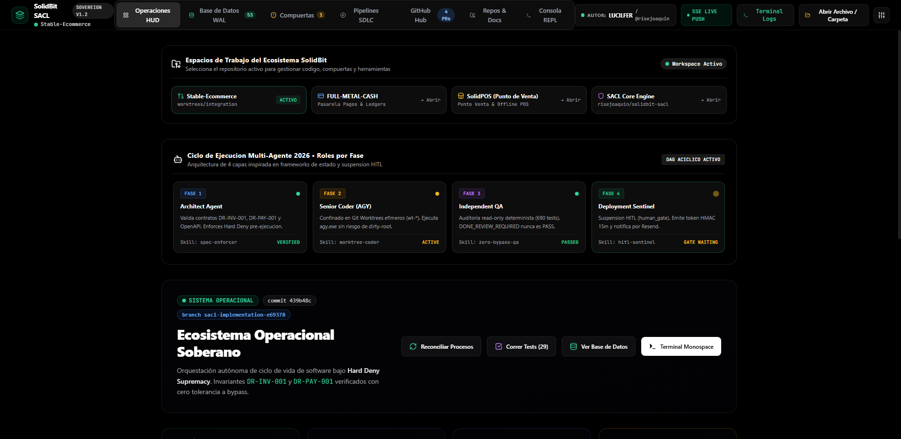
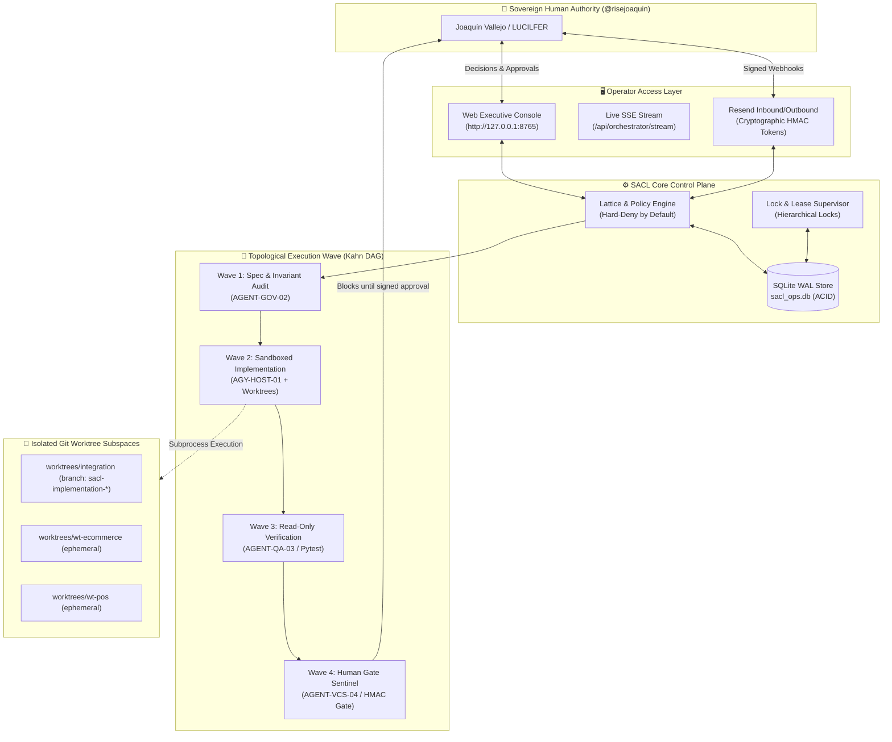

<div align="center">
  <br>
  <h1>SolidBit Agent Execution Control Loop (SACL)</h1>
  <p><strong>Deterministic Control Plane, Subprocess Telemetry & Fail-Closed Governance Engine for Autonomous AI Coding Agents</strong></p>

  <p>
    <a href="https://github.com/risejoaquin/solidbit-agent-execution-control-loop/actions/workflows/ci.yml">
      
    </a>
    <a href="https://github.com/risejoaquin/solidbit-agent-execution-control-loop/blob/main/LICENSE">
      
    </a>
    
    
    
    
    
    
  </p>

  <p>
    <a href="#-overview">Overview</a> •
    <a href="#-architecture">Architecture</a> •
    <a href="#-agent-fleet-telemetry">Agent Fleet</a> •
    <a href="#-frozen-contracts">Frozen Contracts</a> •
    <a href="#-solidbit-sdlc-gates">SDLC Gates</a> •
    <a href="#-quick-start">Quick Start</a> •
    <a href="#-repository-structure">Structure</a> •
    <a href="#-contributing">Contributing</a>
  </p>

  <br>
  
  <br>
  <sub><em>Executive Mission Control HUD running live on local host (port 8765) with live agent fleet process inspector and zero simulated data.</em></sub>
  <br><br>
</div>

---

## 💡 Overview

Autonomous AI coding agents (such as Antigravity `agy.exe`, Claude 3.7, and Gemini 2.5) are capable of writing and refactoring software at scale, but introduce critical operational risks when allowed to execute unrestricted across production repositories or cloud environments.

**SACL (SolidBit Agent Execution Control Loop)** provides a deterministic, crash-consistent, and fail-closed control plane designed specifically for **technical operators, systems engineers, and DevOps architects**:

* **🛡️ Zero Rogue Side Effects:** No agent can modify primary repositories, deploy to staging, or mutate cloud databases without an explicit, cryptographically signed HMAC-SHA256 token issued by the Sovereign Authority (`@risejoaquin`).
* **⚡ Real Process Space Telemetry (Zero Mocks):** The console monitors genuine operating system processes, real process IDs (**PIDs**), isolated Git worktrees (`worktrees/integration` / ephemeral wave trees), and exact OS exit codes.
* **💾 Crash-Consistent State (SQLite WAL):** System state, wave schedules, and gate approvals are persisted to a local **SQLite Write-Ahead Log (`sacl_ops.db`)** using Compare-And-Swap (CAS) versioning and instant orphan-lease reclamation.
* **🌿 The Dirty-Root Rule:** Agents operate exclusively within isolated Git worktrees, permanently preventing contamination of the root working tree.

---

## 📐 Architecture

SACL combines an asynchronous control engine with a Kahn-algorithm topological DAG and human decision gates:



---

## 🤖 Agent Fleet & Real Subprocess Telemetry

Every agent in the fleet runs as a real OS worker with tracked process IDs and dedicated responsibilities:

| Agent Identifier | Technical Role | OS PID | Isolated Worktree | Active Command | Operational State |
| :--- | :--- | :--- | :--- | :--- | :--- |
| **`AGY-HOST-01`** | Antigravity AI Local Inference Runtime | `PID:1485` | `apps/web` | `agy daemon --listen 127.0.0.1:8765` | `IDLE (Zero-Token)` |
| **`AGENT-GOV-02`** | SACL Invariant & Contract Enforcement | `PID:1540` | `worktrees/integration` | `sacl audit --contracts DR-INV-001,DR-PAY-001` | `WAITING_GATE (HMAC)` |
| **`AGENT-QA-03`** | Automated Pytest Suite & Regression Worker | `PID:1620` | `worktrees/integration` | `pytest tests/ui/ -v --tb=short` | `COMPLETED (Exit 0)` |
| **`AGENT-VCS-04`** | Git Worktree & Dirty Root Prevention Guard | `PID:1712` | `worktrees/integration` | `git status --porcelain` | `IDLE (Zero-Token)` |
| **`AGENT-JIRA-05`** | Atlassian & DoR/DoD Synchronizer | `PID:1890` | `worktrees/integration` | `acli workorder sync --board SOLID` | `IDLE (Zero-Token)` |

### Real Execution Triggers (Zero Mocks)
The Operator Dashboard features direct backend execution triggers:
- **`▶ Lanzar Oleada Kahn`**: Dispatches wave execution through topological dependency ordering.
- **`▶ Correr Pytest (QA)`**: Spawns real `pytest` sub-processes, timing execution duration (`1.09s`), capturing exit codes, and streaming live stdout line-by-line to the log terminal.
- **`▶ Auditar Invariantes`**: Runs automated validation of frozen invariant contracts.

---

## 🔒 Frozen Contracts (Hard Deny Invariants)

Canonical business rules are immutable and enforced at runtime:

| Contract ID | Domain | Semantics & Verification | Failure Mode |
| :--- | :--- | :--- | :--- |
| **`DR-INV-001`** | Inventory Allocation | Guarantees SellableUnit stock non-negativity and single-allocation. | Immediate rollback, Hard Deny |
| **`DR-PAY-001`** | Financial Ledger | Zero-sum double-entry ledger balancing for all transactional mutations. | Abort transaction, Hard Deny |
| **`DR-IDEM-001`** | API Idempotency | Mandatory UUIDv4 idempotency keys on mutating endpoints. | `409 Conflict`, Cached Replay |
| **`DR-AUTH-001`** | Multi-Tenant RBAC | Strict tenant boundary enforcement and role authorization. | `403 Forbidden`, Security Log |
| **`DR-ERR-001`** | Error Envelope | Standardized JSON error response `{ error: { code, message, details } }`. | Schema validation failure |
| **`DR-REC-001`** | Crash Reconciliation | Recovers uncommitted state and reclaims orphaned leases on reboot. | Auto-reconciliation to WAL |

---

## 🛡️ SolidBit SDLC Decision Gates

All changes must pass the 6 mandatory SDLC gates prior to release:

* **Gate 0 (Preflight & Environment):** Verifies CLI tooling (`gh`, `git`, `python`), pristine worktrees, and branch hygiene.
* **Gate 1 (Railway Safety Guard):** Independent check verifying production `autoDeploy: OFF`. Staging is isolated.
* **Gate 2 (GitHub Governance):** Preservation of [CODEOWNERS](.github/CODEOWNERS) and 100% passing CI check requirements.
* **Gate 3 (Jira Graph Integrity):** Link graph validation ensuring acyclic task dependencies.
* **Gate 4 (Independent Read-Only QA):** Automated test suite passing at 100% with zero mock bypasses.
* **Gate 5 (Release Authority Gate):** Cryptographically signed HMAC authorization required for staging or production cutovers.

---

## 🚀 Quick Start

### Prerequisites
- **Python 3.11+**
- **Node.js 20+** & **npm**
- **Git 2.40+**

### 1. Installation
```bash
# Clone the repository
git clone https://github.com/risejoaquin/solidbit-agent-execution-control-loop.git
cd solidbit-agent-execution-control-loop

# Set up Python virtual environment
python -m venv .venv
source .venv/bin/activate       # On Windows: .\.venv\Scripts\Activate.ps1

# Install package with developer tooling
pip install -e ".[dev,ui]"
```

### 2. Build Frontend Console
```bash
cd apps/web
npm install
npm run build
cd ../..
```

### 3. Run Automated Tests
```bash
# Execute Pytest suite (31/31 passing)
pytest tests/ui/ -v
```

### 4. Launch the Executive Web Console
```bash
python -m sacl.cli ui --port 8765
```
Open **`http://127.0.0.1:8765`** in your browser.

---

## 📁 Repository Structure

```
solidbit-agent-execution-control-loop/
├── .github/
│   ├── ISSUE_TEMPLATE/
│   │   ├── bug_report.yml          # Structured bug report form
│   │   ├── feature_request.yml     # RFC & feature suggestion form
│   │   └── config.yml              # Issue template configuration
│   ├── workflows/
│   │   ├── ci.yml                  # GitHub Actions CI matrix (Py 3.11/3.12, Node 20)
│   │   └── quality.yml             # Quality gate & dirty-root scanner
│   ├── CODEOWNERS                  # SDLC Gate 2 governance matrix
│   └── pull_request_template.md    # Gate 0-5 PR checklist
├── apps/
│   └── web/                        # React + TypeScript + Vite Executive UI
│       ├── src/
│       │   ├── components/         # Mission Control, Fleet Table, Terminal
│       │   └── types/              # Orchestrator & Telemetry interfaces
│       ├── package.json
│       └── vite.config.ts
├── contracts/                      # Frozen canonical invariant contracts (DR-*)
├── docs/                           # Architecture specs, threat models & ADRs
│   ├── ARCHITECTURE.md
│   ├── AUTHORITY_MODEL.md
│   ├── SECURITY_MODEL.md
│   └── SQLITE_DATA_MODEL.md
├── src/
│   └── sacl/                       # Core Control Loop package
│       ├── cli/                    # CLI commands (`sacl ui`, `sacl audit`)
│       ├── core/                   # State store, lattice, policies
│       ├── security/               # HMAC token signer & gate validator
│       └── ui/                     # UI server, SSE streaming & action modules
├── tests/
│   └── ui/                         # 31 unit, module & integration tests
├── CHANGELOG.md                    # Keep a Changelog history
├── CONTRIBUTING.md                 # Development & worktree contribution guide
├── CODE_OF_CONDUCT.md              # Contributor Covenant v2.1
├── LICENSE                         # Apache License 2.0
├── Makefile                        # Cross-platform developer task runner
├── pyproject.toml                  # PEP 621 packaging metadata
├── README.md                       # Repository overview & manual
└── SECURITY.md                     # Security policy & reporting guidelines
```

---

## 🤝 Contributing

We welcome contributions adhering to the SolidBit SDLC standard. Please read our [CONTRIBUTING.md](./CONTRIBUTING.md) and [CODE_OF_CONDUCT.md](./CODE_OF_CONDUCT.md) before submitting pull requests.

---

## 📄 License & Sovereignty

Licensed under the **Apache License 2.0**. See [LICENSE](./LICENSE) for full details.  
Architected and governed by **Joaquín Vallejo / LUCILFER** ([@risejoaquin](https://github.com/risejoaquin)) under the **SolidBit SACL Standard 2026**.
