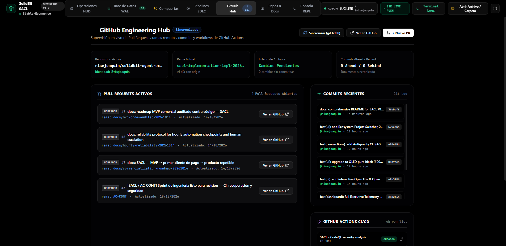
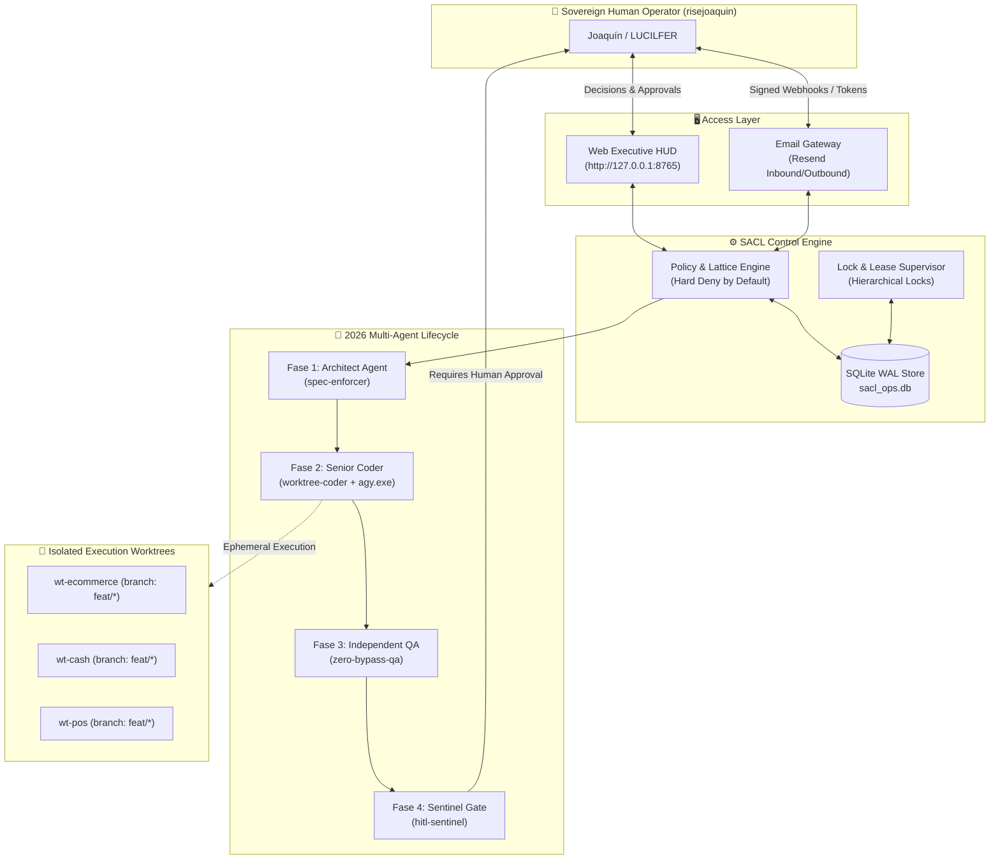

<div align="center">
  <br>
  <h1>SolidBit Agent Execution Control Loop (SACL V1)</h1>
  <p><strong>Deterministic, Crash-Consistent Control Plane & Governance Engine for Autonomous AI Coding Agents</strong></p>

  <p>
    <a href="#-quick-start">Quick Start</a> •
    <a href="#-key-capabilities">Capabilities</a> •
    <a href="#-architecture">Architecture</a> •
    <a href="#-hard-deny-invariants">Invariants</a> •
    <a href="#-native-technology-matrix">Tech Stack</a> •
    <a href="#-documentation-sitemap">Docs</a>
  </p>

  <p>
    
    
    
    
    
    
    
  </p>

  <br>
  
  <br>
  <sub><em>Executive OLED HUD (#000000) running live on local host (port 8765) with unified ecosystem switcher and 2026 multi-agent DAG.</em></sub>
  <br><br>
</div>

---

## 💡 The Core Problem & Solution

Autonomous AI agents (`agy.exe`, Claude 3.7, Gemini 3.8) are exceptionally capable of modifying code, but inherently dangerous when executing directly against host workstations or cloud infrastructure.

**SACL resolves this architectural challenge through a deterministic, fail-closed governance loop:**
- **Zero Rogue Side Effects:** No agent can touch primary repositories, deploy to staging, or mutate cloud databases without an explicit, cryptographically signed HMAC token issued by the sovereign human operator (`risejoaquin`).
- **Fail-Closed Staging:** Direct writes to `main` and unreviewed deployments are permanently hard-denied at the kernel level.
- **Crash-Consistent Recovery:** State is persisted to a local **SQLite Write-Ahead Log (`sacl_ops.db`)** with Compare-And-Swap (CAS) versioning and instant orphan-lease reclamation.
- **Git Worktree Isolation:** AI workers operate strictly within disposable, ephemeral worktrees (`wt-*`), enforcing the **Local Dirty-Root Rule** and preventing working tree contamination.

---

## ✨ Key Capabilities

### 🎛️ 1. Executive OLED HUD (V12)
- **Zero Visual Noise:** Built on pure OLED pitch black (`#000000`) with high-contrast `#FFFFFF` typography and translucent borders (`border-white/10`).
- **Multi-Project Ecosystem Switcher:** 1-click workspace switching between `Stable-Ecommerce`, `FULL-METAL-CASH`, `SolidPOS`, and `SACL Core Engine`.
- **Integrated Code Viewer:** Recursive tree explorer with syntax view, line numbering, and copy controls directly in-browser.

### 🤖 2. 2026 Multi-Agent Phase Workflow (Topological DAG)
1. **Architect Agent (`spec-enforcer`):** Statically verifies OpenAPI specs, schemas, and contract rules before execution begins.
2. **Senior Coder (`worktree-coder`):** Conconfined to ephemeral worktrees, invoking the native `agy.exe` runtime with clean process sandboxing.
3. **Independent QA (`zero-bypass-qa`):** Executes 29+ test suites in read-only isolation; `DONE_REVIEW_REQUIRED` is never treated as `PASS`.
4. **Deployment Sentinel (`hitl-sentinel`):** Suspends execution state (`human_gate`), issues an authenticated decision dossier, and triggers outbound alerts via Resend.

### 🐙 3. GitHub Engineering Hub
- Live integration with GitHub CLI (`gh`) and Git core:
  - Real-time **Pull Request Matrix** with draft and review statuses.
  - Recent commit history with SHA copying and relative timestamps.
  - Automated **GitHub Actions CI/CD** workflow monitoring.
  - 1-click Git synchronization (`git fetch origin`) and modal PR creator.

<div align="center">
  <br>
  
  <br>
  <sub><em>GitHub Engineering Hub: live Pull Requests, commit streams, and GitHub Actions telemetry via gh CLI.</em></sub>
  <br><br>
</div>

### 🛡️ 4. Invariants Enforcement (Hard Deny Supremacy)
- `DR-INV-001` (Sellable Unit Ledger): Prevents double-allocation or negative inventory states.
- `DR-PAY-001` (Double-Entry Financial Balance): Strictly mandates zero-sum double-entry ledgers for all payment operations.
- `DR-IDEM-001` (Idempotency Key Guard): Rejects replay attacks and duplicated calls.
- `DR-REC-001` (Crash-Safe Reconciliation): Reclaims interrupted processes safely upon system startup.

---

## 📐 System Architecture



---

## 🚀 Quick Start

### Prerequisites
- Python 3.11+
- Git 2.40+
- GitHub CLI (`gh`) logged in
- Windows 10/11 or Linux

### 1. Installation
```bash
git clone https://github.com/risejoaquin/solidbit-agent-execution-control-loop.git
cd solidbit-agent-execution-control-loop

python -m venv .venv
source .venv/bin/activate  # On Windows: .\.venv\Scripts\Activate.ps1
pip install -e .
pip install pytest requests selenium
```

### 2. Run Test Suite
```bash
export PYTHONPATH="src"    # On Windows: $env:PYTHONPATH = "src"
pytest tests/ui -v
```
> **Output:** `29 passed in 40.03s (100% PASS)`

### 3. Start the Executive Web Console
```bash
python -m sacl.cli ui --port 8765
```
Open **`http://127.0.0.1:8765`** in your browser.

---

## 🔌 Native Technology Matrix (Zero Mocks)

| Service / Tool | Layer | Integration Pattern | Identity / Version |
| :--- | :--- | :--- | :--- |
| **Git Core** | SCM Engine | Ephemeral worktrees (`wt-*`), SHA locking | `risejoaquin` |
| **GitHub CLI (`gh`)** | Remote SCM | Real-time PR/Actions API | `@risejoaquin` (keyring) |
| **Railway CLI** | PaaS Cloud | Staging preview isolation | Project `lucilfer` |
| **Supabase CLI** | PostgreSQL Cloud | Schema migrations & WAL replication | v2.122.0 |
| **Resend API** | Email Gateway | Dual-direction notifications & HMAC webhooks | `resend-cli v2.26.0` |
| **Antigravity CLI** | Model Engine | Native execution sandbox | `agy.exe v1.4.5` |
| **SQLite WAL** | Operational State | ACID relational storage (16 domains) | `sacl_ops.db` |
| **Python** | Runtime Backend | Asynchronous HTTP server & Pytest suite | Python 3.11.9 (64-bit) |

---

## 🏛️ Precedence Hierarchy

Every operational decision in SACL complies strictly with the 4-tier canonical precedence hierarchy:

```
+==================================================================================================+
|                               SACL CANONICAL PRECEDENCE HIERARCHY                                |
+==================================================================================================+
|  TIER 1: Explicit Joaquín Decisions (LUCILFER / @risejoaquin)                                    |
|          Inviolable baseline decisions codified directly by the human sovereign architect.       |
+--------------------------------------------------------------------------------------------------+
|  TIER 2: Proven Production Behavior                                                              |
|          Local Dirty-Root Rule, Worktree Isolation, Non-Killing Timeouts, PID Recycling Guards.   |
+--------------------------------------------------------------------------------------------------+
|  TIER 3: Codified Governance & Contracts                                                         |
|          Invariants DR-INV-001, DR-PAY-001, JSON Schemas Draft 2020-12, Machine Governance Headers|
+--------------------------------------------------------------------------------------------------+
|  TIER 4: Industry Standards (POSIX, Windows, RFCs)                                               |
|          Standard specifications applied strictly to unresolved technical gaps.                  |
+==================================================================================================+
```

---

## 📚 Documentation Sitemap

Detailed architectural documents, threat models, and ADRs are located under [`docs/`](./docs):

- [`docs/ARCHITECTURE.md`](./docs/ARCHITECTURE.md) — Comprehensive technical blueprint.
- [`docs/AUTHORITY_MODEL.md`](./docs/AUTHORITY_MODEL.md) — Sovereign human-in-the-loop governance model.
- [`docs/SECURITY_MODEL.md`](./docs/SECURITY_MODEL.md) — Threat model, STRIDE analysis, and boundary enforcement.
- [`docs/SQLITE_DATA_MODEL.md`](./docs/SQLITE_DATA_MODEL.md) — Relational schema across 16 operational domains.
- [`docs/RECOVERY_MODEL.md`](./docs/RECOVERY_MODEL.md) — Crash-consistent startup reconciliation.
- [`docs/adr/`](./docs/adr) — Architectural Decision Records (ADR-001 through ADR-014).

---

## 👤 Author & License

Architected and governed by **LUCILFER / risejoaquin** ([@risejoaquin](https://github.com/risejoaquin)).  
All rights reserved under the **SolidBit SACL Standard 2026**.
