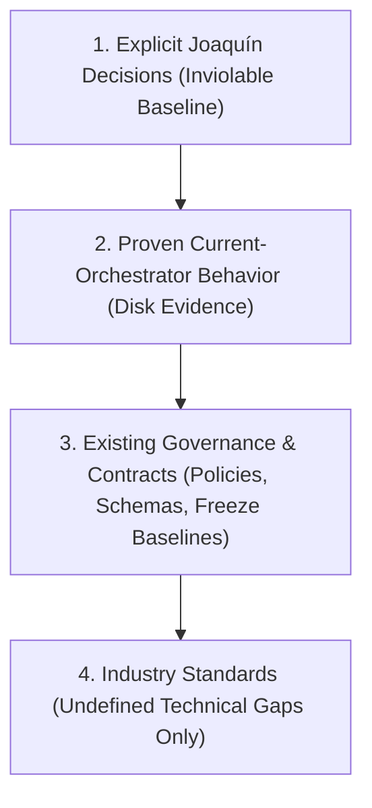
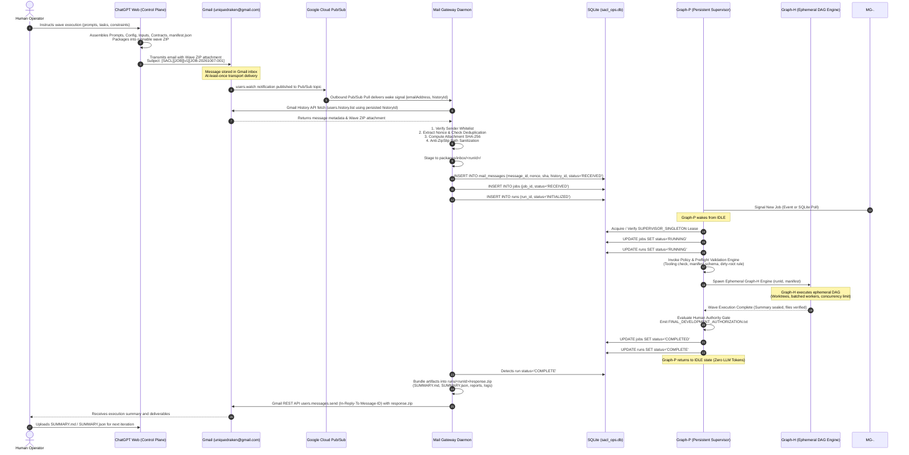
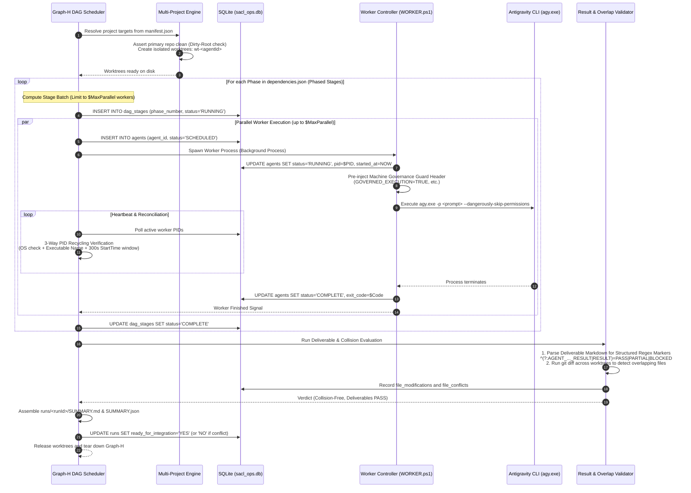
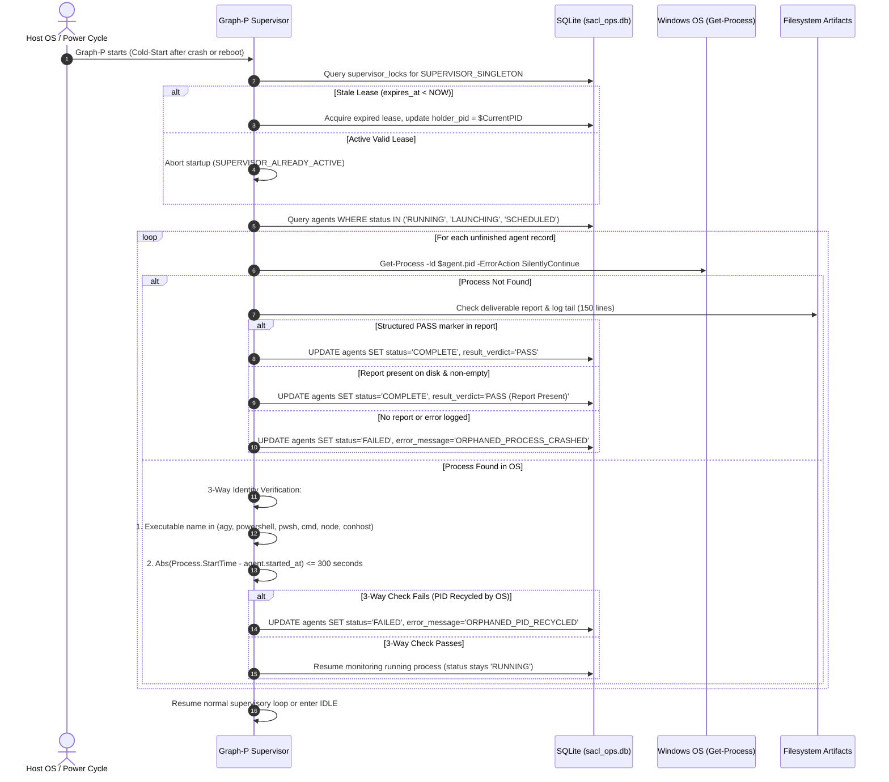

# SolidBit Agent Execution Control Loop (SACL V1) Architecture Specification

> **Specification Version:** 1.0.0  
> **Target System:** Windows 10/11 Host Workstation  
> **Target Repository:** `risejoaquin/solidbit-agent-execution-control-loop`  
> **Implementation Status:** `IMPLEMENTATION_AUTHORIZED=NO` (Architecture Materialized & Frozen)  
> **Safety Mode:** Fail-Closed Staging / Remote Production Execution Prohibited in V1  

---

## 1. Constitutional Precedence & Core Architectural Principles

The architecture of the **SolidBit Agent Execution Control Loop (SACL V1)** is governed by a strict four-level canonical precedence hierarchy codified in `DECISION_BASELINE.md` and `contracts/architecture-invariants.json`. Every architectural choice, protocol definition, data model, and runtime guard must strictly satisfy this precedence order:



### 1.1 Precedence Rules
1. **Explicit Joaquín Decisions:** Sovereign architectural decisions documented in `DECISION_BASELINE.md` and `contracts/architecture-invariants.json`. Cannot be overridden by agent preferences, existing code, or industry standards.
2. **Proven Current-Orchestrator Behavior:** Production mechanics validated by disk evidence in `Stable-Ecommerce-Orchestrator`. Operational stability invariants must be preserved verbatim.
3. **Existing Governance & Contracts:** Codified repository policies, schemas, freeze remediation baselines (W0.1/W0.2/W0.3), machine guard headers, and human authority boundaries.
4. **Industry Standards (Undefined Technical Gaps Only):** RFC protocols and standard POSIX/Windows conventions applied exclusively to close undefined technical gaps without eroding higher-level invariants. Never silently override Tiers 1–3.

### 1.2 Formal Baseline Mapping

| # | Inviolable Decision / Invariant | Source | Architectural Implementation |
| :- | :--- | :--- | :--- |
| **1** | Target repository: `risejoaquin/solidbit-agent-execution-control-loop` | Decision #10 | This repository hosts all SACL V1 documentation, core modules, and tests. |
| **2** | Reuse/refactor current orchestrator; do not start from zero | Decision #11 | All 18 proven legacy capabilities are inventoried and mapped to SACL subsystems. |
| **3** | ChatGPT Web = Cloud Control Plane | Decision #12 | Control plane is restricted to planning, package authoring, and summary analysis. Zero local host execution privileges. |
| **4** | Gmail = Asynchronous Transport (`uniquedraken@gmail.com`) | Decision #13, #14 | Store-and-forward channel. Self-mail supported. Transport layer only; does NOT hold authorization authority. |
| **5** | Gmail and Antigravity identities are independent | Decision #15 | Credential decoupling. Antigravity CLI has zero access to Gmail credentials or OAuth tokens. |
| **6** | Mail Gateway and Graph-P are separate daemons | Decision #16 | Process isolation between edge mail intake and orchestrator execution. |
| **7** | Graph-P maintains Zero Idle LLM Token Posture | Decision #17 | Graph-P supervisor is strictly IDLE when no execution jobs are pending. Zero LLM tokens consumed; zero `agy.exe` workers running while idle. |
| **8** | Graph-H is ephemeral per job | Decision #18 | DAG engine is spawned dynamically per wave package and torn down completely upon completion. |
| **9** | Preserve self-contained wave ZIP package model | Decision #19, SB-FREEZE-P1-10 | Packages contain `prompts/`, `scripts/`, `config/`, `inputs/`, `contracts/`, and `manifest.json`. Task context is complete and versioned on disk, avoiding ad-hoc cloud discovery. Explicitly configured runtime services (Gmail API, Pub/Sub, Antigravity CLI, Git, and conditionally GitHub) are permitted by policy. |
| **10** | Local Dirty-Root Rule is inviolable | Proven Behavior | Automation never runs `git reset --hard`, `git clean -fd`, `git checkout .`, or automatic `git stash` on primary checkout. |
| **11** | Worktree Isolation & Branch Inviolability | Proven Behavior | Agents run exclusively in isolated worktrees (`git worktree add`). `MAIN_BRANCH_NOT_ALLOWED` and `PRIMARY_CHECKOUT_NOT_ALLOWED` strictly enforced. |
| **12** | SQLite = Local Operational State Store (`sacl_ops.db`) | Decision #22 | Relational ACID database in WAL mode replacing legacy loose JSON files. Preserves all proven state fields. |
| **13** | Heavy artifacts remain on filesystem | Decision #23 | Logs, diffs, reports, and response ZIPs remain under `artifacts/runs/<runId>/`. Never stored as BLOBs in SQLite. |
| **14** | Remote production execution prohibited in V1 | Decision #25 | All actions targeting Railway, GitHub repository rulesets, Jira live mutations, or production databases fail closed. |
| **15** | Non-Killing Diagnostic Timeouts | Proven Behavior | Workers exceeding timeout transition to `TIMEOUT_RUNNING` and are never auto-killed. Context preserved for human inspection. |
| **16** | 3-Way PID Recycling Defense | Proven Behavior | Verifies OS process activity, process executable whitelist, and 300s `StartTime` window tolerance before any process query or stop. |
| **17** | Human Authority Gate | Proven Behavior | Emits `FINAL_DEVELOPMENT_AUTHORIZATION.txt`. Agents cannot self-authorize merges, deploys, or live tracker transitions. |
| **18** | Canonical Four-Part Reconciliation | W0.1 Baseline | Success requires: Process observation + Persisted agent state + Required outputs + Final verdict. Exit code alone is insufficient. |
| **19** | Mandatory Dual Deliverables | W0.1 Baseline | Every run generates both human-readable `SUMMARY.md` and machine-readable `SUMMARY.json`. |
| **20** | Canonical Routing Syntax | W0.1 Baseline | Inbound email subject format: `[SACL][JOB][v1][<JOB_ID>]`. Subject is a routing hint; authoritative metadata resides in `manifest.json`. |

---

## 2. System Architecture & Component Specifications

SACL V1 partitions the execution control loop into ten decoupled, loosely coupled subsystems with explicit boundaries:

```mermaid
flowchart TD
    subgraph ControlPlane [1. Control Plane]
        CPT["ChatGPT Web<br>(Strategic Planning & Package Authoring)"]
    end

    subgraph TransportLayer [2. Cloud / Local Transport]
        GM["Gmail Store & Forward<br>(uniquedraken@gmail.com)<br>Subject: [SACL][JOB][v1][<JOB_ID>]"]
        PS["Google Cloud Pub/Sub<br>(Pull / StreamingPull Topic)"]
    end

    subgraph EdgeBoundary [Local Edge Intake]
        MG["3. Mail Gateway Daemon<br>(Gmail API & Pub/Sub Pull,<br>Nonce Anti-Replay, SHA-256 Check, Anti-ZipSlip)"]
    end

    subgraph GovernanceBoundary [Local Policy & Safety Boundary]
        POL["4. Policy & Validation Engine<br>(Preflight Tooling, Manifest Schema,<br>Dirty-Root Invariant, Branch Guard)"]
        GATE["10. Human Authority Gate<br>(FINAL_DEVELOPMENT_AUTHORIZATION.txt)"]
        KILL["Local Kill Switch<br>(STOP.ps1, Non-Killing Timeouts)"]
    end

    subgraph StateAndStorage [Persistence & Evidence Layer]
        DB[("7. Operational State Store<br>sacl_ops.db (SQLite WAL, 16 Domains)<br>Leases, Runs, Agents, Audits")]
        FS[("8. Filesystem Artifact Store<br>artifacts/runs/<runId>/<br>Logs, Reports, Diffs, Dual Summaries")]
    end

    subgraph Orchestration [Supervision & Execution Engines]
        GP["5. Graph-P Persistent Supervisor<br>(Singleton Lease, Zero Idle Tokens,<br>Crash Recovery Supervisor)"]
        GH["6. Graph-H Ephemeral DAG Engine<br>(Phased Stages, $MaxParallel Throttling,<br>Worktrees, Result Extractor)"]
        MP["9. Multi-Project Engine<br>(manifest.json Registry,<br>Dynamic Repo Resolution)"]
    end

    subgraph ExecutionWorkers [Agent Execution Fleet]
        WRK["Worker Controller (WORKER.ps1)<br>Pre-injected Machine Governance Guard"]
        AGY["Antigravity CLI (agy.exe)<br>Isolated Worktrees (wt-<agentId>)"]
    end

    subgraph Monitoring [Real-Time Observability]
        MON["Live Console Monitor (MONITOR.ps1)<br>Read-Only SQLite Connection (10s Loop)"]
    end

    CPT -->|Inbound Wave Package| GM
    GM -->|users.watch Notification| PS
    PS -->|Pub/Sub Pull Wake Signal| MG
    MG -->|Gmail History API Fetch (historyId)| GM
    MG -->|Register Inbound Job| DB
    MG -->|Stage Package ZIP| FS
    MG -.->|Job Signal| GP
    GP -->|Validate Package| POL
    POL -->|Verify Invariants| DB
    GP -->|Resolve Target Repos| MP
    GP -->|Spawn Ephemeral DAG| GH
    GH -->|Create Worktrees| MP
    GH -->|Spawn Batched Workers| WRK
    WRK -->|Execute Governed Agent| AGY
    WRK -->|State & Metrics| DB
    WRK -->|Logs & Diffs| FS
    GH -->|Deliverable Verdict & Collision Eval| DB
    GH -->|Generate SUMMARY.md & SUMMARY.json| FS
    GH -->|Seal & Teardown| GP
    GP -->|Verify Safety Boundaries| GATE
    GP -->|Update Status COMPLETED| DB
    MG -->|Poll Completed Runs| DB
    MG -->|Bundle response.zip| FS
    MG -->|Gmail API (users.messages.send)| GM
    GM -->|Execution Results| CPT
    MON -.->|Read-Only Inspection| DB
    KILL -.->|Emergency Intervention| WRK
```

---

### 2.1 Component 1: Control Plane (ChatGPT Web)
- **Role:** High-level strategic planner, architecture supervisor, prompt generator, and human conversational interface.
- **Responsibilities:**
  - Ingests human intent, engineering requirements, and previous run summaries.
  - Decomposes tasks into structured agent roles with explicit contracts.
  - Constructs runnable wave packages conforming strictly to `EXECUTION_PACKAGE_SPEC`.
  - Packages prompts, configuration, inputs, contracts, and `manifest.json` into a self-contained ZIP archive.
  - Transmits packages to the local environment via the transport layer (or direct human-mediated upload).
  - Evaluates run deliverables, test verdicts, and summaries returned from the local orchestrator to formulate subsequent execution waves.
- **Boundary Restriction:** The Control Plane has **zero direct network access or command execution capability** inside the local Windows environment. It does **not** possess host credentials, private signing keys, or direct database access.

---

### 2.2 Component 2: Cloud / Local Transport (Gmail)
- **Role:** Asynchronous, secure store-and-forward communication pipeline between the Cloud Control Plane and local execution.
- **Target Mailbox:** `uniquedraken@gmail.com`.
- **Identity Decoupling Invariant:** Gmail transport credentials and Antigravity CLI identities are completely independent. Antigravity does not possess, manage, or access email credentials.
- **Delivery Semantics:** At-least-once transport. Duplicate deliveries are tolerated and handled idempotently by local consumers. Exactly-once delivery is **never** assumed.
- **Routing Protocol:**
  - **Inbound Subject Format:** `[SACL][JOB][v1][<JOB_ID>]` (e.g. `[SACL][JOB][v1][JOB-20261007-001]`). The email subject serves strictly as a **routing hint**, never as an authoritative source of configuration or permissions.
  - **Outbound Subject Format:** `Re: [SACL][JOB][v1][<JOB_ID>] - [STATUS: <VERDICT>]` with RFC 2822 `In-Reply-To` and `References` headers preserving the email conversation thread.
- **Connection Security:** Outbound TLS connection only. Local gateway subscribes to Google Cloud Pub/Sub via Pull/StreamingPull for wake notifications; outbound execution results are dispatched via Gmail REST API (`users.messages.send`) over HTTPS TLS with RFC 2822 threading headers. Zero inbound ports, zero public webhooks, and zero SMTP daemons or protocols in V1. Credentials stored securely in Windows Credential Manager.

---

### 2.3 Component 3: Mail Gateway Daemon
- **Role:** Edge intake daemon operating strictly at the transport boundary.
- **Process Isolation:** Independent standalone background daemon isolated from `Graph-P`.
- **Zero Execution Privilege Posture:** The Mail Gateway has **zero execution permissions**. It never runs PowerShell scripts, never invokes `agy.exe`, and never touches git repositories.
- **Ingestion Lifecycle:**
  1. Subscribes to Google Cloud Pub/Sub pull subscription via outbound TLS connection to receive mailbox update wake signals.
  2. Treats Pub/Sub notification strictly as a wake signal, not the authoritative data source.
  3. Queries Gmail History API (`users.history.list`) using locally persisted `historyId` cursor in SQLite (`sacl_ops.db`) to retrieve new message IDs gaplessly.
  4. Fetches email metadata and package ZIP attachment via Gmail REST API (`users.messages.get` / `users.messages.attachments.get`).
  5. Filters incoming messages matching routing hint `^\[SACL\]\[JOB\]\[v1\]\[([a-zA-Z0-9_-]+)\]`.
  6. Validates sender authorization against allowed sender whitelist (`uniquedraken@gmail.com`, supporting self-mail pattern).
  7. Extracts anti-replay `nonce`, calculates SHA-256 checksum of ZIP attachment, and sanitizes entry paths fail-closed against Zip Slip.
  8. Automatically renews `users.watch` lease prior to 7-day expiration; performs startup reconciliation from persisted `historyId`; maintains periodic direct polling strictly as degraded fallback.
  9. Writes validated package to `packages/inbox/<runId>/`, records `mail_messages` and `jobs` in SQLite `sacl_ops.db` with status `RECEIVED`.
  10. Outbound Dispatch: Monitors `mail_outbox` for completed runs, packages `runs/<runId>/response.zip` (containing `SUMMARY.md`, `SUMMARY.json`, reports, logs), and dispatches reply directly via Gmail REST API (`users.messages.send`) with thread continuation (`threadId`, `In-Reply-To`, `References`).

---

### 2.4 Component 4: Policy & Validation Engine
- **Role:** Security boundary and preflight gatekeeper protecting local repositories and environment integrity.
- **Responsibilities:**
  - **Preflight Tooling Verification:** Verifies installed binaries (`git`, `powershell.exe`, `agy.exe`, `gh`). Resolves tool dependencies declared dynamically in `manifest.json`.
  - **Manifest Validation:** Validates `manifest.json` against `manifest.schema.json`, verifying package metadata, project aliases, agent schemas, and expected deliverable file paths.
  - **Local Dirty-Root Enforcement:** Verifies that target product repositories do not have uncommitted human changes in the primary checkout before adding worktrees. Reuses the inviolable legacy rule from `prepare-worktrees.ps1`.
  - **Branch & Target Guard:** Enforces `MAIN_BRANCH_NOT_ALLOWED` and `PRIMARY_CHECKOUT_NOT_ALLOWED`. Blocks any agent configuration targeting protected branches or primary working trees.
  - **Secret Isolation Check:** Scans prompts and configs to ensure no plaintext tokens or credentials are requested or embedded.

---

### 2.5 Component 5: Persistent Orchestrator Process (`Graph-P`)
- **Role:** Long-running local supervisor daemon providing instance leasing, job lifecycle state management, and safety supervision.
- **Zero Idle LLM Token Posture:** In strict adherence to explicit decision #17, `Graph-P` remains strictly **IDLE** when no execution jobs are pending. It consumes **zero LLM tokens** and spawns zero AI worker processes while waiting.
- **Responsibilities:**
  - **Supervisor Singleton Lease:** Maintains an ACID lease in SQLite table `supervisor_locks` (`SUPERVISOR_SINGLETON`). Heartbeat cadence every 10 seconds; lease expiration after 60 seconds. Prevents overlapping supervisor processes.
  - **Job Queue Consumer:** Monitors SQLite `runs` table for jobs in `INITIALIZED` state. Transitions job to `RUNNING` and executes policy validation.
  - **Ephemeral Lifecycle Launcher:** Instantiates an ephemeral `Graph-H` execution engine dynamically for the validated job.
  - **Crash Recovery & Reconciliation:** Periodically reconciles in-memory/process state against SQLite, detecting abnormal worker termination, process crashes, or PID recycling.
  - **Safety Supervision:** Bridges the Human Authority Gate before sealing any run.

---

### 2.6 Component 6: Ephemeral Job Execution DAG (`Graph-H`)
- **Role:** Job-scoped, ephemeral Directed Acyclic Graph execution engine instantiated dynamically to execute a single wave package.
- **Responsibilities:**
  - **Worktree Preparation:** Resolves target product repository paths from `manifest.json` via Multi-Project Engine. Creates isolated Git worktrees (`git worktree add -b <branch> <path> origin/<branch>`) per agent.
  - **DAG Scheduling & Concurrency Throttling:** Reads `config/dependencies.json`. Computes topological sort and executes agents in ordered stages. Throttles concurrent execution using `$MaxParallel` worker pool loop (`Wait-Batch`).
  - **Worker Controller & Machine Governance Injection:** Spawns `WORKER.ps1` processes wrapping `agy.exe`. Pre-injects immutable machine governance headers:
    ```
    --- SACL MACHINE GOVERNANCE GUARD ---
    GOVERNED_EXECUTION=TRUE
    MERGE=NOT_AUTHORIZED
    DEPLOY=NOT_AUTHORIZED
    DESTRUCTIVE_DB=NOT_AUTHORIZED
    WORKTREE_PATH=<path>
    BRANCH=<branch>
    HEAD_COMMIT=<sha>
    --- END MACHINE GUARD ---
    ```
  - **Result Extraction & Deliverable Verification:** Evaluates agent completion using the canonical regex marker protocol:
    `^(?:AGENT_[A-Z0-9_-]+_RESULT|RESULT|FINAL_RESULT)\s*=\s*(PASS|PARTIAL|BLOCKED)`. Validates physical presence and non-zero length of expected deliverable markdown files.
  - **Cross-Agent Overlap & Collision Evaluator:** Computes `git diff --name-only origin/main...HEAD` across all agent worktrees. Detects concurrent modifications of identical files. Flags conflicts in `file_conflicts` table and sets `READY_FOR_INTEGRATION=NO`.
  - **Dual Summary Generation:** Assembles both `SUMMARY.md` and `SUMMARY.json`.
  - **Tear-Down & Cleanup:** Updates SQLite, releases worktree locks, and terminates. `Graph-H` ceases to exist once the wave finishes.

---

### 2.7 Component 7: Operational State Store (SQLite `sacl_ops.db`)
- **Role:** ACID-compliant, local operational relational database recording all transactional states, runs, agent executions, stage transitions, and operational locks.
- **Concurrency & Configuration:**
  - `PRAGMA journal_mode = WAL;` (Write-Ahead Logging enables concurrent non-blocking reads).
  - `PRAGMA busy_timeout = 5000;` (5-second write lock wait queue).
  - `PRAGMA synchronous = NORMAL;` (High durability with minimal SSD wear).
  - `PRAGMA foreign_keys = ON;` (Relational integrity enforcement).
- **Canonical Schema:** Structured across 16 operational domains: `schema_migrations`, `projects`, `packages`, `mail_messages` (with `historyId` cursors), `jobs`, `runs`, `graph_nodes`, `node_attempts`, `agents`, `events` (`audit_events`), `approvals`, `artifacts`, `results`, `leases` (`supervisor_locks`), `heartbeats`, and `errors`. Preserves backward-compatible entity mappings (`dag_stages`, `agent_dependencies`, `file_modifications`, `file_conflicts`, `mail_inbox`, `mail_outbox`).

---

### 2.8 Component 8: Filesystem Artifact Store
- **Role:** Hierarchical filesystem repository for heavy binary and unstructured text artifacts.
- **Storage Policy:** In strict adherence to explicit decision #23, large unstructured files (worker stdout/stderr streams, git diff patches, deliverable markdown reports, incoming/outgoing ZIPs) **never enter SQLite**.
- **Directory Layout:**
  ```
  artifacts/runs/<runId>/
  ├── evidence/             # Git diffs, commit SHAs, FINAL_DEVELOPMENT_AUTHORIZATION.txt
  ├── logs/                 # agy.exe stdout and stderr log streams per agent
  ├── reports/              # Agent deliverable markdown reports
  ├── state/                # Run snapshot metadata and package manifest copies
  ├── SUMMARY.md            # Human-readable markdown summary
  ├── SUMMARY.json          # Machine-readable validated JSON summary
  └── response.zip          # Packaged result archive for email transport
  ```

---

### 2.9 Component 9: Multi-Project Engine
- **Role:** Multi-repository workspace abstraction layer.
- **Mechanics:** Eliminates hardcoded single-repository assumptions by parameterizing target projects inside `manifest.json` under a `projects` dictionary.
- **Dynamic Resolution:** The Git Workspace Manager dynamically resolves project paths, validates target directory existence, asserts valid Git repository state, verifies remote origin patterns, and enforces the local dirty-root rule before any worktree operation.

---

### 2.10 Component 10: Human Authority & Safety Boundaries
- **Role:** Constitutional safeguard ensuring human supremacy over irreversible operations.
- **Human Action Gate:** Implements the proven `run-human-action-gate.ps1` pattern as an architectural contract. Emits structured authorization requests: `runs/<runId>/evidence/FINAL_DEVELOPMENT_AUTHORIZATION.txt`.
- **Authority Boundaries & Controlled GitHub Writes:** Direct push to `main`, `master`, or release branches is permanently hard denied. Automated merging is hard denied in V1. Feature/task branch push and PR creation can occur only through locally trusted operations when project policy, package request, and valid bounded human approval all allow it; W0.3 itself performs no GitHub write. Agents have zero authority to alter production databases, mutate GitHub repository rulesets, or transition external Jira issues.
- **V1 Remote Production Prohibition:** Live mutations against remote systems (Railway, GitHub ruleset API, Jira) are strictly disabled in V1. Such commands fail closed and generate offline dry-run action plans (`.plan.json` / `.plan.md`) for human execution.

---

### 2.11 Local Kill Switch & Safety Controls
- **Explicit Stop Interface:** Exposes `scripts/STOP.ps1` allowing immediate, operator-authorized termination of individual agents or all running workers (`STOP.ps1 -All`).
- **Non-Killing Diagnostic Timeout Invariant:** When an agent exceeds its allotted execution timeout during automated batch execution, the supervisor marks it as `TIMEOUT_RUNNING`. The worker is **never killed automatically**, preserving transient context and diagnostic logs.
- **PID Recycling Defense:** Before any process operation or status check, the supervisor executes a 3-way verification:
  1. Verifies process handle is active in Windows OS.
  2. Verifies process executable matches allowed whitelist (`agy`, `powershell`, `pwsh`, `cmd`, `node`, `conhost`).
  3. Verifies process `StartTime` matches recorded database `started_at` within a 300-second tolerance window.

---

## 3. End-to-End Execution Lifecycles & Sequence Diagrams

### 3.1 Wave Package Ingestion, Verification, and Dispatch Lifecycle



---

### 3.2 Ephemeral Graph-H Execution & Concurrency Lifecycle



---

### 3.3 Crash Recovery & PID State Reconciliation Lifecycle



---

## 4. Multi-Project Support & Worktree Governance Mechanics

### 4.1 Multi-Project Configuration Model
SACL V1 parameterizes all repository paths and targets dynamically inside `manifest.json`. Core engine scripts contain zero hardcoded product paths:

```json
{
  "version": "1.0.0",
  "wave_id": "WAVE-01",
  "projects": {
    "stable-ecommerce": {
      "path": "/workspace/Stable-Ecommerce",
      "default_branch": "main",
      "remote_pattern": ".*risejoaquin/stable-ecomerce.*",
      "worktree_root": "/workspace/Stable-Ecommerce-Orchestrator\\worktrees"
    },
    "solidbit-control-loop": {
      "path": "/workspace/solidbit-agent-execution-control-loop",
      "default_branch": "main",
      "remote_pattern": ".*risejoaquin/solidbit-agent-execution-control-loop.*",
      "worktree_root": "/workspace/solidbit-agent-execution-control-loop\\worktrees"
    }
  },
  "agents": [
    {
      "id": "agent-a",
      "project_ref": "stable-ecommerce",
      "branch": "feature/checkout-refactor",
      "worktree_subdir": "wt-agent-a",
      "expected_report": "reports/CHECKOUT_REPORT.md",
      "prompt": "prompts/agent-a.md"
    }
  ]
}
```

### 4.2 Invariant Worktree Safety Rules
1. **Local Dirty-Root Rule:** The primary product checkout (`.git` common dir) may legitimately contain uncommitted human changes. Automation must **never** run `git reset --hard`, `git clean -fd`, `git checkout .`, or automatic `git stash`. If the primary checkout has unstaged/staged modifications, worktree provisioning will not alter it. Worktrees are branched strictly from existing remote tracking branches (`origin/<branch>`) or explicit commit SHAs.
2. **Branch Inviolability (`MAIN_BRANCH_NOT_ALLOWED`):** The default branch (`main`) is strictly protected. Agents operate exclusively within designated task branches.
3. **Primary Checkout Protection (`PRIMARY_CHECKOUT_NOT_ALLOWED`):** All file-modifying agent tasks execute inside dedicated worktrees (`git worktree add -b <branch> <path> origin/<branch>`). The primary checkout is treated as read-only.
4. **Collision Pre-Merge Evaluation:** Before any wave is certified ready for human integration, `collect-results.ps1` algorithm evaluates cross-worktree diffs (`git diff --name-only origin/main...HEAD`). If two or more agents modify the same file path, the wave is flagged as `CONCURRENT_FILE_COLLISION`, and integration is blocked.

---

## 5. Operational State & Data Persistence Architecture

### 5.1 Storage Segmentation
SACL V1 enforces strict physical and logical separation between relational state and filesystem artifacts:
- **Relational Operational State Store (`sacl_ops.db`):** SQLite database in WAL mode structured across 16 formal operational domains: `schema_migrations`, `projects`, `packages`, `mail_messages` (with `historyId` cursors), `jobs`, `runs`, `graph_nodes`, `node_attempts`, `agents`, `events` (`audit_events`), `approvals`, `artifacts`, `results`, `leases` (`supervisor_locks`), `heartbeats`, and `errors`.
- **Filesystem Artifact Store (`artifacts/runs/<runId>/`):** Local disk hierarchy storing worker stdout/stderr logs, git diff patches, deliverable markdown reports, dual summaries (`SUMMARY.md` and `SUMMARY.json`), and ZIP packages. Heavy artifacts **never enter SQLite**.

### 5.2 Canonical Relational Architecture (`sacl_ops.db`)

The canonical DDL implements the complete 16-domain relational architecture codified in [`db/migrations/001_init.sql`](file:////workspace/solidbit-agent-execution-control-loop/db/migrations/001_init.sql) and specified in [`docs/SQLITE_DATA_MODEL.md`](file:////workspace/solidbit-agent-execution-control-loop/docs/SQLITE_DATA_MODEL.md):

```sql
PRAGMA journal_mode = WAL;          -- Write-Ahead Logging for non-blocking concurrent reads
PRAGMA busy_timeout = 5000;         -- 5-second wait queue on write contention
PRAGMA synchronous = NORMAL;        -- Optimal durability with minimal SSD wear
PRAGMA foreign_keys = ON;           -- Enforce relational referential integrity

-- Table 1: System-wide Instance Leases & Process Locks
CREATE TABLE IF NOT EXISTS supervisor_locks (
    lock_name       TEXT PRIMARY KEY,               -- e.g. 'SUPERVISOR_SINGLETON'
    run_id          TEXT NOT NULL,
    holder_pid      INTEGER NOT NULL,
    acquired_at     TEXT NOT NULL,                  -- ISO-8601 UTC
    heartbeat_at    TEXT NOT NULL,                  -- ISO-8601 UTC
    expires_at      TEXT NOT NULL                   -- Heartbeat expiration threshold
);

-- Table 2: Execution Runs & Packages
CREATE TABLE IF NOT EXISTS runs (
    run_id              TEXT PRIMARY KEY,           -- e.g. 'w0-20261007-003429-e4fa9b'
    package_id          TEXT NOT NULL,              -- e.g. 'SACL-W0-ARCHITECTURE-FREEZE-RUNNABLE-v1'
    project             TEXT NOT NULL,              -- e.g. 'solidbit-agent-execution-control-loop'
    repository          TEXT NOT NULL,              -- e.g. 'risejoaquin/solidbit-agent-execution-control-loop'
    mode                TEXT NOT NULL,              -- e.g. 'architecture_freeze_and_repo_bootstrap'
    source_orchestrator TEXT NOT NULL,
    target_repo_path    TEXT NOT NULL,
    run_dir             TEXT NOT NULL,              -- Path to runs/<runId>/
    status              TEXT NOT NULL CHECK(status IN (
                            'INITIALIZED', 'RUNNING', 'GATE_HALTED', 
                            'COMPLETE', 'FAILED', 'STOPPED'
                        )),
    ready_for_integration TEXT NOT NULL DEFAULT 'NO' CHECK(ready_for_integration IN ('YES', 'NO')),
    started_at          TEXT NOT NULL,
    completed_at        TEXT,
    error_summary       TEXT
);

-- Table 3: DAG Stages & Pipeline Phases
CREATE TABLE IF NOT EXISTS dag_stages (
    stage_id        INTEGER PRIMARY KEY AUTOINCREMENT,
    run_id          TEXT NOT NULL,
    phase_number    INTEGER NOT NULL,               -- 1, 2, 3, 4
    stage_name      TEXT NOT NULL,                  -- e.g. 'PHASE_1_COMPATIBILITY'
    status          TEXT NOT NULL CHECK(status IN ('PENDING', 'RUNNING', 'COMPLETE', 'FAILED')),
    started_at      TEXT,
    completed_at    TEXT,
    FOREIGN KEY(run_id) REFERENCES runs(run_id) ON DELETE CASCADE
);

-- Table 4: Agent Execution Instances & Reconciliation State
CREATE TABLE IF NOT EXISTS agents (
    agent_id            TEXT NOT NULL,              -- e.g. 'AG-COMPAT', 'AG-SCHEMA'
    run_id              TEXT NOT NULL,
    stage_id            INTEGER NOT NULL,
    status              TEXT NOT NULL CHECK(status IN (
                            'SCHEDULED', 'LAUNCHING', 'RUNNING', 
                            'TIMEOUT_RUNNING', 'STOPPING', 'STOPPED', 
                            'COMPLETE', 'FAILED', 'UNKNOWN'
                        )),
    result_verdict      TEXT NOT NULL DEFAULT 'UNKNOWN' CHECK(result_verdict IN (
                            'PASS', 'PARTIAL', 'BLOCKED', 'FAILED', 
                            'IN_PROGRESS', 'UNKNOWN', 'STOPPED_BY_USER',
                            'PASS (Report Present)'
                        )),
    pid                 INTEGER,
    branch              TEXT,
    commit_sha          TEXT,
    worktree_path       TEXT,
    prompt_path         TEXT NOT NULL,
    report_path         TEXT NOT NULL,
    stdout_path         TEXT NOT NULL,
    stderr_path         TEXT NOT NULL,
    started_at          TEXT,
    updated_at          TEXT NOT NULL,
    finished_at         TEXT,
    exit_code           INTEGER,
    error_message       TEXT,
    PRIMARY KEY(agent_id, run_id),
    FOREIGN KEY(run_id) REFERENCES runs(run_id) ON DELETE CASCADE,
    FOREIGN KEY(stage_id) REFERENCES dag_stages(stage_id)
);

-- Table 5: DAG Execution Edge Dependencies
CREATE TABLE IF NOT EXISTS agent_dependencies (
    run_id              TEXT NOT NULL,
    upstream_agent_id   TEXT NOT NULL,
    downstream_agent_id TEXT NOT NULL,
    PRIMARY KEY(run_id, upstream_agent_id, downstream_agent_id),
    FOREIGN KEY(run_id) REFERENCES runs(run_id) ON DELETE CASCADE
);

-- Table 6: Cross-Agent File Modifications (Collision Detection)
CREATE TABLE IF NOT EXISTS file_modifications (
    mod_id          INTEGER PRIMARY KEY AUTOINCREMENT,
    run_id          TEXT NOT NULL,
    agent_id        TEXT NOT NULL,
    file_path       TEXT NOT NULL,                  -- Normalized forward-slash relative path
    change_type     TEXT NOT NULL,                  -- 'MODIFIED', 'ADDED', 'DELETED'
    recorded_at     TEXT NOT NULL,
    FOREIGN KEY(run_id, agent_id) REFERENCES agents(run_id, agent_id) ON DELETE CASCADE
);

-- Table 7: Detected Cross-Agent Collisions
CREATE TABLE IF NOT EXISTS file_conflicts (
    conflict_id     INTEGER PRIMARY KEY AUTOINCREMENT,
    run_id          TEXT NOT NULL,
    file_path       TEXT NOT NULL,
    agents_involved TEXT NOT NULL,                  -- JSON Array of Agent IDs: ["AG-ARCH","AG-SEC"]
    detected_at     TEXT NOT NULL,
    resolution      TEXT NOT NULL DEFAULT 'UNRESOLVED' CHECK(resolution IN ('UNRESOLVED', 'RESOLVED', 'WAIVED')),
    FOREIGN KEY(run_id) REFERENCES runs(run_id) ON DELETE CASCADE
);

-- Table 8: Inbound Transport Queue & Message Registry (Mail Gateway)
CREATE TABLE IF NOT EXISTS mail_inbox (
    message_id      TEXT PRIMARY KEY,               -- RFC-2822 Message-ID
    sender          TEXT NOT NULL,
    subject         TEXT NOT NULL,
    received_at     TEXT NOT NULL,
    nonce           TEXT NOT NULL UNIQUE,           -- Anti-replay nonce
    attachment_sha  TEXT NOT NULL,                  -- SHA-256 of ZIP attachment
    status          TEXT NOT NULL CHECK(status IN (
                            'PENDING', 'VALIDATED', 'PROCESSED', 
                            'REJECTED', 'DUPLICATE_IGNORED'
                        )),
    rejection_reason TEXT,
    run_id          TEXT,
    FOREIGN KEY(run_id) REFERENCES runs(run_id)
);

-- Table 9: Outbound Transport Queue (Mail Gateway)
CREATE TABLE IF NOT EXISTS mail_outbox (
    outbox_id       INTEGER PRIMARY KEY AUTOINCREMENT,
    run_id          TEXT NOT NULL,
    recipient       TEXT NOT NULL,
    subject         TEXT NOT NULL,
    body_markdown   TEXT NOT NULL,
    attachment_path TEXT,                           -- Path to packaged result ZIP
    status          TEXT NOT NULL CHECK(status IN ('QUEUED', 'SENT', 'FAILED')),
    attempts        INTEGER NOT NULL DEFAULT 0,
    created_at      TEXT NOT NULL,
    sent_at         TEXT,
    error_log       TEXT,
    FOREIGN KEY(run_id) REFERENCES runs(run_id)
);

-- Table 10: Append-Only Audit Event Log
CREATE TABLE IF NOT EXISTS audit_events (
    event_id        INTEGER PRIMARY KEY AUTOINCREMENT,
    run_id          TEXT,
    agent_id        TEXT,
    event_type      TEXT NOT NULL,                  -- 'PROCESS_SPAWN', 'STATUS_CHANGE', 'CONFLICT_DETECTED', 'SAFETY_GATE'
    severity        TEXT NOT NULL CHECK(severity IN ('INFO', 'WARN', 'ERROR', 'FATAL')),
    payload_json    TEXT NOT NULL,
    created_at      TEXT NOT NULL
);

-- Indexes for Concurrency & Low Latency
CREATE INDEX IF NOT EXISTS idx_agents_run_status ON agents(run_id, status);
CREATE INDEX IF NOT EXISTS idx_file_mods_run_file ON file_modifications(run_id, file_path);
CREATE INDEX IF NOT EXISTS idx_audit_run_type ON audit_events(run_id, event_type);
CREATE INDEX IF NOT EXISTS idx_mail_inbox_nonce ON mail_inbox(nonce);
```

---

## 6. Architecture Decision Records (Canonical ADR Set: ADR-001 through ADR-014)

The physical ADR files located under [`docs/adr/`](file:////workspace/solidbit-agent-execution-control-loop/docs/adr/) represent the authoritative, constitutional decisions governing SACL V1. Every ADR number and title below matches its physical counterpart exactly:

### ADR-001: Gmail Self-Mailbox Transport via Gmail API and Cloud Pub/Sub Pull for Asynchronous Control Loop
- **Status:** ACCEPTED
- **Scope:** SACL V1 Transport Layer & Ingress Architecture
- **Context:** Decoupling high-level cognitive supervision (ChatGPT Web) from local Windows host execution without exposing local network listeners or public webhooks.
- **Decision:** Gmail (`uniquedraken@gmail.com`) acts as the asynchronous store-and-forward transport channel. Ingress is event-driven via Gmail API `users.watch` and Google Cloud Pub/Sub pull/StreamingPull subscriber (outbound connection only). Pub/Sub notification is strictly an untrusted wake signal. Authoritative changes and packages are fetched via Gmail History API (`users.history.list`) using persisted `historyId` cursors. Automatic watch renewal, startup reconciliation, and periodic fallback polling only. Outbound results dispatched directly via Gmail REST API (`users.messages.send`) with RFC 2822 threading. Zero SMTP in V1. Self-mail workflow supported.
- **Physical Document:** [`docs/adr/ADR-001-gmail-self-mailbox-transport.md`](file:////workspace/solidbit-agent-execution-control-loop/docs/adr/ADR-001-gmail-self-mailbox-transport.md)

### ADR-002: SQLite Operational State Store (`sacl_ops.db`)
- **Status:** ACCEPTED
- **Scope:** SACL V1 Data Tier & Operational Persistence
- **Context:** Legacy orchestrator tracked state across loose JSON files, risking race conditions and crash inconsistency.
- **Decision:** Replace loose JSON files with a local relational SQLite database (`sacl_ops.db`) in WAL mode structured across 16 formal operational domains. Connection bootstrap executes: `PRAGMA journal_mode = WAL; PRAGMA busy_timeout = 5000; PRAGMA synchronous = NORMAL; PRAGMA foreign_keys = ON;`. Preserves all proven legacy tracking properties (`agent`, `status`, `pid`, `started_at`, `finished_at`, `exit_code`, `commit_sha`, `report_path`, `result_verdict`, `error_message`). Long-term analytics warehouse is deferred.
- **Physical Document:** [`docs/adr/ADR-002-sqlite-operational-state-store.md`](file:////workspace/solidbit-agent-execution-control-loop/docs/adr/ADR-002-sqlite-operational-state-store.md)

### ADR-003: Persistent IDLE Supervisor Daemon (`Graph-P`) with Zero Idle Token Burn
- **Status:** ACCEPTED
- **Scope:** SACL V1 Host Daemon & Execution Lifecycle
- **Context:** The system must supervise execution and manage leases without incurring continuous LLM token costs or resource leaks.
- **Decision:** `Graph-P` supervisor maintains a strict Zero Idle LLM Token Posture—remaining strictly IDLE with zero running LLM workers when no jobs are pending. Singleton mutual exclusion lease (`SUPERVISOR_SINGLETON`) with 10s heartbeat and 60s expiration. Spawns an ephemeral Directed Acyclic Graph engine (`Graph-H`) per wave package, which tears down completely upon completion.
- **Physical Document:** [`docs/adr/ADR-003-persistent-idle-supervisor.md`](file:////workspace/solidbit-agent-execution-control-loop/docs/adr/ADR-003-persistent-idle-supervisor.md)

### ADR-004: Self-Contained Runnable Wave Package Compatibility Model
- **Status:** ACCEPTED
- **Scope:** SACL V1 Package Specification, Authority Boundaries & Runtime Conventions
- **Context:** Wave packages must execute deterministically without implicit host dependencies or runtime internet downloads, while preserving legacy package conventions.
- **Decision:** Standardize wave packages as self-contained ZIP archives containing `manifest.json`, `prompts/`, `config/`, `inputs/`, `contracts/`, `schemas/`, and `scripts/`. Packages are strictly declarative in authority: they declare requested operations but cannot grant execution trust to attached code (`authorized_scripts` is prohibited). Local Operation Registry owns trusted handlers. Root PowerShell entrypoints preserved for backwards compatibility.
- **Physical Document:** [`docs/adr/ADR-004-wave-package-compatibility.md`](file:////workspace/solidbit-agent-execution-control-loop/docs/adr/ADR-004-wave-package-compatibility.md)

### ADR-005: Sovereign Decision Precedence Hierarchy
- **Status:** ACCEPTED
- **Scope:** SACL V1 Architecture Governance, Precedence & Conflict Resolution
- **Context:** Preventing architecture erosion, preference creep, or silent overrides across multi-agent development cycles.
- **Decision:** Establish a strict four-tier canonical precedence hierarchy: (1) Explicit Joaquín Decisions (`DECISION_BASELINE.md`), (2) Proven Current-Orchestrator Behavior (`Stable-Ecommerce-Orchestrator`), (3) Existing Governance & Contracts, (4) Industry Standards for undefined gaps only. Higher tiers unconditionally supersede lower tiers. Prohibition of silent overrides.
- **Physical Document:** [`docs/adr/ADR-005-decision-precedence.md`](file:////workspace/solidbit-agent-execution-control-loop/docs/adr/ADR-005-decision-precedence.md)

### ADR-006: Prohibition of Arbitrary Remote Code Execution and Governed Worker Execution
- **Status:** ACCEPTED
- **Scope:** SACL V1 Security Boundary, Package Trust & Worker Sandboxing
- **Context:** Headless worker execution (`agy.exe --dangerously-skip-permissions`) presents severe prompt-injection and arbitrary code execution (ACE) risks if unconstrained.
- **Decision:** Packages cannot self-authorize attached code. Autoexecution is strictly restricted to locally installed handlers registered in the Local Operation Registry (`schemas/operation-registry.schema.json`). Headless worker controllers (`WORKER.ps1`) require `-BypassAcknowledged`, pre-inject immutable machine governance guard headers (`GOVERNED_EXECUTION=TRUE`, `MERGE=NOT_AUTHORIZED`, `DEPLOY=NOT_AUTHORIZED`), confine execution to isolated Git worktrees (`wt-*`), and fail closed on path traversal (Zip Slip defense).
- **Physical Document:** [`docs/adr/ADR-006-no-arbitrary-remote-code.md`](file:////workspace/solidbit-agent-execution-control-loop/docs/adr/ADR-006-no-arbitrary-remote-code.md)

### ADR-007: Sovereign Human Authority Gate for Irreversible Operations
- **Status:** ACCEPTED
- **Scope:** SACL V1 Authority Model, Approval Contracts & Human Action Gate
- **Context:** Autonomous agents must not self-authorize code merges into `main`, production deployments, or tracker transitions.
- **Decision:** Human developer (Joaquín) remains the sole sovereign principal. Irreversible operations require explicit human approval via a generic bounded action-approval contract (`job_id + action + scope + request_id + expires_at`). Approval resumes the same logical run without spawning disconnected runs. Approvals cannot exceed the hard local policy envelope or override hard denies.
- **Physical Document:** [`docs/adr/ADR-007-human-authority.md`](file:////workspace/solidbit-agent-execution-control-loop/docs/adr/ADR-007-human-authority.md)

### ADR-008: Structural Process Separation of Mail Gateway and Orchestrator Core (`Graph-P`)
- **Status:** ACCEPTED
- **Scope:** SACL V1 Subsystem Topology & Process Architecture
- **Context:** Isolating external transport intake from internal job execution to enforce zero-privilege edge security.
- **Decision:** Mail Gateway daemon and `Graph-P` supervisor execute as completely separate OS processes. Mail Gateway has zero execution privileges (no git access, no PowerShell execution, no worker spawning). Gateway stages validated packages and registers records in SQLite `sacl_ops.db`; `Graph-P` polls or receives local signals to initiate execution.
- **Physical Document:** [`docs/adr/ADR-008-mail-gateway-separation.md`](file:////workspace/solidbit-agent-execution-control-loop/docs/adr/ADR-008-mail-gateway-separation.md)

### ADR-009: Multi-Project Parameterization via Manifest vs Hardcoded Single-Repo Paths
- **Status:** ACCEPTED
- **Scope:** SACL V1 Workspace Manager, Project Registry Authority & Concurrency
- **Context:** Legacy orchestrator hardcoded single-repo paths (`Stable-Ecommerce`). SACL must support multi-repository orchestration without allowing packages to redirect execution arbitrarily.
- **Decision:** Parameterize target repositories in `manifest.json`. The local Project Registry (`schemas/project-registry.schema.json`) is the sole local authority for filesystem roots; packages requesting unauthorized paths fail closed (`POLICY_DENIED_UNAUTHORIZED_TARGET_ROOT`). Mutating concurrency baseline: initially exactly 1 mutating job per project, with concurrent read-only allowed.
- **Physical Document:** [`docs/adr/ADR-009-multiproject-core.md`](file:////workspace/solidbit-agent-execution-control-loop/docs/adr/ADR-009-multiproject-core.md)

### ADR-010: At-Least-Once Delivery and Idempotent Ingestion Semantics
- **Status:** ACCEPTED
- **Scope:** SACL V1 Messaging Protocol, Event Synchronization & Deduplication
- **Context:** Email and Pub/Sub transport inherently exhibit at-least-once delivery; consumers must be strictly idempotent.
- **Decision:** Implement at-least-once transport semantics with deterministic deduplication on `(message_id, nonce)`. Re-delivery of identical message (`same JOB_ID` + `same SHA-256`) is idempotently ignored. Conflicting payload (`same JOB_ID` + `different SHA-256`) is rejected fail-closed. Valid retries require a new nonce.
- **Physical Document:** [`docs/adr/ADR-010-at-least-once-idempotent-processing.md`](file:////workspace/solidbit-agent-execution-control-loop/docs/adr/ADR-010-at-least-once-idempotent-processing.md)

### ADR-011: Filesystem Retention for Heavy Artifacts and SQLite Metadata Model
- **Status:** ACCEPTED
- **Scope:** SACL V1 Data Tier, Storage Hierarchy & Artifact Contracts
- **Context:** Heavy unstructured logs, diffs, and reports degrade SQLite WAL performance if stored as BLOBs.
- **Decision:** Retain heavy unstructured artifacts strictly on filesystem under `artifacts/runs/<runId>/`. SQLite stores only metadata, foreign keys, and relative filesystem paths. Mandatory dual deliverables: human-readable `SUMMARY.md` and machine-readable `SUMMARY.json`.
- **Physical Document:** [`docs/adr/ADR-011-filesystem-artifacts-sqlite-metadata.md`](file:////workspace/solidbit-agent-execution-control-loop/docs/adr/ADR-011-filesystem-artifacts-sqlite-metadata.md)

### ADR-012: Strict Prohibition of Remote Production Execution in SACL V1
- **Status:** ACCEPTED
- **Scope:** SACL V1 Scope Boundaries, Permission Lattice & Safety Policy
- **Context:** Automated mutating commands against Railway, production databases, GitHub rulesets, or Jira pose catastrophic operational risk.
- **Decision:** Remote production execution is strictly disabled in SACL V1 (fail-closed). Automated merges, deploys, production DB writes, and secret exports are permanently denied by Hard Local Policy (`schemas/hard-policy.schema.json`). Commands targeting remote production emit offline dry-run action plans (`.plan.json` / `.plan.md`) for human execution.
- **Physical Document:** [`docs/adr/ADR-012-no-remote-production-v1.md`](file:////workspace/solidbit-agent-execution-control-loop/docs/adr/ADR-012-no-remote-production-v1.md)

### ADR-013: Multi-Dimensional Run Status Reconciliation and Diagnostic Timeouts
- **Status:** ACCEPTED
- **Scope:** SACL V1 Execution State Reconciliation & Process Supervision
- **Context:** Process exit code alone is insufficient to verify agent task completion. Killing timed-out processes destroys forensic context.
- **Decision:** Run status reconciliation requires four verification factors: (1) OS process observation, (2) SQLite persisted state, (3) physical output verification on disk, and (4) structured regex marker extraction (`^(?:AGENT_[A-Z0-9_-]+_RESULT|RESULT|FINAL_RESULT)\s*=\s*(PASS|PARTIAL|BLOCKED)`). Fallback verdict `'PASS (Report Present)'` preserved. Workers exceeding timeouts transition to `TIMEOUT_RUNNING` and are never auto-killed. 3-way PID recycling verification (OS handle + whitelist image + 300s `StartTime` window tolerance).
- **Physical Document:** [`docs/adr/ADR-013-run-status-reconciliation.md`](file:////workspace/solidbit-agent-execution-control-loop/docs/adr/ADR-013-run-status-reconciliation.md)

### ADR-014: V1 Transport Authentication Model and Deferral of Package Signing
- **Status:** ACCEPTED
- **Scope:** SACL V1 Transport Security & Cryptographic Boundary
- **Context:** ChatGPT Web cannot possess long-lived HMAC secrets or private signing keys without unacceptable exposure risks.
- **Decision:** Adopt a secretless Control Plane posture. Cryptographic package signing is formally deferred to future waves when a dedicated, isolated key-custody signer exists. V1 authentication relies on transport-layer authentication (Gmail OAuth2/TLS), strict sender whitelisting (`uniquedraken@gmail.com`), attachment SHA-256 integrity tracking, anti-replay nonces, Anti-Zip Slip extraction defenses, and local policy preflight verification.
- **Physical Document:** [`docs/adr/ADR-014-v1-transport-authentication-signing-deferred.md`](file:////workspace/solidbit-agent-execution-control-loop/docs/adr/ADR-014-v1-transport-authentication-signing-deferred.md)

---

## 7. Downstream Directives & Safety Summary

```properties
SPECIFICATION_VERSION        = 1.0.0
ARCHITECTURE_FREEZE          = NOT_YET_PASS (Awaiting Human Sovereign Review & Sign-Off)
IMPLEMENTATION_AUTHORIZED    = NO
W0_2_CONSISTENCY_REMEDIATION = RECONCILED
OPEN_CONTRADICTIONS          = 0
SECURITY_CRITICAL_UNKNOWNS   = 0
REMOTE_PRODUCTION_EXECUTION  = DISABLED_FAIL_CLOSED
STATUS                       = RECONCILED_PENDING_HUMAN_REVIEW
NEXT_SAFE_ACTION             = HUMAN_REVIEW_OF_ARCHITECTURE_SPECIFICATIONS
```
