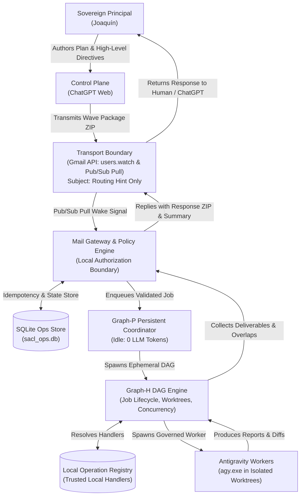

# SACL V1 Canonical Authority Model & Operational Governance Specification

**Document Identifier:** `docs/AUTHORITY_MODEL.md`  
**Status:** CANONICAL ARCHITECTURAL SPECIFICATION (Wave 0.2 Consistency Remediation)  
**Target Repository:** `risejoaquin/solidbit-agent-execution-control-loop`  
**Sovereign Principal:** Joaquín (Human Developer)  
**Canonical Precedence:**
1. Explicit Joaquín decisions (`DECISION_BASELINE.md`)
2. Proven current-orchestrator behavior (`Stable-Ecommerce-Orchestrator`)
3. Existing SolidBit governance and contracts (`ANTIGRAVITY_GOVERNANCE.md`, `manifest.json`, `ARCHITECTURE_INVARIANTS.json`)
4. Industry standards for undefined gaps only (never overriding prior decisions)

---

## 1. Executive Summary & Constitutional Authority Hierarchy

The SolidBit Agent Execution Control Loop (SACL V1) is a governed, local-first execution environment for autonomous AI coding agents operating across multi-repository workspaces. SACL bridges strategic cloud intelligence (ChatGPT Web control plane) with deterministic local execution via Antigravity CLI (`agy.exe`).

Under the SACL V1 constitutional architecture, **authority is sovereign, strictly human, non-delegable for irreversible actions, and fail-closed by default**. Autonomous agents, background daemons, and LLMs operate solely as non-authoritative delegated executors.

Furthermore:
- **Packages are declarative in authority:** An incoming execution package is an untrusted remote artifact. It declares requested parameters, target repositories, and requested operations. It possesses zero execution authority and cannot grant executable trust to its own attached code.
- **Packages cannot self-authorize attached scripts:** The presence of executable files (`.ps1`, `.bat`, `.cmd`, `.exe`) in a package does not grant permission for host execution. The manifest field `authorized_scripts` is strictly prohibited from serving as an execution-authority field.
- **Local Operation Registry owns trusted handlers:** Autoexecution in SACL core is restricted exclusively to locally installed handlers registered in the local operation registry (`schemas/operation-registry.schema.json`). Attached scripts in `scripts/` are preserved solely for backward compatibility and human inspection.

```
+==================================================================================================+
|                                    SACL V1 AUTHORITY HIERARCHY                                   |
+==================================================================================================+
|                                                                                                  |
|   +------------------------------------------------------------------------------------------+   |
|   |                       SOVEREIGN PRINCIPAL: Human Developer (Joaquín)                     |   |
|   |         Sole authority for approvals, architectural decisions, merges, and deployments   |   |
|   +------------------------------------------------------------------------------------------+   |
|                                             |                                                    |
|                                             v                                                    |
|   +------------------------------------------------------------------------------------------+   |
|   |                       CONTROL PLANE: ChatGPT Web (Interactive Sessions)                  |   |
|   |       High-level planning, wave package authoring, review of artifacts, intent drafting  |   |
|   |       *Zero local execution permissions. Must not possess long-lived signing secrets*    |   |
|   +------------------------------------------------------------------------------------------+   |
|                                             |                                                    |
|                                             v (Wave Package ZIP via At-Least-Once Transport)     |
|   +------------------------------------------------------------------------------------------+   |
|   |                   TRANSPORT BOUNDARY: Gmail API (users.watch -> Pub/Sub Pull)            |   |
|   |       Untrusted, asynchronous transport channel. Zero direct execution authority.        |   |
|   |       Subject is routing hint ONLY: [SACL][JOB][v1][<JOB_ID>]. Transport != Authority.  |   |
|   +------------------------------------------------------------------------------------------+   |
|                                             |                                                    |
|                                             v                                                    |
|   +------------------------------------------------------------------------------------------+   |
|   |       LOCAL GATEWAY & POLICY ENGINE <---> SQLITE OPS STORE (sacl_ops.db)                 |   |
|   |       Local authorization boundary: Payload validation, Zip-Slip check, idempotency,     |   |
|   |       deduplication, preflight tool verification, dirty-root check.                      |   |
|   |       Enforces Effective-Permission Lattice: Hard Local Policy & Project Policy.         |   |
|   +------------------------------------------------------------------------------------------+   |
|                                             |                                                    |
|                                             v                                                    |
|   +------------------------------------------------------------------------------------------+   |
|   |               GRAPH-P (Persistent Job Coordinator & State Supervisor)                    |   |
|   |       Idle when no active jobs (0 LLM tokens). Enforces singleton lease & kill switch.   |   |
|   +------------------------------------------------------------------------------------------+   |
|                                             |                                                    |
|                                             v (Spawns Ephemeral Job)                             |
|   +------------------------------------------------------------------------------------------+   |
|   |                 GRAPH-H (Ephemeral Per-Job DAG Execution Engine)                         |   |
|   |       Enforces phase order, dependency tree, concurrency limits ($MaxParallel),          |   |
|   |       worktree lifecycle, deliverable checks, and file collision prevention.             |   |
|   |       Maps requested_operations to locally trusted handlers in Operation Registry.       |   |
|   +------------------------------------------------------------------------------------------+   |
|                                             |                                                    |
|                                             v (Injects Guard Headers & Bypass Acknowledgement)   |
|   +------------------------------------------------------------------------------------------+   |
|   |                 ANTIGRAVITY CLI WORKERS (agy --dangerously-skip-permissions)             |   |
|   |       Non-authoritative task execution confined to isolated Git Worktrees (wt-*).        |   |
|   |       Headless execution gated by explicit -BypassAcknowledged parameter.                |   |
|   +------------------------------------------------------------------------------------------+   |
|                                                                                                  |
+==================================================================================================+
```



---

## 2. The Effective-Permission Lattice

### 2.1 The Four-Layer Lattice Formula
Authorization in SACL V1 is evaluated strictly through the formal mathematical intersection of four distinct authority domains:

$$\text{Effective Permissions} = \text{Hard Local Policy} \cap \text{Project Policy} \cap \text{Package Requested Permissions} \cap \text{Valid Approval Grant}$$

```
+------------------------------------------------------------------------------------------+
|                            THE EFFECTIVE-PERMISSION LATTICE                              |
+------------------------------------------------------------------------------------------+
|                                                                                          |
|   [ Hard Local Policy ]  (schemas/hard-policy.schema.json)                               |
|            │             - Host-level non-overridable safety envelope                    |
|            │             - HARD DENY ALWAYS WINS                                         |
|            ▼                                                                             |
|   [ Project Policy ]     (schemas/policy.schema.json)                                    |
|            │             - Repository-level permissions & stop-conditions                |
|            │             - Cannot widen what Hard Local Policy denies                    |
|            ▼                                                                             |
|   [ Package Requested ]  (schemas/manifest.schema.json: requested_operations)            |
|            │             - Declarative requests from untrusted incoming package          |
|            │             - Cannot widen Project Policy or Hard Local Policy              |
|            ▼                                                                             |
|   [ Valid Approval Grant ] (schemas/approval.schema.json)                                |
|            │             - Bounded human sign-off (request_id, job_id, action, scope)    |
|            │             - CANNOT OVERRIDE HARD DENY                                     |
|            ▼                                                                             |
|   ====================================================================================   |
|   EFFECTIVE PERMISSION = (Hard Local ∩ Project ∩ Package Requested ∩ Approval Grant)     |
|   ====================================================================================   |
+------------------------------------------------------------------------------------------+
```

### 2.2 Invariant: Hard Deny Always Wins
1. **Unconditional Override:** If an action is denied by the **hard local policy**, the effective evaluation is unconditionally **DENIED**, regardless of what is configured in project policy, requested by the package, or granted in an approval artifact.
2. **Approval Cannot Override Hard Deny:** A human approval grant (`schemas/approval.schema.json`) can only authorize actions within the allowable envelope of hard local policy. An approval token cannot waive, bypass, or override a hard deny. Any attempt to authorize a hard-denied action fails closed immediately.

### 2.3 V1 Hard Local Policy Enclosure (`schemas/hard-policy.schema.json`)
The V1 host execution environment enforces the following immutable hard denials:

| Policy Key | Invariant Rule | V1 Enforcement |
| :--- | :--- | :---: |
| `remote_production_execution` | Deny live execution, mutation, or deployment against remote production environments (Railway, cloud providers, remote endpoints). | **HARD DENY** |
| `github_merge` | Deny automated git merges into protected branches (`main`, `master`, release) and automated PR merges. | **HARD DENY** |
| `production_db_write` | Deny writes, destructive queries, or schema alterations against shared or production databases. | **HARD DENY** |
| `secret_export` | Deny reading, exporting, extracting, or transmitting secrets, API keys, and private credentials. | **HARD DENY** |
| `arbitrary_remote_code` | Deny execution of arbitrary remote scripts. Packages cannot self-authorize attached code; execution is restricted to locally trusted handlers in the operation registry. | **HARD DENY** |
| `main_branch_execution` | Deny agent execution directly on `main` or `master` branches. Execution requires isolated secondary worktrees. | **HARD DENY** |
| `primary_checkout_mutation` | Deny mutating files in the primary product checkout directory (`.git` directory root). | **HARD DENY** |
| `hard_reset` | Deny `git reset --hard` and destructive `git clean` operations in developer workspaces. | **HARD DENY** |
| `auto_stash` | Deny automated `git stash` and `git stash pop` operations that touch uncommitted human modifications. | **HARD DENY** |

---

## 3. Package Trust & Declarative Authority Boundary

### 3.1 Packages Are Declarative, Not Authoritative
In accordance with Decision Baseline §2 and Remediation Findings SB-FREEZE-P1-02, SB-FREEZE-P1-10, and SB-FREEZE-P2-01:
- An execution package is untrusted external input transmitted across an unauthenticated or semi-trusted channel.
- A package is strictly declarative: it specifies metadata, inputs, prompt templates, and a list of `requested_operations`.
- A package **cannot grant execution authority to itself** or to any executable scripts bundled inside its archive.
- **Self-Contained Task Context vs Runtime Services:** Packages carry complete, self-contained, and versioned task context (prompts, configurations, schemas, and contracts) so execution does not require ad-hoc documentation or dependency discovery. Explicitly configured runtime services (Gmail API, Google Cloud Pub/Sub, Antigravity CLI, Git, and conditionally GitHub when an allowed operation requires it) are permitted by policy and are not prohibited by the self-contained package model.

### 3.2 Elimination of `authorized_scripts` as an Authority Field
In prior experimental materializations, `manifest.json` included `authorized_scripts`, implying that declaring a script in the package manifest granted permission to execute it. This is structurally invalid:
- `authorized_scripts` is **strictly removed** from the manifest schema (`schemas/manifest.schema.json`).
- Manifest MUST require `job_id` and `requested_operations`.
- The package declares *what operation* it requests (e.g. `op:preflight-check`, `op:worker-governed-execution`), not *what executable file* to launch.

### 3.3 Preserved Compatibility & The Local Operation Registry
- **Archive Compatibility:** The `scripts/` directory inside wave packages is preserved for backward compatibility and human review.
- **Local Operation Registry:** The local SACL core installation owns and maintains the authoritative **Local Operation Registry** (`schemas/operation-registry.schema.json`).
- When `Graph-H` or the orchestrator runs an operation requested by a package:
  1. It resolves the `operation_id` against the local registry.
  2. If the operation is not registered or disabled, execution halts immediately (`UNKNOWN_OPERATION`).
  3. It verifies the cryptographic SHA-256 hash of the local handler file against `handler_sha256`.
  4. It enforces the handler's `execution_profile` (timeout, memory, isolation, allowed process images).
  5. It verifies that required permissions fall within the effective-permission envelope.

---

## 4. Bounded Human Action Gate & Generic Approval Contract

### 4.1 Generic Bounded Approval Specification (`schemas/approval.schema.json`)
Irreversible actions, milestone transitions, and execution resumptions are gated behind structured human approvals. Rather than being wave- or freeze-specific, the SACL V1 approval contract is a **generic, bounded action-approval**:

An approval artifact is valid if and only if all of the following seven fields are present and verified:
1. `request_id`: Unique identifier of the specific authorization request.
2. `job_id`: Logical job ID bound to the operation.
3. `action`: The exact bounded action requested (e.g., `STAGE_CONTINUATION`, `BRANCH_INTEGRATION`, `SPECIFICATION_MATERIALIZATION`).
4. `scope`: Explicit bounded file or operational scope (e.g., `["docs/*", "schemas/*"]`).
5. `expires_at`: Strict ISO 8601 UTC expiration timestamp. Expired approvals fail closed.
6. `decision`: Explicit decision enum (`APPROVED`, `REJECTED`, `DEFERRED`).
7. `approver`: Structured object containing `identity` (e.g., `Joaquín`) and `channel` (`CLI`, `GMAIL`, `MANUAL`; `WEBHOOK` is excluded from V1 as no public inbound webhooks exist).

### 4.2 Run Resumption Semantics
When a job or task encounters an approval boundary, it enters the canonical side state `WAITING_APPROVAL`:
- **Same Logical Run Resumption:** When a valid approval artifact matching `(job_id, action, scope, request_id)` is submitted before `expires_at`, SACL resumes the **same logical run**. It does not spawn a new disconnected run or re-execute already completed stages.
- **Fail-Closed on Mismatch or Expiry:** If the approval token is expired, has a mismatched hash, targets an incompatible scope, or attempts to authorize a hard-denied action, the supervisor transitions the job to `POLICY_DENIED` or `BLOCKED`.
- **Cannot Override Hard Deny:** If an approval attempts to authorize `remote_production_execution` or `github_merge`, the engine rejects it immediately, preserving the hard local policy invariant.

### 4.3 Universal Run Summary & Human Authorization
In the universal run summary (`schemas/summary.schema.json`):
- `implementation_authorized` is modeled as a generic `boolean`.
- In Wave 0, Wave 0.1, and Wave 0.2, examples and active states remain strictly `implementation_authorized: false`.
- In future functional development waves, when explicit human approval is granted, `implementation_authorized` may be recorded as `true`.
- **Evidence vs Authority Principle:** The boolean flag in `SUMMARY.json` is purely recorded evidence of human authorization, not the source of authority. Authority resides solely in the human sovereign principal attested through valid approval records.

---

## 5. Git Workspace & Worktree Governance

To prevent corruption of active development branches, SACL V1 codifies inviolable workspace rules:

### 5.1 `MAIN_BRANCH_NOT_ALLOWED`
- **Rule:** Under no circumstances may an agent worker, test script, or execution DAG target the `main` or `master` branch as its working branch.
- **Enforcement:** Prior to launching any agent, the workspace controller executes:
  ```powershell
  $branch = git rev-parse --abbrev-ref HEAD
  if ($branch -eq "main" -or $branch -eq "master") {
      throw "MAIN_BRANCH_NOT_ALLOWED: Target branch cannot be main/master."
  }
  ```

### 5.2 `PRIMARY_CHECKOUT_NOT_ALLOWED`
- **Rule:** The primary product checkout (the directory hosting the `.git` folder directly, where the human developer edits code) is strictly read-only for agent automation.
- **Enforcement:** The workspace controller inspects the Git common directory:
  ```powershell
  $common = git rev-parse --git-common-dir
  if ($common -eq ".git") {
      throw "PRIMARY_CHECKOUT_NOT_ALLOWED: Agent cannot execute within primary checkout."
  }
  ```
  Agents execute exclusively in secondary worktrees linked via `git worktree add`, ensuring `.git` inside the worktree points to a gitdir file (`gitdir: ...`).

### 5.3 The Local Dirty-Root Safety Invariant
- **Rule:** The primary product checkout may legitimately contain uncommitted human modifications, experimental files, or partial stash states. Governance automation **must never** execute:
  - `git reset --hard`
  - `git clean -fd`
  - Automated `git stash` / `git stash pop`
  - Broad file restore commands (`git restore .`)
- **Enforcement:** If a primary checkout validation detects uncommitted human modifications (`git status --porcelain` returning non-empty) during worktree setup or branch switching, the operation halts immediately with status `BLOCKED_DIRTY_ROOT`, failing closed to safeguard human work.

### 5.4 Cross-Agent Collision & File Overlap Prevention
- **Rule:** Concurrent writing agents are strictly forbidden from modifying overlapping sets of files.
- **Enforcement:** SACL V1 adopts the proven overlap algorithm from legacy `collect-results.ps1`:
  1. For each active agent worktree, query changed files relative to the base branch (`git diff --name-only origin/main...HEAD`).
  2. Map each file path to the list of modifying agent IDs.
  3. If any file has more than one modifying agent, emit a collision alert, record in SQLite `file_conflicts`, set `runs.ready_for_integration = 'NO'`, and halt wave integration.

### 5.5 Controlled GitHub Write Semantics
In strict adherence to architectural invariants (`contracts/architecture-invariants.json`):
1. **Direct Main/Protected Push Hard Denied:** Direct `git push` to `main`, `master`, or release branches is permanently hard denied (`direct_main_push_hard_denied = true`).
2. **Merge Hard Denied in V1:** Automated `git merge` or automated pull request merging is permanently hard denied in V1 (`merge_hard_denied_v1 = true`).
3. **Controlled Feature Branch Push & PR Creation:** Feature/task branch push and PR creation can occur only through locally trusted operations when all four conditions are met:
   - Project policy explicitly allows it (`project_policy`);
   - Ingested package requests it (`package_requested_permissions`);
   - A valid bounded human approval grant authorizes it (`valid_approval_grant`);
   - The operation executes via an authoritative, locally trusted handler in the local operation registry.
4. **W0.3 Freeze Boundary Invariant:** Wave W0.3 itself performs zero GitHub writes (`IMPLEMENTATION_AUTHORIZED=NO`).

---

## 6. Result Reconciliation & Process Observation

### 6.1 Multi-Dimensional Reconciliation
A run or task verdict cannot be determined by `$Process.ExitCode` alone. Operating system exit codes only indicate whether the wrapper process terminated cleanly; they do not prove that required deliverables were produced, that internal assertions passed, or that agent self-reports are valid.

Canonical reconciliation integrates four orthogonal evidence dimensions:
1. **Process Observation:** The process exited with code 0 and was confirmed terminated without PID recycling.
2. **Persisted Agent State:** SQLite `agents` record reflects orderly transition to `COMPLETED`.
3. **Required Outputs:** Deliverable report files physically exist on disk, are non-empty, and reside within the authorized directory.
4. **Final Verdict Marker:** Report content contains valid, unambiguous regex markers conforming to the SACL Result Protocol (`RESULT_PROTOCOL.md`).

### 6.2 Structured Verdict Domain
The canonical verdict domain consists of:
- `PASS`: Task succeeded completely; all required artifacts created and verified.
- `DONE_REVIEW_REQUIRED`: Execution completed, but the nature of the task requires human inspection before proceeding. **`DONE_REVIEW_REQUIRED` never means PASS.**
- `PARTIAL`: Task produced partial deliverables; specific items blocked or deferred.
- `BLOCKED`: Task cannot proceed due to external dependency, missing input, or safety conflict.
- `FAILED`: Task crashed, encountered unhandled error, or violated preflight assertions.
- `PASS (Report Present)`: Preserved legacy fallback verdict when a deliverable report physically exists and is non-empty, but lacks an explicit regex marker.

---

## 7. Delegation, Supervision & Safe Cessation

### 7.1 Process Supervision & Emergency Kill Switch
`Graph-P` acts as the persistent supervisor, enforcing a local singleton lock via SQLite (`supervisor_locks`) and an OS-level named mutex (`Global\SACL_Supervisor_Instance_Lock`).

If an agent behaves abnormally, an operator or supervisor may trigger the local kill switch (`scripts/stop-agents.ps1 -Force`). The termination engine strictly enforces the **Anti-Recycling Safe Stop Algorithm**:
1. Query OS for active process matching stored PID.
2. Assert process executable name belongs to the whitelist (`agy`, `powershell`, `pwsh`, `cmd`, `node`, `conhost`).
3. Assert process `StartTime` matches recorded `StartedAt` within a 300-second window. If timestamps diverge, termination is refused (`SAFETY_REFUSAL`) to avoid killing an unrelated process that reused the PID.
4. Issue graceful stop, falling back to forced termination only upon timeout.

### 7.2 Non-Killing Diagnostic Timeout Invariant
Preserving the proven operational invariant from `Stable-Ecommerce-Orchestrator`:
- When an agent exceeds its allocated execution timeout (`WaitMinutes`), the supervisor **does NOT automatically kill the process**.
- The agent status is updated to `TIMEOUT_RUNNING`.
- Downstream dependent DAG stages are blocked (`READY_FOR_INTEGRATION=NO`).
- The running process is left alive for human inspection and forensic analysis.
- Termination requires explicit human invocation of the local kill switch.
