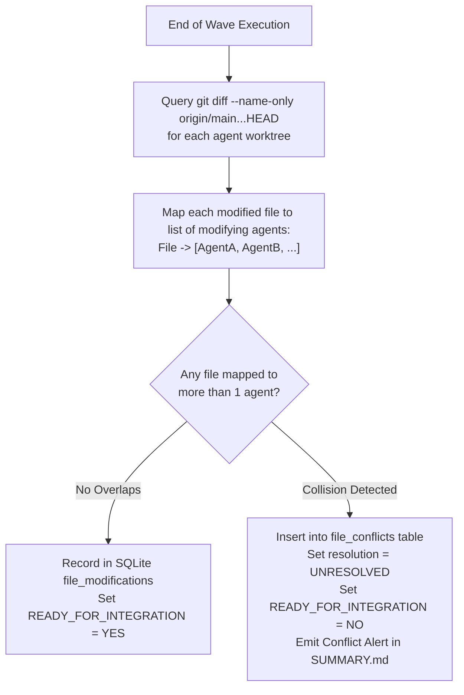

# SolidBit Agent Execution Control Loop (SACL V1) Concurrency & Locking Specification

> **Specification Version:** 1.0.0  
> **Target System:** Windows 10/11 Host Workstation  
> **Status:** ARCHITECTURE FREEZE / LOCAL CANONICAL BASELINE  
> **Implementation Authorization:** `IMPLEMENTATION_AUTHORIZED=NO`  
> **Authoritative Precedence:** Explicit Joaquín Decisions > Proven Current-Orchestrator Behavior > SolidBit Governance > Industry Standards (Undefined Gaps Only)  

---

## 1. Concurrency Architecture & Design Philosophy

SACL V1 operates as a multi-process distributed control loop on a local Windows host workstation. Because the system coordinates multiple independent daemons, worker processes, Git repositories, file trees, and database connections, deterministic execution depends upon rigorous concurrency isolation, non-blocking synchronization, and explicit mutual exclusion primitives:

```mermaid
flowchart TD
    subgraph TransportLayer [Edge Transport & Wake Ingress]
        PS["Google Cloud Pub/Sub Pull Subscriber<br>(Wake Signal Ingress)"]
        GH["Gmail History API Fetcher<br>(Authoritative Ingestion Cursor historyId)"]
    end

    subgraph SupervisorProcess [Supervisor Daemon]
        GP["Graph-P Supervisor<br>(Acquires SUPERVISOR_SINGLETON Lease)"]
    end

    subgraph LockHierarchy [Hierarchical Lock Ladder]
        L1["1. System Lock (SUPERVISOR_SINGLETON)"]
        L2["2. Project Lock (PROJECT_&lt;projectId&gt; - 1 Mutating Job)"]
        L3["3. Repo Lock (REPO_&lt;repoId&gt; - Git Index / Worktree Admin)"]
        L4["4. Worktree Lock (WORKTREE_&lt;agentId&gt; - Agent Exclusive)"]
        L5["5. Resource Lock (RESOURCE_&lt;id&gt; - Shared DB/Ports/Caches)"]
        L1 --> L2 --> L3 --> L4 --> L5
    end

    subgraph DAGExecution [Ephemeral DAG Execution Fleet]
        SCHED["Graph-H DAG Scheduler<br>(Topological Barrier & $MaxParallel Throttler)"]
        W1["Worker 1 (agy.exe)<br>Worktree wt-agent-1"]
        W2["Worker 2 (agy.exe)<br>Worktree wt-agent-2"]
        W3["Worker 3 (agy.exe)<br>Worktree wt-agent-3"]
    end

    subgraph MonitoringTool [Non-Intrusive Observability]
        MON["MONITOR.ps1<br>(Read-Only SQLite Connection mode=ro)"]
    end

    subgraph StorageEngine [Concurrency Synchronization Boundaries]
        DB[("SQLite sacl_ops.db<br>PRAGMA journal_mode=WAL<br>PRAGMA busy_timeout=5000<br>16 Operational State Domains")]
        GIT[("Git Repository & Worktrees<br>Independent Branch & Private Index Isolation")]
    end

    PS -->|Wake Signal| GH
    GH -->|Transactional Ingestion Write| DB
    GP -->|Lease Heartbeat & Status Update| DB
    GP -->|Enforce Hierarchy| LockHierarchy
    SCHED -->|Stage Barrier & Agent States| DB
    W1 -->|Atomic State Update| DB
    W2 -->|Atomic State Update| DB
    W3 -->|Atomic State Update| DB
    MON -.->|Non-Blocking Read mode=ro| DB

    SCHED -->|Spawn Isolated Worktree| GIT
    W1 -->|Private Index Commit / Diff| GIT
    W2 -->|Private Index Commit / Diff| GIT
    W3 -->|Private Index Commit / Diff| GIT
```



### Core Concurrency Invariants
1. **Concurrency Baseline:** Initially, exactly **one mutating job per project** is permitted to execute at any time. Safe read-only work (monitoring, log tailing, status inspection, static preflights) may coexist concurrently with an active mutating job.
2. **Hierarchical Lock Ladder:** All execution locks must be acquired in strict hierarchical order: `system` $\rightarrow$ `project` $\rightarrow$ `repo` $\rightarrow$ `worktree` $\rightarrow$ `resource`.
3. **Zero Contention on Critical Paths:** Heavy worker processes never compete for shared write locks on the primary Git repository or file trees.
4. **ACID Relational State:** All process status transitions, leasing, and coordination occur through SQLite in Write-Ahead Logging (WAL) mode, eliminating fragile loose JSON file overwrites.
5. **Ephemerality of Execution Graphs:** Worker graphs (`Graph-H`) are short-lived and torn down upon task completion, preventing runaway process leaks.
6. **PID Recycling Protection:** Windows PID reuse hazards are mitigated through multi-factor process identity checks.
7. **Non-Killing Diagnostic Timeouts:** Automated timeouts mark processes as `TIMEOUT_RUNNING` without issuing destructive termination signals, preserving forensics and partial deliverables.

---

## 2. Hierarchical Lock Model (`system/project/repo/worktree/resource`)

To prevent deadlocks, race conditions, and corrupted Git indices, SACL V1 formalizes a five-level lock hierarchy:

```
+==================================================================================================+
|                               SACL HIERARCHICAL LOCKING SPECIFICATION                            |
+==================================================================================================+
|  LEVEL 1: System Lock (SYSTEM)                                                                  |
|           Singleton lease for orchestrator supervisor (Graph-P). Global machine boundary.        |
|           Resource key: 'SUPERVISOR_SINGLETON' in table 'leases' (or 'supervisor_locks').        |
+--------------------------------------------------------------------------------------------------+
|  LEVEL 2: Project Lock (PROJECT)                                                                |
|           Enforces the Concurrency Baseline: 1 mutating job per registered project.             |
|           Allows concurrent read-only operations. Key: 'PROJECT_<projectId>'                     |
+--------------------------------------------------------------------------------------------------+
|  LEVEL 3: Repo Lock (REPO)                                                                      |
|           Serializes Git administrative mutations against common dir (.git/worktrees).           |
|           Prevents Git index.lock collisions during worktree provisioning. Key: 'REPO_<repoId>'  |
+--------------------------------------------------------------------------------------------------+
|  LEVEL 4: Worktree Lock (WORKTREE)                                                              |
|           Exclusive filesystem lease on isolated working tree (worktrees/wt-<agentId>/).         |
|           Dedicated private index per worker. Key: 'WORKTREE_<agentId>'                          |
+--------------------------------------------------------------------------------------------------+
|  LEVEL 5: Resource Lock (RESOURCE)                                                              |
|           Fine-grained locks for shared host resources (e.g. test database, build cache, port).  |
|           Key: 'RESOURCE_<resourceName>'                                                         |
+==================================================================================================+
```

### 2.1 Level 1: System Lock (`SUPERVISOR_SINGLETON`)
- **Invariant:** At any moment, exactly one instance of the `Graph-P` supervisor daemon may hold the active system lease.
- **Heartbeat & Expiration:** Heartbeat cadence is 10 seconds; lease TTL is 60 seconds.
- **Graceful Release:** The supervisor deletes the lease row upon controlled shutdown.
- **Crash Recovery:** If a supervisor crashes, the lease expires after 60 seconds (`expires_at < NOW()`), allowing a subsequent supervisor process to claim ownership automatically.

### 2.2 Level 2: Project Lock (`PROJECT_<projectId>`)
- **Mutating Job Exclusivity:** Exactly one mutating job wave may be active for a given project at any time.
- **Read-Only Coexistence:** Read-only inspection tasks (e.g. `MONITOR.ps1`, status queries, preflight assertions) acquire shared read locks and execute without blocking or being blocked.
- **Queueing Semantics:** When a second mutating job arrives for an active project, it is placed in state `QUEUED` in SQLite until the active job releases the project lock.

### 2.3 Level 3: Repo Lock (`REPO_<repoId>`)
- **Git Common Dir Protection:** Although Git worktrees isolate working trees, operations like `git worktree add` and `git worktree remove` mutate the common `.git/worktrees` directory and refs.
- **Serialization:** Worktree provisioning and teardown acquire an exclusive short-lived `REPO_<repoId>` lock (typical hold time < 2 seconds) to avoid `.git/index.lock` collisions.

### 2.4 Level 4: Worktree Lock (`WORKTREE_<agentId>`)
- **Worker Exclusivity:** Each worker operates in its own isolated worktree (`worktrees/wt-<agentId>/`).
- **Private Index:** The agent possesses an exclusive lock on its worktree directory and private Git index (`.git/worktrees/wt-<agentId>/index`).

### 2.5 Level 5: Resource Lock (`RESOURCE_<resourceId>`)
- **Shared Host Resources:** Used when multiple workers within a wave require access to a shared local resource (e.g. a local test SQLite instance or mock server port).
- **Fine-Grained Granularity:** Allocated and released dynamically within worker stages.

---

## 3. Relational Lease Schema (`leases`)

Lease acquisition and heartbeat management execute inside `sacl_ops.db`:

```sql
CREATE TABLE IF NOT EXISTS leases (
    lease_name      TEXT PRIMARY KEY,               -- e.g. 'SUPERVISOR_SINGLETON', 'PROJECT_solidbit'
    lease_type      TEXT NOT NULL CHECK(lease_type IN ('SYSTEM', 'PROJECT', 'REPO', 'WORKTREE', 'RESOURCE')),
    run_id          TEXT NOT NULL,                  -- Associated Run ID or 'IDLE_SUPERVISOR'
    holder_pid      INTEGER NOT NULL,               -- OS Process ID of active holder
    is_mutating     INTEGER NOT NULL DEFAULT 1,     -- 1 = Mutating (Exclusive), 0 = Read-Only (Shared)
    acquired_at     TEXT NOT NULL,                  -- ISO-8601 UTC timestamp
    heartbeat_at    TEXT NOT NULL,                  -- ISO-8601 UTC timestamp
    expires_at      TEXT NOT NULL                   -- Expiration timestamp (heartbeat + TTL)
);

CREATE INDEX IF NOT EXISTS idx_leases_type_run ON leases(lease_type, run_id);
```

*(Note: Table `supervisor_locks` is retained as a compatibility view/alias pointing to `leases WHERE lease_type = 'SYSTEM'`.)*

### Atomic Acquisition Function
```powershell
function Acquire-HierarchicalLease {
    param(
        [string]$LeaseName,
        [string]$LeaseType,
        [string]$RunId,
        [int]$Pid = $PID,
        [bool]$IsMutating = $true,
        [int]$TtlSeconds = 60
    )
    $now = (Get-Date).ToUniversalTime().ToString("o")
    $expires = (Get-Date).ToUniversalTime().AddSeconds($TtlSeconds).ToString("o")
    $mutatingInt = if ($IsMutating) { 1 } else { 0 }

    $sql = @"
        INSERT INTO leases (lease_name, lease_type, run_id, holder_pid, is_mutating, acquired_at, heartbeat_at, expires_at)
        VALUES ('$LeaseName', '$LeaseType', '$RunId', $Pid, $mutatingInt, '$now', '$now', '$expires')
        ON CONFLICT(lease_name) DO UPDATE SET
            run_id = excluded.run_id,
            holder_pid = excluded.holder_pid,
            is_mutating = excluded.is_mutating,
            heartbeat_at = excluded.heartbeat_at,
            expires_at = excluded.expires_at
        WHERE expires_at < '$now';
"@
    $rowsAffected = Invoke-SqliteNonQuery -Query $sql
    if ($rowsAffected -eq 0) {
        throw "LEASE_CONTENTION: Lease '$LeaseName' ($LeaseType) is actively held by PID."
    }
}
```

---

## 4. SQLite Operational State Store Concurrency

### 4.1 Write-Ahead Logging (WAL) Mode
SACL V1 standardizes on SQLite in WAL mode across all 16 operational state domains:

```sql
PRAGMA journal_mode = WAL;          -- Allows concurrent readers and a single writer
PRAGMA busy_timeout = 5000;         -- Queues concurrent writes for up to 5000ms
PRAGMA synchronous = NORMAL;        -- Optimal durability with minimal write amplification
PRAGMA foreign_keys = ON;           -- Enforces referential integrity
```

### 4.2 Reader/Writer Concurrency Dynamics
1. **Non-Blocking Concurrent Reads:** Read-only processes (`MONITOR.ps1`, status reporting queries) never block or wait for write transactions. They read committed snapshots from the WAL buffer.
2. **Connection Isolation for Monitoring:** `MONITOR.ps1` explicitly opens the database using the read-only URI:
   `Data Source=sacl_ops.db;Mode=ReadOnly;` (or `file:sacl_ops.db?mode=ro`).
3. **Serialized Micro-Transactions:** Write operations (updating agent state, recording audit events, updating stage status) execute inside short, focused transactions (`BEGIN IMMEDIATE TRANSACTION ... COMMIT`) that complete in under 5 milliseconds.
4. **Busy Timeout Queueing:** If a write transaction occurs while another process holds the write lock, SQLite automatically waits up to 5,000 milliseconds before raising a busy error.

---

## 5. Ephemeral Graph-H DAG Concurrency & Stage Throttling

### 5.1 Phased Stage Boundaries (Topological Barriers)
`Graph-H` organizes multi-agent execution into discrete topological phases defined in `config/dependencies.json`. Agents within Phase $N+1$ cannot launch until all agents in Phase $N$ have completed with passing verdicts:

```mermaid
flowchart LR
    subgraph Phase1 [Phase 1: Analysis & Compat]
        A1["AG-COMPAT"]
    end

    subgraph Barrier1 [Barrier Synchronization 1]
        B1{"All Phase 1<br>Verdicts == PASS?"}
    end

    subgraph Phase2 [Phase 2: Core Design & Specs (Parallel)]
        A2["AG-ARCH"]
        A3["AG-SEC"]
        A4["AG-SCHEMA"]
    end

    subgraph Barrier2 [Barrier Synchronization 2]
        B2{"All Phase 2<br>Verdicts == PASS?"}
    end

    subgraph Phase3 [Phase 3: Quality Assurance]
        A5["AG-QA"]
    end

    subgraph Barrier3 [Barrier Synchronization 3]
        B3{"Phase 3<br>Verdict == PASS?"}
    end

    subgraph Phase4 [Phase 4: Synthesis & Seal]
        A6["AG-FINAL"]
    end

    A1 --> B1
    B1 -->|Yes| A2
    B1 -->|Yes| A3
    B1 -->|Yes| A4
    A2 --> B2
    A3 --> B2
    A4 --> B2
    B2 -->|Yes| A5
    A5 --> B3
    B3 -->|Yes| A6
```

### 5.2 Pool Concurrency Throttling (`$MaxParallel`)
To prevent host memory exhaustion, CPU thrashing, and process starvation, `Graph-H` limits the number of simultaneously active worker processes to `$MaxParallel` (default: 3 workers).

The scheduling engine implements the proven batching loop from `RUN-WAVE3.ps1`:

```powershell
function Invoke-PhasedDagExecution {
    param(
        [array]$StageAgents,
        [int]$MaxParallel = 3
    )
    $runningWorkers = @{}
    $queue = [System.Collections.Generic.Queue[object]]::new($StageAgents)

    while ($queue.Count -gt 0 -or $runningWorkers.Count -gt 0) {
        # Spawn new workers up to $MaxParallel capacity
        while ($queue.Count -gt 0 -and $runningWorkers.Count -lt $MaxParallel) {
            $agent = $queue.Dequeue()
            $proc = Start-AgentWorkerProcess -Agent $agent
            $runningWorkers[$agent.id] = $proc
        }

        # Poll running workers every 3 seconds
        Start-Sleep -Seconds 3
        foreach ($agentId in @($runningWorkers.Keys)) {
            $proc = $runningWorkers[$agentId]
            if ($proc.HasExited) {
                Reconcile-FinishedAgent -AgentId $agentId -ExitCode $proc.ExitCode
                $runningWorkers.Remove($agentId)
            }
        }
    }
}
```

---

## 6. Worktree Concurrency & Git Locking

### 6.1 The Git Lock Contention Problem
When multiple processes run `git` commands against a single repository simultaneously, Git creates lock files (`.git/index.lock`, `.git/refs/heads/<branch>.lock`). Concurrent writes trigger fatal errors:
`fatal: Unable to create '.../.git/index.lock': File exists.`

### 6.2 Worktree Isolation Architecture
SACL V1 completely eliminates Git lock contention by providing each agent with an isolated working tree:
1. **Isolated Directory Root:** Each agent operates exclusively within its own worktree directory:
   `worktrees/wt-<agentId>/`
2. **Dedicated Task Branch:** Each agent is provisioned with a unique branch:
   `git worktree add -b <branch> <path> origin/<branch>`
3. **Independent Index Files:** Each Git worktree maintains its own private index file (`.git/worktrees/wt-<agentId>/index`). Staging, unstaged edits, and local commits within `wt-agent-a` never touch or lock the index of `wt-agent-b`.
4. **Primary Checkout Inviolability:** The primary checkout (`.git` common dir) is strictly read-only for agents. The Local Dirty-Root Rule forbids automated operations from modifying human working trees.

---

## 7. Cross-Agent File Collision & Mutex Tracking

### 7.1 Parallel Branch Conflict Hazard
Even when worktrees isolate the filesystem during execution, parallel agents may independently modify the same file across their respective branches. If left undetected, merging these branches causes merge conflicts or subtle regression overwrites.

### 7.2 Pre-Merge Overlap Detection Algorithm
At the conclusion of each phased wave, `Graph-H` executes the battle-tested collision evaluation algorithm from `collect-results.ps1`:



---

## 8. Process Lifecycle Synchronization & PID Recycling Defense

### 8.1 The Windows PID Recycling Hazard
On Microsoft Windows, process identifiers (PIDs) are integers reused aggressively by the operating system kernel once a process exits. In an autonomous multi-agent system running for hours, this creates a severe race condition:
- Agent A runs with PID `4820` and exits unexpectedly.
- Windows OS immediately reassigns PID `4820` to an unrelated background system application (e.g. `svchost.exe`, `chrome.exe`, or an IDE).
- An automated supervisor querying PID `4820` detects an active process and mistakenly assumes Agent A is still running.
- Alternatively, if a stop command is issued, `Stop-Process -Id 4820 -Force` would terminate the innocent system process.

### 8.2 The 3-Way Identity Verification Protocol
SACL V1 adopts the proven 3-way check from `orchestrator-common.ps1` (`Test-AgentProcessRunning`):

```powershell
function Test-AgentProcessRunning {
    param(
        [int]$ProcessId,
        [datetime]$ExpectedStartTime,
        [string[]]$AllowedProcessNames = @('agy', 'powershell', 'pwsh', 'cmd', 'node', 'conhost')
    )
    
    # 1. OS Process Existence Check
    $proc = Get-Process -Id $ProcessId -ErrorAction SilentlyContinue
    if (-not $proc) {
        return @{ IsRunning = $false; Reason = "PROCESS_NOT_FOUND" }
    }

    # 2. Executable Name Whitelist Check
    $matchesName = $false
    foreach ($allowed in $AllowedProcessNames) {
        if ($proc.ProcessName -like "*$allowed*") {
            $matchesName = $true
            break
        }
    }
    if (-not $matchesName) {
        return @{ IsRunning = $false; Reason = "PROCESS_NAME_MISMATCH_RECYCLED"; ActualName = $proc.ProcessName }
    }

    # 3. StartTime Tolerance Check (Window <= 300 seconds)
    try {
        $actualStartTime = $proc.StartTime.ToUniversalTime()
        $expectedUtc = $ExpectedStartTime.ToUniversalTime()
        $varianceSeconds = [Math]::Abs(($actualStartTime - $expectedUtc).TotalSeconds)
        
        if ($varianceSeconds -gt 300) {
            return @{ IsRunning = $false; Reason = "START_TIME_MISMATCH_RECYCLED"; Variance = $varianceSeconds }
        }
    }
    catch {
        return @{ IsRunning = $false; Reason = "ACCESS_DENIED_SUSPECTED_RECYCLED" }
    }

    return @{ IsRunning = $true; Process = $proc }
}
```

### 8.3 Non-Killing Diagnostic Timeouts
If an agent exceeds its designated execution duration (`timeout_minutes`), SACL strictly enforces the non-killing invariant:
1. Status is transitioned in SQLite to `TIMEOUT_RUNNING`.
2. An alert event is appended to `audit_events`.
3. The process is **never terminated automatically**.
4. Rationale: AI coding agents frequently perform heavy multi-step tool calls. Terminating them mid-stream corrupts local worktree git indexes, truncates diagnostic logs, and prevents forensic analysis.
5. If termination is required, it must be performed through the explicit Local Kill Switch (`STOP.ps1`).

---

## 9. Transport Ingestion Concurrency & Gmail Event Synchronization

### 9.1 Event-Driven Pub/Sub Wake Ingress
Rather than continuous polling, the transport synchronization loop operates via event-driven ingress:
- **Primary Wake Signal:** Google Cloud Pub/Sub pull notification (`gmail_api_users_watch_pubsub_pull`).
- **Authoritative Fetch:** Gmail History API (`authoritative_fetch = "gmail_history_api"`).
- **Monotonic Cursor:** Synchronized via `historyId` stored transactionally in SQLite table `mail_messages`.
- **Startup Reconciliation:** Reconciles missed messages from `historyId` upon daemon restart.
- **Watch Renewal:** Periodic renewal of `users.watch` lease prior to expiration.
- **Fallback Polling:** Fallback polling is enabled strictly as degraded-mode reconciliation, never as the primary source of truth.

### 9.2 Inbound Deduplication & Replay Prevention
```sql
CREATE TABLE IF NOT EXISTS mail_messages (
    message_id      TEXT PRIMARY KEY,               -- RFC-2822 Message-ID or Gmail messageId
    history_id      TEXT NOT NULL,                  -- Gmail historyId cursor
    sender          TEXT NOT NULL,
    subject         TEXT NOT NULL,
    received_at     TEXT NOT NULL,
    nonce           TEXT NOT NULL UNIQUE,           -- Anti-replay nonce
    attachment_sha  TEXT NOT NULL,                  -- SHA-256 of ZIP attachment
    status          TEXT NOT NULL CHECK(status IN (
                            'PENDING', 'VALIDATED', 'PROCESSED', 
                            'REJECTED', 'DUPLICATE_IGNORED'
                        )),
    rejection_reason TEXT,
    run_id          TEXT,
    FOREIGN KEY(run_id) REFERENCES runs(run_id)
);
```

### 9.3 Idempotency Synchronization Rules
1. **At-Least-Once Delivery Acceptance:** Email transport provides at-least-once delivery guarantees. Consumers are inherently idempotent.
2. **Duplicate Message Redelivery:** If a message arrives with a `message_id` or `nonce` already present in `mail_messages`, the gateway marks it as `DUPLICATE_IGNORED` and skips execution.
3. **Legitimate Retries:** Re-submitting the same job with a newly generated `nonce` represents a legitimate retry. The gateway registers a new run record linked to the new message.
4. **Conflicting Payload Rejection:** If an incoming message specifies the same `job_id` as an existing run but carries a different `attachment_sha`, the system detects a mutation conflict, rejects the package, and logs `REJECTED_PAYLOAD_CONFLICT`.
