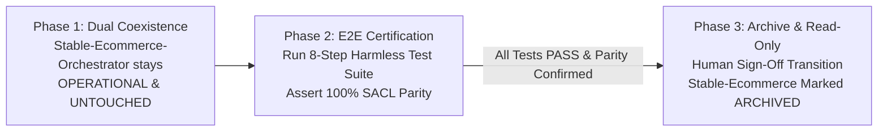
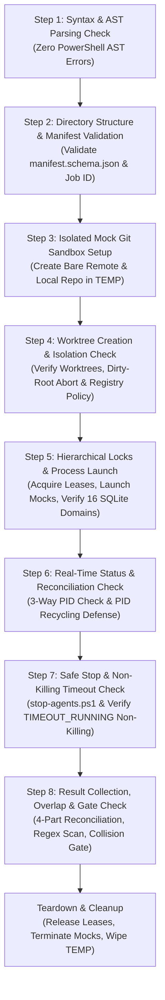

# SACL V1 End-to-End Certification Plan (E2E_CERTIFICATION_PLAN)

**Document ID:** SACL-PLAN-CERT-v1  
**Status:** ARCHITECTURE FREEZE / LOCAL CANONICAL BASELINE  
**Authoritative Precedence:** Explicit Joaquín Decisions > Proven Current-Orchestrator Behavior > SolidBit Governance > Industry Standards (Undefined Technical Gaps Only)  

---

## 1. Executive Summary & Sandboxed Certification Boundary

The SACL V1 End-to-End Certification Plan establishes a deterministic, fully automated, and 100% harmless test harness to certify the integrity of the SolidBit Agent Execution Control Loop prior to operational deployment, and to validate functional parity against `Stable-Ecommerce-Orchestrator`.

### The Zero-Mutation Boundary
To guarantee absolute safety:
1. **Isolated Sandbox Location:** All tests execute entirely within disposable temporary directories under `$env:TEMP\sacl-e2e-<RunId>\`.
2. **Zero Production Mutation:** The test harness **NEVER** touches production repositories, production databases, Jira, Railway, or remote git remotes.
3. **Zero LLM Token Consumption:** The harness uses harmless mock worker scripts (`-TestMode`), simulating agent lifecycle transitions and report generation without invoking real LLM APIs or consuming cloud tokens.
4. **Clean Teardown:** All created mock processes, temporary worktrees, and SQLite test databases are cleaned up automatically upon suite completion.

---

## 2. Legacy Orchestrator Lifecycle Transition Gate

The operational transition between `Stable-Ecommerce-Orchestrator` and SACL V1 is bound to this certification plan:



1. **Untouched / Fully Operational Rule:**
   `Stable-Ecommerce-Orchestrator` (`C:\Users\Lucilfer\Documents\Stable-Ecommerce-Orchestrator`) **must remain completely operational and untouched** throughout SACL V1 construction and testing. No legacy scripts, configs, or state files may be altered or deleted.
2. **Certification Gate:**
   SACL V1 cannot be designated as operational until it achieves 100% verified parity across all 18 evaluated components (`docs/CURRENT_ORCHESTRATOR_COMPATIBILITY_MATRIX.md`) and passes all 8 steps of this certification plan.
3. **Archive Transition:**
   Upon formal human sign-off confirming SACL parity and successful E2E certification, `Stable-Ecommerce-Orchestrator` transitions to an **archived, read-only** reference repository.

---

## 3. The 8-Step Certification Test Harness

The test suite formalizes and hardens the proven verification pipeline from `Stable-Ecommerce-Orchestrator/scripts/test-orchestrator-e2e.ps1`:



---

## 4. Detailed Step Verifications & Assertions

### Step 1: Syntax & AST Parsing Verification
- **Purpose:** Ensure that all runtime PowerShell orchestration scripts are free of syntax errors, unterminated string literals, and parser exceptions.
- **Method:** Execute the .NET PowerShell AST parser across all runtime `.ps1` files:
  ```powershell
  $errors = $null
  $tokens = $null
  [System.Management.Automation.Language.Parser]::ParseFile($scriptPath, [ref]$tokens, [ref]$errors)
  ```
- **Assertion:** `$errors.Count -eq 0` across all files (`RUN-WAVE.ps1`, `WORKER.ps1`, `MONITOR.ps1`, `FINALIZE.ps1`, `scripts/*.ps1`).
- **Required Verdict:** `PASS`.

### Step 2: Directory Structure & Manifest Schema Validation
- **Purpose:** Verify that the wave package conforms to the canonical directory layout and that `manifest.json` satisfies `manifest.schema.json`.
- **Method:**
  1. Inspect physical presence of required directories: `prompts/`, `scripts/`, `config/`, `contracts/`, `inputs/`, `schemas/`.
  2. Inspect physical presence of required root files: `manifest.json`, `README.md`, `EXECUTION_PLAN.md`.
  3. Validate `manifest.json` against `schemas/manifest.schema.json` (confirming `job_id` is required).
- **Assertion:** All required paths exist; manifest schema validator returns zero errors.
- **Required Verdict:** `PASS`.

### Step 3: Isolated Mock Git Sandbox Setup
- **Purpose:** Create an isolated local Git environment for testing branch creation and worktrees without network calls.
- **Method:**
  1. Create a bare remote repository at `$env:TEMP\sacl-e2e-remote.git`.
  2. Clone to local sandbox at `$env:TEMP\sacl-e2e-local`.
  3. Configure mock committer (`git config user.name "SACL Tester"`).
  4. Create an initial commit on branch `main` and push to the bare remote.
- **Assertion:** Git repository initializes cleanly; origin remote points to local bare repo.
- **Required Verdict:** `PASS`.

### Step 4: Worktree Creation, Dirty-Root & Project Registry Authority
- **Purpose:** Verify worktree isolation, Project Registry root authority, and the Local Dirty-Root Rule.
- **Method:**
  1. Register mock sandbox in local Project Registry (`config/projects.json`).
  2. Invoke `prepare-worktrees.ps1` targeting the mock sandbox.
  3. Verify worktrees created under `worktrees/<agent>/` on dedicated branches.
  4. **Registry Non-Redirection Test:** Submit a test manifest attempting to target an arbitrary directory outside registry policy (`C:\Windows\Temp\exploit`). Assert immediate `POLICY_DENIED_UNAUTHORIZED_TARGET_ROOT`.
  5. **Inviolable Dirty-Root Test:** Create an uncommitted file (`dirty_proof.txt`) in the primary sandbox root and rerun worktree preparation.
- **Assertion:**
  - `main` branch is untouched.
  - Unauthorized path redirection is rejected fail-closed.
  - Presence of uncommitted file triggers an immediate `DIRTY_ROOT_HALT` exception.
- **Required Verdict:** `PASS`.

### Step 5: Hierarchical Locks, Mock Process Launch & 16-Domain SQLite Ingestion
- **Purpose:** Verify hierarchical locking (system, project, repo, worktree, resource), mutating concurrency limit (1 per project), and state persistence across all 16 SQLite domains.
- **Method:**
  1. Initialize SQLite test database `$env:TEMP\sacl_ops_test.db` in WAL mode with full DDL.
  2. Acquire system lock (`SUPERVISOR_SINGLETON`) and project lock (`PROJECT_mock`).
  3. **Concurrency Baseline Test:** Attempt to acquire a second mutating project lock for the same project. Assert that second request queues or throws `LEASE_CONTENTION`.
  4. Spawn two mock worker processes via `Start-Process` running a harmless loop.
  5. Record execution state across `jobs`, `runs`, `agents`, `leases`, `heartbeats`, and `events`.
- **Assertion:** Hierarchical locks enforce single mutating job limit; process PIDs are captured; all 16 relational domains function without constraint errors.
- **Required Verdict:** `PASS`.

### Step 6: Real-Time Status & Reconciliation Verification
- **Purpose:** Test process observation, start-time drift checks, and PID recycling defenses.
- **Method:**
  1. Run `Test-AgentProcessRunning` against active mock workers.
  2. Simulate PID recycling: tamper with recorded PID in database by setting it to a non-existent PID or an unrelated OS PID.
- **Assertion:**
  - Active mock worker evaluates to `$true`.
  - Tampered / recycled PID evaluates to `$false` via start-time drift or image mismatch, preventing false-positive reporting.
- **Required Verdict:** `PASS`.

### Step 7: Safe Stop & Non-Killing Timeout Verification
- **Purpose:** Validate controlled termination and verify the non-killing diagnostic timeout invariant.
- **Method:**
  1. Invoke `stop-agents.ps1 mock-agent-1`. Verify process terminates and status in SQLite transitions to `STOPPED` with verdict `STOPPED_BY_USER`.
  2. Simulate timeout on `mock-agent-2`: advance elapsed time past `timeout_minutes`.
- **Assertion:**
  - `mock-agent-1` terminates gracefully.
  - `mock-agent-2` transitions to `TIMEOUT_RUNNING` while the OS process **remains alive and running**, confirming the non-killing invariant.
- **Required Verdict:** `PASS`.

### Step 8: Result Collection, 4-Part Reconciliation & Gate Check
- **Purpose:** Verify deliverable regex marker extraction, legacy fallback `'PASS (Report Present)'`, cross-agent file overlap detection, and Human Action Gate emission.
- **Method:**
  1. Write mock deliverable report for Agent A containing `AGENT_MOCK_1_RESULT = PASS`.
  2. Write mock deliverable report for Agent B with clean content but no regex marker (tests `'PASS (Report Present)'` fallback).
  3. Simulate cross-agent file collision: commit a modification to `docs/shared.md` on both Agent A and Agent B branches.
  4. Run `collect-results.ps1`, conflict evaluation query, and 4-part reconciliation ladder.
  5. Run `run-human-action-gate.ps1`.
- **Assertion:**
  - Agent A reconciles as `PASS`.
  - Agent B reconciles as `'PASS (Report Present)'`.
  - Overlap detector records collision on `docs/shared.md`.
  - SQLite `runs.ready_for_integration` evaluates to `'NO'`.
  - Gate artifact `FINAL_DEVELOPMENT_AUTHORIZATION.txt` is generated with `FUNCTIONAL_DEVELOPMENT = NOT_AUTHORIZABLE`.
  - Overall harness output: `ALL_VALIDATION_TESTS = PASS`.
- **Required Verdict:** `PASS`.

---

## 5. Teardown & Isolation Cleanup

Upon completion of the 8 steps:
1. Any remaining mock worker processes are terminated via PID lookup.
2. All hierarchical leases in SQLite are released.
3. The SQLite database connection is closed.
4. The `$env:TEMP\sacl-e2e-*` directories are deleted.
5. An executive certification report is generated at `artifacts/runs/<runId>/reports/E2E_CERTIFICATION.md`.

---

## 6. Acceptance Matrix & Certification Criteria

| Test Identifier | Validated Subsystem | Pass Criteria | Hard Gate Condition |
| :--- | :--- | :--- | :--- |
| **TEST-01-AST** | Parser & Syntax | Zero AST syntax errors across runtime scripts | Syntax error halts suite |
| **TEST-02-SCHEMA**| Manifest Contract | 100% compliance with `manifest.schema.json` & required `job_id` | Schema mismatch halts suite |
| **TEST-03-SANDBOX**| Git Infrastructure | Bare remote and clean clone initialized | Git failure halts suite |
| **TEST-04-DIRTY** | Worktree & Authority | Dirty root throws `DIRTY_ROOT_HALT`; unauthorized path blocked | Dirty root overwrite or path leak halts suite |
| **TEST-05-LOCKS** | Hierarchical Locks | 1 mutating job per project enforced; 16 SQLite domains operational | Concurrency violation halts suite |
| **TEST-06-RECON** | Process Integrity | PID recycling detected and flagged | False positive halts suite |
| **TEST-07-STOP** | Safe Stop & Timeout | `TIMEOUT_RUNNING` non-killing verified | Auto-kill on timeout halts suite |
| **TEST-08-GATE** | 4-Part Reconciliation | Overlap blocks integration; `'PASS (Report Present)'` valid | Unblocked conflict halts suite |
