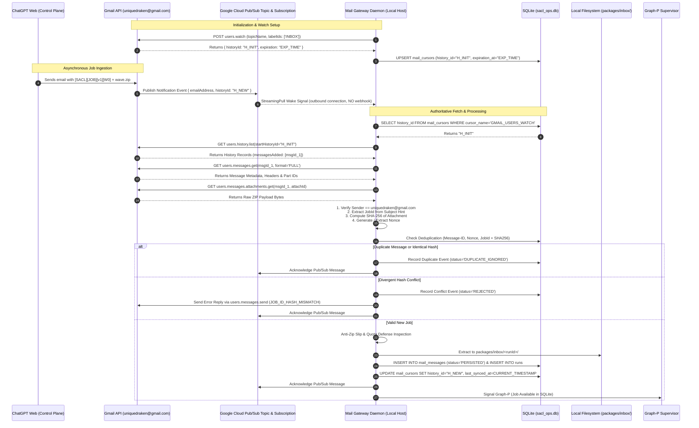

# SACL V1 Canonical Mail Protocol Specification & Transport Envelope Contract

**Document Identifier:** `docs/MAIL_PROTOCOL.md`  
**Status:** CANONICAL ARCHITECTURAL SPECIFICATION (Wave 0.2 Freeze Consistency Remediation)  
**Target Repository:** `risejoaquin/solidbit-agent-execution-control-loop`  
**Precedence Hierarchy:**
1. Explicit Joaquín decisions (`DECISION_BASELINE.md`)
2. Proven current-orchestrator behavior (`Stable-Ecommerce-Orchestrator`)
3. Existing SolidBit governance and contracts (`ARCHITECTURE_INVARIANTS.json`, `manifest.json`)
4. Industry standards for undefined gaps only (never overriding prior decisions)

---

## 1. Architectural Role & Boundary Definitions

The SolidBit Agent Execution Control Loop (SACL V1) utilizes email as an asynchronous, non-interactive transport bridge between the Cloud Control Plane (ChatGPT Web) and the local Windows workstation.

In strict adherence to explicit architectural decisions (DECISION_BASELINE §2, SB-FREEZE-P1-01, and SB-FREEZE-P2-03), the ingress architecture is event-driven via **Gmail API `users.watch`**, **Google Cloud Pub/Sub**, and a **local Pull/StreamingPull subscriber**. The system exposes **zero public inbound webhooks**, requires **no open inbound ports**, and eliminates any requirement for legacy IMAP or SMTP in V1. **Gmail API OAuth2** is the canonical transport authentication model; App Passwords are permanently removed as a V1 credential. Mailbox unread state is never the source of truth and must not be a gating input.

```
+==================================================================================================+
|                                  MAIL TRANSPORT BOUNDARY ARCHITECTURE                            |
+==================================================================================================+
|                                                                                                  |
|   CLOUD CONTROL PLANE (ChatGPT Web)                                                              |
|   - Authors wave execution package ZIP                                                           |
|   - Sends package via email to target mailbox (uniquedraken@gmail.com)                           |
|                                                                                                  |
|                              |                                                                   |
|                              v                                                                   |
|   TRANSPORT CARRIER: Gmail (uniquedraken@gmail.com)                                              |
|   - Untrusted, asynchronous message transit                                                      |
|   - users.watch emits mailbox state change events to Google Cloud Pub/Sub Topic                  |
|   - At-least-once delivery semantics (consumers must be idempotent)                              |
|   - Zero direct execution authority                                                              |
|                                                                                                  |
|                              |                                                                   |
|                              v (Push Notification to Topic)                                      |
|   GOOGLE CLOUD PUB/SUB (Cloud Topic & Subscription)                                              |
|   - Holds mailbox change events                                                                  |
|   - Carries Wake Signal payload: {"emailAddress": "...", "historyId": "..."}                     |
|                                                                                                  |
|                              |                                                                   |
|                              v (Outbound Pull / StreamingPull over gRPC/HTTPS TLS - NO WEBHOOK)  |
|   LOCAL HOST: MAIL GATEWAY DAEMON (Independent Process)                                          |
|   - Subscribes via local Pull / StreamingPull (Outbound connection only; NO inbound ports)       |
|   - Treats Pub/Sub notification strictly as a WAKE SIGNAL, NOT source of truth                  |
|   - Queries Gmail History API (users.history.list) using persisted historyId from SQLite         |
|   - Fetches authoritative message metadata & attachment via Gmail REST API                       |
|   - Renews Gmail users.watch lease automatically before 7-day expiration                         |
|   - Performs startup reconciliation from persisted historyId                                     |
|   - Maintains periodic polling strictly as safety reconciliation / fallback                     |
|   - Enforces Anti-Zip Slip, resource quotas, and manifest schema validation                      |
|   - Records message state & cursors into SQLite (sacl_ops.db: mail_messages, mail_cursors)       |
|   - Stages validated packages to packages/inbox/<runId>/                                         |
|   - Dispatches execution summaries & response ZIPs via Gmail API (users.messages.send)           |
|                                                                                                  |
+==================================================================================================+
```

### 1.1 Invariant Protocol Tenets
1. **Gmail is Transport, Not Authority:** Email transit does not confer execution permissions. Local authorization, safety gates, and preflight policy checks are executed entirely on the local host by the Policy Engine.
2. **Separation of Transport and Agent Identities:** Gmail mailbox OAuth2 credentials (`uniquedraken@gmail.com`) and Antigravity CLI identities are completely decoupled. Antigravity workers have zero knowledge of, or access to, mail account credentials or OAuth tokens.
3. **Delivery Semantics:** Transport delivery is **at-least-once**. The orchestrator and Mail Gateway are idempotent. Under no circumstances does the system claim exactly-once network transport.
4. **Subject Line is a Routing Hint Only:** The email subject line is strictly used for intake filtering and thread correlation (`[SACL][JOB][v1][<JOB_ID>]`). It is **never an authority source**. Authoritative project scopes, execution modes, agent dependencies, and permissions live exclusively in validated package metadata (`manifest.json`).
5. **No Code Execution from Email Body:** The email body is treated strictly as unparsed metadata or human text. No script, command, or shell expression is ever executed from email text or headers.
6. **Pub/Sub is a Wake Signal, Not Truth:** Pub/Sub notifications notify the daemon that changes occurred. The **Gmail History API (`users.history.list`)** with persisted `historyId` is the sole authoritative mechanism for retrieving mailbox changes.
7. **SQLite is the Operational Source of Truth:** Operational state, message intake records, anti-replay nonces, and the synchronized `historyId` cursor are maintained in SQLite (`sacl_ops.db`).
8. **No SMTP Required in V1:** Outbound results are dispatched using the **Gmail REST API (`users.messages.send`)** with thread continuation (`threadId`, `In-Reply-To`, `References`).
9. **Self-Mailbox Workflow Supported:** Sending from `uniquedraken@gmail.com` to `uniquedraken@gmail.com` is explicitly supported.
10. **Zero Private Keys in ChatGPT Web:** ChatGPT Web must not possess long-lived HMAC secrets or private signing keys. Package signing is formally deferred to future waves.

---

## 2. Inbound Message Protocol

### 2.1 Canonical Subject Line Syntax (Routing Hint)
Inbound messages carrying wave packages must adhere to the canonical routing hint syntax:

```
[SACL][JOB][v1][<JOB_ID>]
```

- **Tag `[SACL]`:** Distinguishes SACL automation emails from regular personal correspondence.
- **Tag `[JOB]`:** Denotes an incoming execution task package.
- **Tag `[v1]`:** Protocol envelope version.
- **`<JOB_ID>`:** Alphanumeric identifier matching the wave or task identifier (e.g. `W0`, `WAVE-01`, `REFACTOR-DB`). Permitted characters: `[a-zA-Z0-9_-]+`.

*Example:* `[SACL][JOB][v1][W0]`

### 2.2 Inbound Envelope & Payload Requirements
1. **Sender Authentication:**
   - The Mail Gateway verifies the `From:` header against the authorized sender address: `uniquedraken@gmail.com`.
   - The approved **self-mail workflow** (sending from `uniquedraken@gmail.com` to `uniquedraken@gmail.com`) is fully supported. Messages from unknown senders are ignored or moved to a quarantine folder.
2. **Message Body:**
   - Optional human notes, descriptions, or change summaries.
   - The body is ignored by the execution engine and never parsed for executable code.
3. **Attachment Structure:**
   - Must contain **exactly one attachment** with a `.zip` extension.
   - Maximum allowed compressed attachment size: **25 MB**.
   - Attachment must be a valid ZIP archive containing the self-contained wave package (`manifest.json`, `prompts/`, `config/`, etc.).

### 2.3 Cryptographic Key Custody & Integrity Posture (ADR-014 Alignment)
- **ChatGPT Web Secret-Free Architecture:** ChatGPT Web must not possess a long-lived HMAC or private signing key. Storing long-lived cryptographic secrets in interactive web LLM sessions introduces unacceptable leakage risks.
- **Package HMAC Signing Deferred:** HMAC package signing is deferred until a dedicated, cryptographically isolated signer or key-custody component exists in a future hardening wave.
- **V1 Package Trust Foundation:**
  1. Authenticated Gmail OAuth2/channel identity.
  2. Inbound routing hint and strict sender whitelisting.
  3. Strict manifest schema validation (`schemas/manifest.schema.json`).
  4. SHA-256 package hash integrity tracking.
  5. SQLite anti-replay and deduplication controls (`mail_messages.nonce`, `attachment_sha`).
  6. Local policy engine preflight verification and human action gates.

### 2.4 Replay, Deduplication & Conflict Invariants
To maintain consistency across at-least-once delivery, the Mail Gateway executes deterministic deduplication against `mail_messages` and `runs` tables in `sacl_ops.db`:

```
Algorithm: InboundMessageDeduplication
Inputs: RFC 822 Message-ID, Subject Hint (JobId), Attachment SHA-256 Hash, Anti-Replay Nonce

1. Query sacl_ops.db for matching Message-ID or Nonce:
     If exists:
       Log: "Duplicate message delivery detected. Idempotently ignored."
       Acknowledge Pub/Sub message (optional mailbox housekeeping archive/mark read; unread state is never a gating input) and RETURN.

2. Query sacl_ops.db for active or previous run matching JobId:
     If matching run exists:
       StoredHash = Query mail_messages.attachment_sha WHERE run_id = matching run_id OR job_id = JobId
       If StoredHash == Attachment SHA-256:
         Log: "Duplicate delivery of identical package. Idempotently ignored."
         Acknowledge Pub/Sub message (optional mailbox housekeeping archive/mark read; unread state is never a gating input) and RETURN.
       Else:
         Log: "CONFLICT: Same JobId with divergent package hash."
         Emit Alert: "JOB_ID_HASH_MISMATCH: Rejecting conflicting submission."
         Send Conflict Notification Reply to sender via Gmail API.
         Record status = 'REJECTED', rejection_reason = 'JOB_ID_HASH_MISMATCH' in mail_messages.
         Quarantine message and ABORT.

3. If JobId is new or represents an authorized retry attempt:
     Record message into mail_messages (message_id, history_id, thread_id, sender, recipient,
       subject, snippet, received_at, nonce, attachment_sha, status='RECEIVED', job_id).
     Proceed to Zip Slip and schema extraction pipeline.
```

---

## 3. Event-Driven Ingress Architecture (Detailed Specification)

The event-driven ingress model replaces legacy polling with Google Cloud Pub/Sub pull notification and Gmail History API synchronization:



### 3.1 Gmail API `users.watch` Configuration
To register for mailbox notifications, the Mail Gateway executes a watch registration against the Gmail REST API:
- **Endpoint:** `POST https://gmail.googleapis.com/gmail/v1/users/me/watch`
- **Request Payload:**
  ```json
  {
    "topicName": "projects/solidbit-agent-control/topics/sacl-gmail-events",
    "labelIds": ["INBOX"],
    "labelFilterAction": "include"
  }
  ```
- **Response Payload:**
  ```json
  {
    "historyId": "105492",
    "expiration": "1791460800000"
  }
  ```
- **Registration Persistence:** The returned `historyId` and `expiration` timestamp (epoch milliseconds converted to ISO-8601 UTC) are stored in SQLite `mail_cursors`:
  ```sql
  INSERT INTO mail_cursors (cursor_name, history_id, last_synced_at, expiration_at, resource_id)
  VALUES ('GMAIL_USERS_WATCH', '105492', '2026-10-07T11:00:00Z', '2026-10-14T11:00:00Z', 'projects/.../sacl-gmail-events')
  ON CONFLICT(cursor_name) DO UPDATE SET
    history_id = excluded.history_id,
    last_synced_at = excluded.last_synced_at,
    expiration_at = excluded.expiration_at;
  ```

### 3.2 Google Cloud Pub/Sub Integration (Local Pull Subscriber)
- **Zero Inbound Webhook:** The local workstation **does NOT** configure a Pub/Sub push subscription. A push subscription would require a public internet-routable HTTP endpoint or webhook tunnel, violating the security model.
- **Outbound Pull / StreamingPull:** The Mail Gateway establishes an outbound gRPC or HTTPS connection to Google Cloud Pub/Sub using standard service account or OAuth2 client credentials:
  - **Topic:** `projects/<project-id>/topics/sacl-gmail-events`
  - **Subscription:** `projects/<project-id>/subscriptions/sacl-gmail-events-local-pull`
  - **Subscriber Mode:** Google Cloud Pub/Sub `StreamingPull` client library or asynchronous `Pull` request loop.
- **Wake Signal Semantics:**
  - When Gmail publishes a notification, Pub/Sub delivers an event with message data containing:
    ```json
    {
      "emailAddress": "uniquedraken@gmail.com",
      "historyId": "105504"
    }
    ```
  - **Crucial Rule:** The Pub/Sub payload does NOT contain email content, attachments, or headers. It acts strictly as an **untrusted wake signal** informing the Mail Gateway that the mailbox state has progressed.
  - The Mail Gateway acknowledges the Pub/Sub message only after successfully processing the change or updating the local cursor.

### 3.3 Authoritative Fetch via Gmail History API
Upon receiving a wake signal (or executing a reconciliation pass), the Mail Gateway uses the Gmail History API:
1. **Query:**
   - Call `users.history.list`:
     - `userId`: `"me"`
     - `startHistoryId`: Stored `history_id` from SQLite `mail_cursors`.
     - `historyTypes`: `["messageAdded"]`
2. **Process `messagesAdded` Records:**
   - For each history record returned:
     - Identify newly added messages (`message.id`).
     - Invoke `users.messages.get` (`id`, `format="full"`).
     - Verify message headers (`From`, `Subject`, `Message-ID`).
     - Check routing hint syntax `[SACL][JOB][v1][<JOB_ID>]`.
     - Fetch attachment metadata and download raw bytes via `users.messages.attachments.get`.
3. **Advance Cursor:**
   - Once all messages returned in the history response are processed and staged, the gateway atomically updates `mail_cursors.history_id` in SQLite to the response's `historyId`.
4. **Stale Cursor Fallback (`404 History ID Not Found`):**
   - Gmail retains history records for approximately 7 days. If the gateway has been offline for longer than this retention window, `users.history.list` returns HTTP 404.
   - Upon encountering HTTP 404, the gateway executes a safe full-sync fallback:
     - Queries `users.messages.list` with query `q=to:me subject:[SACL][JOB][v1]` (unread state is never the source of truth and must not be a gating input).
     - Compares retrieved message IDs against the persisted SQLite `mail_messages` table to identify unhandled messages and processes them.
     - Resets `historyId` in `mail_cursors` to the latest mailbox `historyId`.

### 3.4 Automatic Watch Renewal
- Gmail watch leases expire after at most 7 days.
- The Mail Gateway maintains an internal timer/scheduler that checks `mail_cursors.expiration_at`.
- When the expiration window is within 24 hours of expiry (or on a daily scheduled cadence), the daemon automatically issues `users.watch` to renew the lease and persists the updated expiration timestamp.

### 3.5 Startup Reconciliation
When the Mail Gateway daemon starts up (or restarts following a crash, reboot, or deployment):
1. Reads `history_id` from `mail_cursors` in `sacl_ops.db`.
2. Calls `users.history.list(startHistoryId=history_id)`.
3. Ingests, validates, and stages any messages that arrived while the daemon was stopped.
4. Updates `mail_cursors.history_id`.
5. Connects the Pub/Sub StreamingPull subscriber to resume real-time event reception.

### 3.6 Periodic Safety Reconciliation / Degraded Fallback Polling
- Direct mailbox polling is **NEVER** the primary source of truth or primary ingress mechanism.
- However, as a defense-in-depth safety reconciliation against network partitioning or transient Pub/Sub subscription dropped streams, the daemon executes a periodic safety reconciliation (e.g. once every 15 minutes, or immediately upon detecting Pub/Sub connection loss).
- If Pub/Sub connectivity is temporarily unavailable, this fallback ensures that tasks sent to `uniquedraken@gmail.com` are still eventually ingested without blocking developer workflows.

### 3.7 Archive Extraction Security Pipeline (Anti-Zip Slip & Resource Defense)
Because packages arrive as compressed ZIP archives from external transport, the extraction pipeline enforces rigorous multi-stage defenses:

```
+-----------------------------------------------------------------------------+
|                      ZIP EXTRACTION DEFENSE PIPELINE                        |
+-----------------------------------------------------------------------------+
|                                                                             |
|   INCOMING WAVE ZIP                                                         |
|         |                                                                   |
|         v                                                                   |
|   [ Step 1: Resource Exhaustion (Zip Bomb) Quotas ]                         |
|   - Maximum compressed archive size: 25 MB                                  |
|   - Maximum uncompressed extraction size: 100 MB                            |
|   - Maximum total file count: 1,000 files                                   |
|   - Maximum compression ratio: 20:1 (Uncompressed / Compressed)             |
|   Violation -> Reject with `ZIP_RESOURCE_LIMIT_EXCEEDED`                     |
|         |                                                                   |
|         v                                                                   |
|   [ Step 2: Canonical Path Sanitization (Anti-Zip Slip) ]                   |
|   - TargetCanonical = Path.GetFullPath(DestinationDirectory)                |
|   - For each entry: EntryCanonical = Path.GetFullPath(Target + entry.FullName)|
|   - Assert: EntryCanonical.StartsWith(TargetCanonical + DirectorySeparator) |
|   - Reject if entry name contains `..` or absolute drive root (`C:\`)       |
|   Violation -> Reject with `ZIP_PATH_TRAVERSAL_DETECTED`                    |
|         |                                                                   |
|         v                                                                   |
|   [ Step 3: Windows Reserved Device Names & ADS Defense ]                   |
|   - Reject files matching DOS device names: CON, PRN, AUX, NUL, COM1-9,     |
|     LPT1-9 (case-insensitive, with or without extensions).                  |
|   - Reject Alternate Data Streams containing colons (`filename:stream`).    |
|   Violation -> Reject with `INVALID_FILENAME_CHARACTER`                     |
|         |                                                                   |
|         v                                                                   |
|   [ Step 4: Symlink, Hardlink & Reparse Point Rejection ]                   |
|   - Any zip entry with Unix symlink attributes or reparse point flags is    |
|     quarantined and rejected to prevent arbitrary filesystem redirection.   |
|   Violation -> Reject with `SYMLINK_NOT_PERMITTED`                          |
|         |                                                                   |
|         v                                                                   |
|   EXTRACT TO ISOLATED STAGING DIRECTORY: `packages/inbox/<runId>/`          |
|                                                                             |
+-----------------------------------------------------------------------------+
```

### 3.8 Quarantine Handling
A message is immediately quarantined and marked processed without triggering execution if:
- Sender address does not match `uniquedraken@gmail.com`.
- Subject syntax does not match `[SACL][JOB][v1][<JOB_ID>]`.
- Attachment is missing, non-ZIP, or exceeds 25 MB.
- Extraction violates Anti-Zip Slip canonical path checks or resource limits.
- Extracted `manifest.json` fails JSON schema validation (`schemas/manifest.schema.json`).

---

## 4. Outbound Message Protocol (Gmail API Send & Threading)

Upon completion, failure, or blocking of an execution wave, the Mail Gateway packages results and transmits a structured email reply using the **Gmail REST API (`users.messages.send`)**. V1 requires **no SMTP configuration or daemon**.

### 4.1 Canonical Outbound Subject Line Syntax
```
[SACL][RESULT][v1][<JOB_ID>] - <STATUS> (Run: <RUN_ID>)
```

- **`<JOB_ID>`:** Matches the originating job ID from the inbound package.
- **`<STATUS>`:** Canonical execution verdict:
  - `PASS`: Execution succeeded completely; all deliverables and assertions verified.
  - `DONE_REVIEW_REQUIRED`: Execution completed cleanly, but deliverables require human inspection. **`DONE_REVIEW_REQUIRED` never means PASS.**
  - `PARTIAL`: Execution produced partial deliverables; specific stages blocked.
  - `BLOCKED`: Execution blocked on preflight, human action gate, or dirty root.
  - `FAILED`: Execution crashed, encountered unhandled error, or assertions failed.
- **`<RUN_ID>`:** Canonical run identifier (e.g. `w0-20261007-094653-54bb4c`).

*Example:* `[SACL][RESULT][v1][W0] - DONE_REVIEW_REQUIRED (Run: w0-20261007-094653-54bb4c)`

### 4.2 Thread Continuity & Gmail API Threading
To maintain unbroken conversation threads in ChatGPT Web and email clients:
- The Mail Gateway utilizes Gmail API threading parameters:
  - Sets the `threadId` field in the `users.messages.send` request body to match the originating message's `threadId`.
  - Sets standard RFC 2822 headers in the MIME payload:
    - `In-Reply-To: <Inbound-RFC822-Message-ID>`
    - `References: <Inbound-RFC822-Message-ID>`
    - `To: uniquedraken@gmail.com`
    - `From: uniquedraken@gmail.com`

### 4.3 Gmail API Send Transmission Mechanics
- **API Endpoint:** `POST https://gmail.googleapis.com/gmail/v1/users/me/messages/send`
- **Payload Structure:**
  ```json
  {
    "raw": "<base64url-encoded-rfc2822-mime-string>",
    "threadId": "<original-gmail-thread-id>"
  }
  ```
- **MIME Multipart Architecture:**
  1. `multipart/mixed` root envelope.
  2. Part 1: `text/markdown` / `text/plain` body containing:
     - Universal Execution Summary (`SUMMARY.md` text formatted in body).
     - Agent Status Table (agent IDs, statuses, exit codes, report presence).
     - Cross-Agent File Overlap Verdict (`READY_FOR_INTEGRATION`).
     - Human Action Gate Verdict and Next Safe Action.
  3. Part 2: `application/zip` attachment named `RESPONSE_<RUN_ID>.zip` containing:
     - `runs/<runId>/SUMMARY.md` (human-readable summary).
     - `runs/<runId>/SUMMARY.json` (machine-readable schema summary).
     - `runs/<runId>/reports/*.REPORT.md` (all agent deliverable reports).
     - `runs/<runId>/evidence/*` (diff patches, test outputs).
     - `runs/<runId>/INVOCATION.json` (execution manifest).
     - Tail 200 lines of worker logs (omitting raw megabyte dumps).

---

## 5. Network Resilience, Timeouts & Error Policies

### 5.1 Google Cloud Pub/Sub & Gmail API Resilience
- **Pub/Sub Stream Disconnection:** If the StreamingPull channel disconnects due to transient network interruption, the client library or daemon automatically reconnects using exponential backoff with jitter:
  ```
  Attempt 1: 5 seconds
  Attempt 2: 15 seconds
  Attempt 3: 45 seconds
  Attempt 4+: 120 seconds (2-minute ceiling)
  ```
- **Gmail API Rate Limit (Quota) Handling:**
  - If Gmail API returns HTTP `429 Too Many Requests` or `503 Service Unavailable`, requests back off exponentially using the `Retry-After` header value or default jittered backoff.
- **Outbound Dispatch Retries:**
  - Outbound response sends are retried up to 5 times with randomized exponential jitter (5s, 15s, 45s, 120s, 300s).
  - If all retries fail, the outbound message remains queued in `mail_outbox` in `sacl_ops.db` with status `PENDING_RETRY`, ensuring that transient network outages do not cause data loss.

---

## 6. Host Credential Storage for Mail Gateway

- **Zero Plaintext Secrets:** Mail credentials (OAuth2 refresh tokens, client secrets, service account keys) must never be stored in plain text configuration files, repositories, or SQLite tables.
- **Credential Storage:**
  - Credentials must be stored in the **Windows Credential Manager** under the target `SACL_Gmail_OAuth_uniquedraken`.
  - Alternatively, credentials can be protected on disk using the **Windows Data Protection API (DPAPI)** scoped to the `Lucilfer` host user account.
- **Antigravity Isolation:** Antigravity CLI workers (`agy.exe`) execute in separate processes and secondary git worktrees. They have zero environment variable access, file access, or OS privileges to read Windows Credential Manager or DPAPI tokens.
