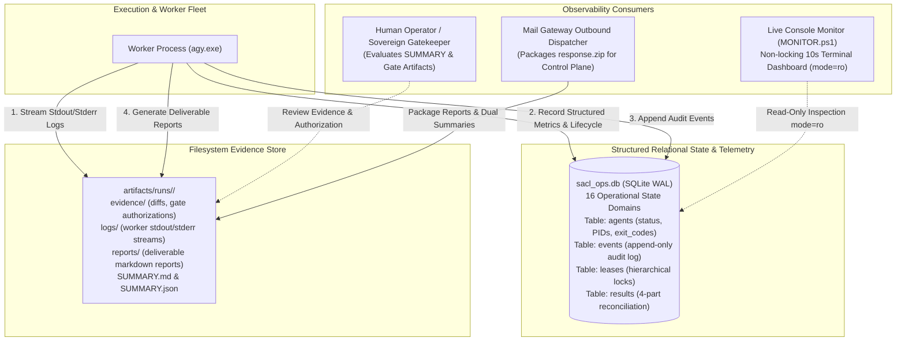
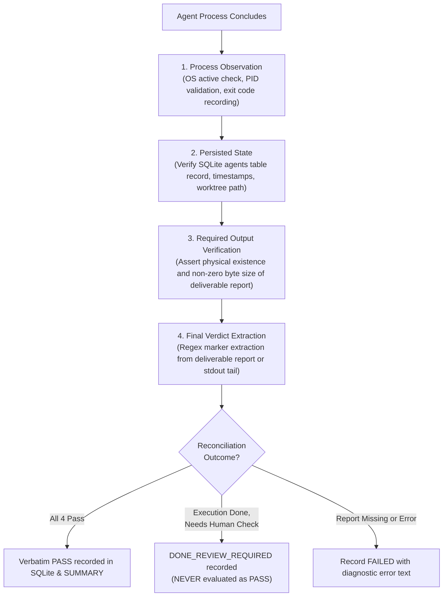

# SolidBit Agent Execution Control Loop (SACL V1) Observability & Audit Specification

> **Specification Version:** 1.0.0  
> **Target System:** Windows 10/11 Host Workstation  
> **Status:** ARCHITECTURE FREEZE / LOCAL CANONICAL BASELINE  
> **Implementation Authorization:** `IMPLEMENTATION_AUTHORIZED=NO`  
> **Authoritative Precedence:** Explicit Joaquín Decisions > Proven Current-Orchestrator Behavior > SolidBit Governance > Industry Standards (Undefined Gaps Only)  

---

## 1. Observability Architecture & Philosophy

In autonomous, multi-agent coding systems executing on developer workstations, visibility into runtime state, execution progress, failure modes, and security boundaries is critical. SACL V1 provides complete observability through a layered architecture that eliminates black-box execution:



### Core Observability Invariants
1. **Four-Part Reconciliation:** Run success is **never** determined by process exit code alone (`process_exit_code_alone_is_authoritative = false`). Reconciliation requires process observation, persisted agent state, physical output verification, and structured verdict extraction.
2. **Clear Review Semantics:** `DONE_REVIEW_REQUIRED` indicates execution completed at an authorized boundary and requires human review; it **never** means `PASS`.
3. **Dual Summary Deliverables:** Every wave generates both human-readable `SUMMARY.md` and machine-readable `SUMMARY.json`.
4. **Append-Only Immutable Auditing:** Critical events are written to SQLite `events` (`audit_events`) and cannot be modified or purged by workers.
5. **Separation of Metadata and Heavy Evidence:** Operational state resides across 16 structured SQLite domains; heavy unstructured streams (logs, diffs, deliverables) reside on the filesystem under `artifacts/runs/<runId>/`.
6. **Hierarchical Lock Telemetry:** Real-time visibility into active system, project, repo, worktree, and resource leases.

---

## 2. The 16 SQLite Operational State Domains

The local relational database (`sacl_ops.db`) partitions observability across 16 formal domains:

| # | Operational Domain | SQLite Table | Primary Telemetry & Observability Function |
| :-: | :--- | :--- | :--- |
| **1** | Schema Migrations | `schema_migrations` | Forward-only database schema version tracking and migration history. |
| **2** | Project Registry | `projects` | Registered local repositories, canonical roots, security risk tiers, and dirty-root policies. |
| **3** | Package Metadata | `packages` | Ingested archive checksums, package IDs, requested operation IDs, and admission records. |
| **4** | Transport Messages | `mail_messages` | Inbound/outbound message envelopes, nonces, `historyId` cursors, and Pub/Sub wake events. |
| **5** | Job Lifecycle | `jobs` | Logical job states (RECEIVED $\rightarrow$ ARCHIVED), routing hints, and lifecycle transitions. |
| **6** | Run Attempts | `runs` | Concrete execution runs, start/finish timestamps, overall verdicts, and integration readiness. |
| **7** | Graph Nodes | `graph_nodes` | Ephemeral DAG node definitions, phased stage assignments, and dependency edges. |
| **8** | Node Attempts | `node_attempts` | Per-node execution attempts, worker assignments, retry counts, and status transitions. |
| **9** | Agent Workers | `agents` | Worker process IDs, exit codes, assigned worktree paths, report paths, and 4-part states. |
| **10** | Audit Events | `events` (`audit_events`) | Append-only security and operational audit trail with standard taxonomy and payloads. |
| **11** | Bounded Approvals | `approvals` | Human approval requests, binding tuples (job, action, scope, request, expiration), and grants. |
| **12** | Artifact Registry | `artifacts` | Relative filesystem pointers, file sizes, MIME types, and SHA-256 hashes of disk files. |
| **13** | Result Extraction | `results` | Extracted regex markers, raw verdict lines, confidence scores, and fallback flags. |
| **14** | Hierarchical Leases | `leases` (`supervisor_locks`)| Real-time mutual exclusion tracking across system, project, repo, worktree, and resource locks. |
| **15** | Heartbeats | `heartbeats` | Timestamped liveness signals for active supervisor daemons and executing workers. |
| **16** | Diagnostic Errors | `errors` | Structured failure classification, exception stack traces, and forensic error payloads. |

---

## 3. Canonical Reconciliation Model (Four-Part Verification)

### 3.1 The Exit Code Limitation Hazard
In AI coding loops, an agent process may terminate with exit code `0` even when:
- It suffered a silent failure or hallucination loop.
- It was terminated before writing its deliverable report.
- It produced empty files or incomplete diffs.
- It hit a permission warning and aborted without throwing a fatal exception.

Conversely, a benign tool warning during an intermediate step may return a non-zero exit code while the agent successfully completed the task and generated a valid report.

### 3.2 The Four-Part Canonical Reconciliation Ladder
In accordance with the constitutional baseline, run success requires four-part holistic reconciliation:



### 3.3 Semantics of `DONE_REVIEW_REQUIRED`
When an execution wave finishes all automated tasks but requires operator inspection (e.g. governance transitions, test review, or gated changes):
- The status is recorded as `DONE_REVIEW_REQUIRED`.
- **Inviolable Invariant:** `DONE_REVIEW_REQUIRED` **never** means `PASS`. It flags that automated processing halted at a valid boundary and cannot advance to integration without human review.

---

## 4. Result Extraction Protocol & Priority Ladder

### 4.1 Deliverable Report Format
Every agent is contracted via `manifest.json` and `OUTPUT_CONTRACT.md` to produce an authoritative deliverable markdown file at `expected_report` (e.g. `reports/CHECKOUT_AUDIT.md`).

### 4.2 Canonical Regex Extraction Markers
The result extractor parses the report looking for the battle-tested regex markers:
```regex
^(?:AGENT_[A-Z0-9_-]+_RESULT|RESULT|FINAL_RESULT)\s*=\s*(PASS|PARTIAL|BLOCKED)
```
And wave-level completion markers:
```regex
(?m)^WAVE[0-9]+_RESULT=PASS\s*$
```

### 4.3 The 5-Tier Priority Ladder
When evaluating an agent's terminal verdict, the extractor executes the following deterministic priority ladder:

| Priority | Evaluation Condition | Resulting Verdict | SQLite Status | Notes |
| :-: | :--- | :--- | :--- | :--- |
| **Priority 1** | Deliverable markdown report exists on disk, is non-empty, and contains explicit regex marker `RESULT = (PASS\|PARTIAL\|BLOCKED)`. | Matches extracted marker verbatim (`PASS`, `PARTIAL`, `BLOCKED`). | `COMPLETED` | Highest authority source. |
| **Priority 2** | Deliverable report lacks marker, but tail 150 lines of worker `stdout`/`stderr` logs contain explicit regex marker. | Matches extracted log marker verbatim. | `COMPLETED` | Log fallback. |
| **Priority 3** | Process threw unhandled exception, syntax error, or fatal tool failure recorded in stderr logs. | `FAILED` | `FAILED` | Explicit error condition. |
| **Priority 4** | Process terminated with non-zero exit code and deliverable report is missing or 0 bytes. | `FAILED` | `FAILED` | Crash with missing deliverable. |
| **Priority 5** | Deliverable markdown report exists on disk, is non-empty, process exited cleanly (ExitCode 0), but report lacks explicit regex marker. | `'PASS (Report Present)'` | `COMPLETED` | **Legacy Fallback Verdict.** Preserved in SQLite CHECK constraint and JSON schema. |

### 4.4 Fallback Verdict Invariant: `'PASS (Report Present)'`
In legacy orchestrator runs, agents occasionally produced complete, high-quality markdown reports but omitted the literal `RESULT=PASS` marker line. To prevent catastrophic workflow crashes during benign omissions:
- The fallback verdict `'PASS (Report Present)'` is an explicit, valid member of the canonical verdict domain.
- Both the SQLite `agents.result_verdict` CHECK constraint and JSON schemas explicitly permit `'PASS (Report Present)'`.

---

## 5. Structured Audit Event Logging (`events` / `audit_events`)

### 5.1 Relational Audit Table Schema
Every critical operational event is recorded to the append-only `events` table in `sacl_ops.db`:

```sql
CREATE TABLE IF NOT EXISTS events (
    event_id        INTEGER PRIMARY KEY AUTOINCREMENT,
    run_id          TEXT,                           -- Associated Run ID (or NULL for system events)
    agent_id        TEXT,                           -- Associated Agent ID (or NULL)
    event_type      TEXT NOT NULL,                  -- Standard event taxonomy type
    severity        TEXT NOT NULL CHECK(severity IN ('INFO', 'WARN', 'ERROR', 'FATAL')),
    payload_json    TEXT NOT NULL,                  -- Structured JSON payload containing event context
    created_at      TEXT NOT NULL                   -- ISO-8601 UTC timestamp
);

CREATE INDEX IF NOT EXISTS idx_events_run_type ON events(run_id, event_type);
```

### 5.2 Standard Event Taxonomy

| Event Type | Severity | Description | Payload Attributes |
| :--- | :---: | :--- | :--- |
| `PUBSUB_WAKE_RECEIVED`| `INFO` | Mail Gateway receives Pub/Sub pull notification. | `message_id`, `publish_time`, `subscription` |
| `HISTORY_FETCHED` | `INFO` | Authoritative Gmail messages retrieved via `historyId`.| `history_id`, `new_messages_count` |
| `JOB_INGESTED` | `INFO` | Wave package archive ingested and recorded. | `job_id`, `nonce`, `attachment_sha`, `package_id` |
| `PREFLIGHT_PASSED` | `INFO` | Environment, tools, and manifest validated. | `job_id`, `project`, `agent_count`, `tools_verified` |
| `PROJECT_LOCK_ACQUIRED`| `INFO`| Mutating project lock claimed in `leases`. | `project_id`, `run_id`, `pid`, `expires_at` |
| `WORKTREE_PROVISIONED` | `INFO` | Isolated Git worktree created for agent. | `agent_id`, `worktree_path`, `branch`, `head_sha` |
| `PROCESS_SPAWNED` | `INFO` | Worker controller spawns `agy.exe`. | `agent_id`, `pid`, `prompt_path`, `worktree_path` |
| `HEARTBEAT_RECORDED` | `INFO` | Supervisor records liveness heartbeat. | `agent_id`, `pid`, `uptime_seconds`, `memory_mb` |
| `TIMEOUT_DETECTED` | `WARN` | Worker exceeded timeout; marked `TIMEOUT_RUNNING`. | `agent_id`, `pid`, `timeout_minutes` |
| `PID_RECYCLED_DETECTED`| `ERROR`| OS recycled PID detected; orphaned worker marked. | `agent_id`, `pid`, `expected_start`, `actual_start` |
| `CONFLICT_DETECTED` | `WARN` | Cross-agent file modification overlap detected. | `file_path`, `agents_involved`, `run_id` |
| `APPROVAL_REQUESTED` | `INFO` | Bounded approval required before proceeding. | `job_id`, `action`, `scope`, `request_id`, `expires_at` |
| `GATE_HALTED` | `INFO` | Execution halted at Human Authority Gate. | `gate_artifact`, `blockers`, `next_safe_action` |
| `RUN_COMPLETED` | `INFO` | Wave completed, reconciled, sealed, and packaged. | `run_id`, `verdict`, `duration_seconds`, `summary_path` |
| `RUN_FAILED` | `ERROR`| Wave execution aborted due to unrecoverable error. | `run_id`, `error_summary`, `failing_stage` |

---

## 6. Live Console Monitoring (`MONITOR.ps1`)

### 6.1 Terminal Monitor Protocol
Operators track multi-agent execution in real time via a dedicated PowerShell console running `scripts/MONITOR.ps1`. The monitor runs with zero locking overhead:
1. **Read-Only SQLite Connection:** Connects to `sacl_ops.db` via URI mode: `Data Source=sacl_ops.db;Mode=ReadOnly;` or `file:sacl_ops.db?mode=ro`.
2. **Refresh Cadence:** Refreshes host display every 10 seconds.
3. **Non-Intrusive Operation:** Terminable via `Ctrl+C` at any time without impacting running workers or database state.

### 6.2 ASCII Dashboard Layout
```
====================================================================================================
                        SOLIDBIT AGENT EXECUTION CONTROL LOOP (SACL V1)
====================================================================================================
 Run ID:      w0-20261007-003429-e4fa9b       Project:     solidbit-agent-execution-control-loop
 Package:     SACL-W0-ARCHITECTURE-FREEZE    Elapsed:     00:14:22
 Status:      RUNNING                         Stage:       PHASE_2_DESIGN (Phase 2/4)
----------------------------------------------------------------------------------------------------
 AGENT EXECUTION FLEET
----------------------------------------------------------------------------------------------------
 Agent ID    | Status           | PID    | Exit | Report | Verdict                | Duration
-------------+------------------+--------+------+--------+------------------------+-----------
 AG-COMPAT   | COMPLETED        | 4812   | 0    | [YES]  | PASS                   | 00:03:15
 AG-ARCH     | RUNNING          | 9240   | --   | [NO]   | IN_PROGRESS            | 00:08:42
 AG-SEC      | RUNNING          | 9316   | --   | [NO]   | IN_PROGRESS            | 00:08:35
 AG-SCHEMA   | TIMEOUT_RUNNING  | 9504   | --   | [NO]   | IN_PROGRESS            | 00:12:10
 AG-QA       | SCHEDULED        | --     | --   | [NO]   | UNKNOWN                | --
 AG-FINAL    | SCHEDULED        | --     | --   | [NO]   | UNKNOWN                | --
----------------------------------------------------------------------------------------------------
 CONCURRENCY & LEASES
----------------------------------------------------------------------------------------------------
 Active Workers: 3 / 3 (MaxParallel Limit Reached)
 Leases:         SYSTEM (PID 2108), PROJECT_solidbit (MUTATING - Active)
 Alerts:         [WARN] AG-SCHEMA exceeded 10m timeout -> Transitioned to TIMEOUT_RUNNING (Alive)
 Conflicts:      None detected.
====================================================================================================
 [Press Ctrl+C to exit monitor. Running agents and supervisors will NOT be terminated.]
```

---

## 7. Filesystem Artifact & Evidence Architecture

### 7.1 Hierarchical Directory Layout
All unstructured and heavy execution artifacts are stored in `artifacts/runs/<runId>/`:

```
artifacts/runs/w0-20261007-003429-e4fa9b/
├── evidence/
│   ├── git-diffs.patch                           # Aggregated diffs across all agent branches
│   ├── commit-shas.json                          # Commit SHAs per agent worktree
│   └── FINAL_DEVELOPMENT_AUTHORIZATION.txt       # Gated human authorization request artifact
├── logs/
│   ├── AG-COMPAT.stdout.log                      # Streamed stdout from agy.exe
│   ├── AG-COMPAT.stderr.log                      # Streamed stderr from agy.exe
│   ├── AG-ARCH.stdout.log
│   ├── AG-ARCH.stderr.log
│   └── supervisor.trace.log                      # Graph-P execution trace log
├── reports/
│   ├── AG-COMPAT.REPORT.md                       # Deliverable markdown report from Agent 1
│   ├── AG-ARCH.REPORT.md                         # Deliverable markdown report from Agent 2
│   ├── AG-SEC.REPORT.md
│   ├── AG-SCHEMA.REPORT.md
│   ├── AG-QA.REPORT.md
│   └── AG-FINAL.REPORT.md
├── state/
│   ├── manifest.copy.json                        # Copy of package manifest executed
│   └── run_snapshot.json                         # Cold-start recovery snapshot
├── SUMMARY.md                                    # Human-readable execution summary
├── SUMMARY.json                                  # Machine-readable validated universal summary
└── response.zip                                  # Packaged archive ready for email dispatch
```

### 7.2 Mandatory Dual Deliverables
Every completed wave must generate both summary formats:
1. **`SUMMARY.md`:** Human-readable markdown document required for developer inspection. Captures executive summary, agent status table, file collision matrix, and next safe actions.
2. **`SUMMARY.json`:** Machine-readable universal summary validating against `schemas/summary.schema.json`. Contains structured verdicts, error summaries, and gating flags (`implementation_authorized=false`).

---

## 8. Transport Telemetry & Outbound Reporting

### 8.1 Outbound Response Packaging
Upon run completion, the Mail Gateway packages the response:
1. Verifies presence of both `SUMMARY.md` and `SUMMARY.json`.
2. Collects all files in `reports/` and `evidence/`.
3. Creates `artifacts/runs/<runId>/response.zip`.
4. Queues a message in `mail_messages` with recipient, subject line referencing the originating thread, and attachment path.

### 8.2 Thread Tracking Headers
The outbound email includes RFC 2822 threading headers:
- `Subject: Re: [SACL][JOB][v1][<JOB_ID>] - [STATUS: PASS]`
- `In-Reply-To: <orig_message_id>`
- `References: <orig_message_id>`

This guarantees that execution reports arrive directly inside the originating conversation thread in the operator's mailbox.
