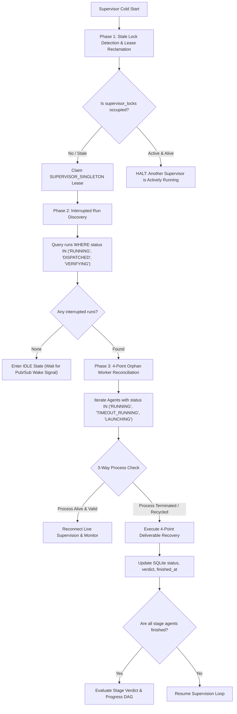

# SACL V1 Crash Recovery, State Reconciliation & Replay Model

## 1. Executive Summary & Recovery Philosophy

This document defines the cold-start crash recovery, orphan worker reconciliation, at-least-once transport handling, and idempotent replay architecture for the SolidBit Agent Execution Control Loop (SACL V1).

### 1.1 Constitutional Precedence Hierarchy
This recovery model strictly adheres to the constitutional hierarchy:
1. **Explicit Joaquín decisions:**
   - SQLite `sacl_ops.db` serves as the Operational State Store.
   - Heavy execution artifacts (logs, diffs, reports) reside strictly in the filesystem.
   - Engineering Analytics Warehouse is deferred.
   - Remote production execution is disabled in V1.
   - Mail Gateway and Graph-P are separated; zero idle token burn.
2. **Proven current-orchestrator behavior:**
   - **Local Dirty-Root Rule during recovery:** Automation NEVER uses `git reset --hard`, `git clean -fd`, or automatic `git stash`. If uncommitted human work blocks recovery, execution halts immediately with `HALTED_SAFETY` / `BLOCKED`.
   - **PID recycling defense:** 3-way check with 300-second start-time drift tolerance.
   - **Regex deliverable extraction ladder:** Structured markers in reports take precedence over process exit codes.
3. **Existing governance and contracts:**
   - Manifest package integrity (`manifest.json`, `checksums.sha256`).
   - Output contracts requiring dual summaries (`SUMMARY.md` and `SUMMARY.json`).
4. **W0.1 / W0.2 Remediation Baselines:**
   - **Core Reconciliation Mandate:** Run success and worker completion MUST reconcile: process observation + persisted state + required outputs + final verdict. Process.ExitCode alone is insufficient.
   - **Inviolable Recovery Invariant:** The recovery engine **NEVER blindly restarts old RUNNING** tasks or jobs. It inspects process observation, persisted state, and required outputs before deciding whether to resume supervision, reconcile results, or transition to `INTERRUPTED` / `FAILED`.
   - **Review Semantic:** `DONE_REVIEW_REQUIRED` means execution completed and requires human review; it never means `PASS`.
   - **Fallback Verdict:** Preserve legacy fallback verdict `'PASS (Report Present)'` in the canonical result domain.

---

## 2. Fundamental Recovery Invariants

```
+========================================================================================================+
|                                    SACL V1 RECOVERY INVARIANTS                                         |
+========================================================================================================+
| 1. Process.ExitCode ALONE is INSUFFICIENT to determine success.                                        |
|    A process that exited with code 0 but produced no deliverable report is FAILED (NO_EVIDENCE_FOUND).  |
|    A process that exited with code 1 due to CLI store shutdown but produced a complete passing report   |
|    and clean commits is evaluated by evidence, not raw exit code.                                      |
|                                                                                                        |
| 2. NEVER BLINDLY RESTART OLD RUNNING JOBS.                                                             |
|    When an orchestrator discovers a run or job in status 'RUNNING', it MUST NOT blindly re-launch it.   |
|    It executes 4-pillar reconciliation: checks if the worker process is still alive via 3-way check,   |
|    inspects on-disk deliverables, and evaluates verdicts.                                              |
|                                                                                                        |
| 3. ZERO WORKSPACE DESTRUCTION.                                                                         |
|    Recovery scripts NEVER run 'git reset --hard', 'git clean -fd', or 'git stash' on primary checkouts |
|    or agent worktrees. Human uncommitted work is inviolable.                                           |
|                                                                                                        |
| 4. AT-LEAST-ONCE TRANSPORT WITH IDEMPOTENT CONSUMERS.                                                  |
|    Network and transport layers may deliver duplicate messages. Consumers deduplicate via nonces and   |
|    guarantee idempotent side effects.                                                                  |
|                                                                                                        |
| 5. IMMUTABLE CHECKPOINTED PHASES.                                                                      |
|    Stages that completed with verified passing verdicts are NEVER re-executed during crash recovery.   |
+========================================================================================================+
```

---

## 3. Supervisor Cold-Start Recovery Workflow

When the SACL supervisor boots or restarts after an unexpected termination (e.g. host reboot, PowerShell terminal closure, power failure, or process kill), it executes a deterministic 3-phase cold-start recovery sequence:



### 3.1 Phase 1: Stale Lock Detection & Lease Reclamation
1. Inspect table `leases` and `supervisor_locks` for `lease_name = 'SUPERVISOR_SINGLETON'`.
2. If lease exists:
   - Check `expires_at`: If current UTC time $< \text{expires\_at}$, the lease is nominally active.
   - Execute the 3-way check on `holder_pid`:
     - If `Test-AgentProcessRunning -ProcessId holder_pid` returns `$true`, an active supervisor is legitimately executing. The starting process halts with: `SUPERVISOR_ALREADY_ACTIVE`.
     - If `holder_pid` is not running or start time has drifted $> 300\text{s}$, the lease is an abandoned orphan.
3. Release the orphaned lease, log an event (`STALE_LOCK_RECLAIMED`), and claim the lease with current PID and a fresh 60-second expiration window.

### 3.2 Phase 2: Interrupted Run Discovery
1. Query table `runs` for runs with `status IN ('RUNNING', 'DISPATCHED', 'VERIFYING', 'QUEUED')`.
2. If no interrupted runs exist, the supervisor transitions to `IDLE` (monitoring Gmail Pub/Sub wake signals with zero token burn).
3. If an interrupted run is discovered:
   - Load run metadata and target repository path.
   - Verify target repository clean root status:
     - Run `git status --porcelain` on primary product checkout.
     - If human uncommitted files exist, **HALT** immediately with status `BLOCKED` (or `HALTED_SAFETY`) and log error: `DIRTY_ROOT_BLOCKS_RECOVERY`.
   - Retrieve all stages and agent execution records for the active run.

### 3.3 Phase 3: Orphan Worker Reconciliation Loop
For each agent associated with the run where `status IN ('RUNNING', 'TIMEOUT_RUNNING', 'LAUNCHING')`:
1. Execute the 3-way process identity check (`Test-AgentProcessRunning`).
2. If the process is still running with valid start time:
   - The worker survived the supervisor crash. Reconnect supervisor monitoring and update `updated_at` heartbeat.
3. If the process has terminated (or the PID was recycled):
   - The worker stopped while the supervisor was down. Trigger **4-Point Deliverable Recovery** (Section 4).

---

## 4. The 4-Point Reconciliation Protocol

To satisfy the constitutional requirement that **Process.ExitCode alone is insufficient**, the reconciliation engine evaluates four independent evidence pillars:

```
+========================================================================================================+
|                                    4-POINT RECONCILIATION PILLARS                                      |
+========================================================================================================+
| Pillar 1: PROCESS OBSERVATION                                                                          |
|           - Query OS process table by recorded PID                                                     |
|           - Validate image name against whitelist ('agy', 'powershell', 'pwsh', 'cmd', 'node')        |
|           - Verify start-time drift: |proc.StartTime - startedAt| <= 300 seconds                       |
|           - Inspect exit code if process termination object was captured                               |
|                                                                                                        |
| Pillar 2: PERSISTED STATE                                                                              |
|           - Read state record from SQLite 'agents' and 'graph_nodes' tables                            |
|           - Check if agent was previously flagged 'TIMEOUT_RUNNING' or 'STOPPED'                       |
|                                                                                                        |
| Pillar 3: REQUIRED OUTPUTS                                                                             |
|           - Verify presence and non-zero byte size of deliverable report on disk (report_path)         |
|           - Check worker stdout log (stdout_path) and stderr log (stderr_path)                         |
|           - Inspect agent worktree git status: verify 'status --porcelain' cleanliness                 |
|           - Inspect git commit log in worktree branch: verify commit created by agent                  |
|                                                                                                        |
| Pillar 4: FINAL VERDICT EXTRACTION                                                                     |
|           - Bottom-up scan of report for structured regex marker:                                      |
|             ^(?:AGENT_[A-Z0-9_-]+_RESULT|RESULT|FINAL_RESULT)\s*=\s*(PASS|PARTIAL|BLOCKED)             |
|           - Top-25 lines scan for Markdown header status:                                              |
|             (?:Final Status|Status)\s*:\s*\*{0,2}(PASS|COMPLETE\s*/\s*VERIFIED)                        |
|           - Tail 150 lines scan of stdout/stderr logs for structured markers                           |
|           - Fallback evaluation: 'PASS (Report Present)' or 'DONE_REVIEW_REQUIRED'                     |
+========================================================================================================+
```

---

## 5. Reconciled Outcome Matrix

The following decision matrix determines the final reconciled state and verdict:

| Pillar 1: Process Observation | Pillar 3: Report & Output Check | Pillar 3: Worktree Status | Pillar 4: Extracted Verdict | Reconciled Agent Status | Reconciled Graph Node State | Reconciled Result Verdict |
| :--- | :--- | :--- | :--- | :---: | :---: | :--- |
| **Dead** (Exited 0 or captured) | Report exists, non-empty | Clean (`porcelain` empty), commits exist | `PASS` | `COMPLETE` | `SUCCEEDED` | `PASS` |
| **Dead** (Exited 0 or captured) | Report exists, non-empty | Clean, commits exist | `PARTIAL` | `COMPLETE` | `SUCCEEDED` | `PARTIAL` |
| **Dead** (Exited 0 or captured) | Report exists, non-empty | Clean, commits exist | None (No regex marker) | `COMPLETE` | `SUCCEEDED` | `PASS (Report Present)` |
| **Dead** (Exited 0 or captured) | Report exists, non-empty | Clean, commits exist | Report states review required | `COMPLETE` | `WAITING_APPROVAL` | `DONE_REVIEW_REQUIRED` |
| **Dead** (Any exit code) | Report exists, non-empty | Any | `BLOCKED` | `FAILED` | `BLOCKED` | `BLOCKED` |
| **Dead** (Exit Code == 0) | **Missing or 0 bytes** | Clean or dirty | None | `FAILED` | `FAILED` | `NO_EVIDENCE_FOUND` |
| **Dead** (Exit Code != 0) | Missing or 0 bytes | Any | Fatal strings in stderr | `FAILED` | `FAILED` | `CRASHED_OR_ERROR` |
| **Dead** (Any exit code) | Report exists, non-empty | **Dirty** (Uncommitted changes exist) | `PASS` | `FAILED` | `FAILED` | `UNCOMMITTED_CHANGES_ON_RECOVERY` |
| **Dead** (Stop signal sent) | Missing report | Any | None | `STOPPED` | `CANCELLED` | `STOPPED_BY_USER` |
| **Alive** (Verified by 3-way) | Report in-progress | Clean or in-progress | In-progress | `RUNNING` | `RUNNING` | `IN_PROGRESS` |
| **Alive** (Verified by 3-way) | Elapsed $>$ timeout | Clean or in-progress | In-progress | `TIMEOUT_RUNNING` | `RUNNING` | `IN_PROGRESS` |
| **Dead** (PID Recycled) | Unknown | Unknown | Unknown | `UNKNOWN` | `FAILED` | `NO_EVIDENCE_FOUND` |

---

## 6. The Inviolable Invariant: Never Blindly Restart Old RUNNING

In naive automation systems, a reboot or daemon crash often triggers a simplistic query:
```sql
-- DANGEROUS / FORBIDDEN PATTERN:
SELECT run_id FROM runs WHERE status = 'RUNNING';
-- Blindly re-launching these runs results in data loss!
```

### 6.1 Why Blind Restarts Are Prohibited
1. **Destruction of Valid Work:** The crashed daemon may have died while workers were in the final milliseconds of committing git diffs or writing deliverable reports. Restarting the job wipes or overwrites completed deliverables.
2. **Double Execution & Race Conditions:** If the child worker survived the daemon crash, blindly re-spawning a new worker process causes two agents to simultaneously write to the same branch or worktree, corrupting git history.
3. **Loss of Forensics:** Re-spawning overwrites stdout and stderr logs, destroying evidence needed to diagnose why the host crashed.

### 6.2 Canonical Reconciliation Protocol for Interrupted Runs
Instead of restarting, SACL V1 executes the following sequence:
1. **Process Liveness Verification:** Check if the child worker process is still alive in the OS using `Test-AgentProcessRunning`. If alive, reconnect supervision.
2. **Deliverable Verification:** If the process is dead, evaluate whether deliverables already exist on disk. If complete passing reports exist, reconcile the state to `COMPLETE` (`SUCCEEDED`) without running the worker again.
3. **Mark as Interrupted / Failed:** If the process is dead and outputs are missing, mark the run as `INTERRUPTED` or `FAILED`. Re-execution requires a fresh, idempotent job attempt with a new run ID and distinct attempt logs.

---

## 7. Local Dirty-Root Safety Rule During Recovery

Under **NO** circumstances will automated recovery scripts issue:
```powershell
# FORBIDDEN COMMANDS DURING RECOVERY:
git reset --hard
git clean -fd
git checkout -f
git stash
```

### 7.1 Rationale
Human developers may leave uncommitted changes or experimental edits in the primary product checkout. An automated recovery script that wipes uncommitted changes or automatically stashes them can cause irrecoverable data loss or create merge conflicts upon stash pop.

### 7.2 Recovery Dirty-Root Policy
1. Before performing any recovery action on a worktree or primary repo, test clean status:
   ```powershell
   $status = git -C $repoPath status --porcelain
   if (-not [string]::IsNullOrWhiteSpace($status)) {
       throw "DIRTY_ROOT_HALT: Uncommitted changes detected in $repoPath. Recovery aborted for safety."
   }
   ```
2. If the primary checkout is dirty, recovery halts with status `BLOCKED` (or `HALTED_SAFETY`).
3. If an agent worktree is dirty during recovery, the worktree is preserved as forensic evidence, and the agent status is marked `FAILED` with verdict `UNCOMMITTED_CHANGES_ON_RECOVERY`.

---

## 8. Transport Replay & Idempotency Contracts

### 8.1 Mail Gateway Deduplication Contract
Inbound messages processed by the Mail Gateway comply with strict idempotency rules:
1. **Primary Key Deduplication:** Inbound emails are indexed by `message_id` and unique `nonce` in table `mail_messages`.
2. **Duplicate Arrival:** If a message with an already-recorded `(message_id, nonce)` arrives:
   - Status is marked `DUPLICATE_IGNORED`.
   - The message is acknowledged at the transport layer.
   - **No new execution run is spawned.**
3. **Valid Retries:** If a wave is re-submitted with a new `nonce` and matching package hash, a new execution attempt is initiated while the logical job history is preserved.

### 8.2 Atomic Output File Generation
All output artifacts generated during recovery and finalization use atomic write-and-rename patterns to prevent partially-written files from being ingested by downstream readers:
```powershell
$tmpFile = "$targetPath.tmp"
$content | Set-Content -LiteralPath $tmpFile -Encoding UTF8
Move-Item -LiteralPath $tmpFile -Destination $targetPath -Force
```

### 8.3 Dual Summary Contract
Upon run completion or sealing, both summary formats are deterministically generated:
1. `runs/<runId>/SUMMARY.md`: Human-readable markdown summary embedded in email dispatch.
2. `runs/<runId>/SUMMARY.json`: Machine-readable summary validating against `schemas/summary.schema.json`.

Both files are validated on disk before `runs.status` transitions to `COMPLETED` or `FAILED`.
