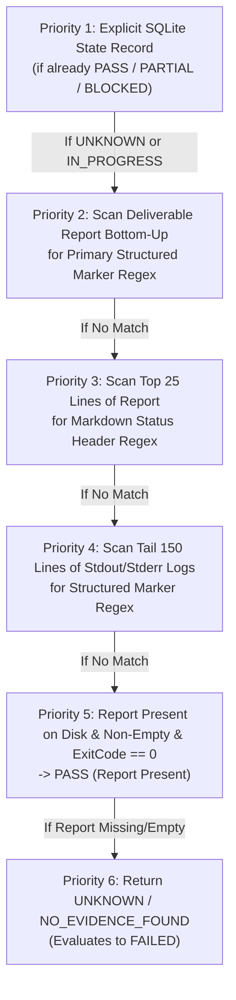

# SACL V1 Result Protocol & Reconciliation Specification (RESULT_PROTOCOL)

**Specification ID:** SACL-SPEC-RES-v1  
**Status:** ARCHITECTURE FREEZE / LOCAL CANONICAL BASELINE (Wave 0.2 Consistency Remediation)  
**Authoritative Precedence:** Explicit Joaquín Decisions > Proven Current-Orchestrator Behavior > SolidBit Governance > Industry Standards  

---

## 1. Executive Summary & Core Invariants

The SACL V1 Result Protocol defines the authoritative mechanism for extracting, evaluating, reconciling, and recording agent deliverable outcomes across multi-agent execution runs.

### 1.1 The Canonical Reconciliation Invariant
**Run success MUST NOT depend on `$Process.ExitCode` alone.** An exit code of `0` indicates only that the host process launcher terminated without an unhandled operating system exception. It does *not* prove that the agent followed its prompt, satisfied its acceptance criteria, generated its deliverable report, or achieved a successful verdict.

In SACL V1, run and agent success are determined through **4-Dimensional Canonical Reconciliation**:
1. **Process Observation:** OS PID verification, process name whitelisting, and a 300-second start-time drift check to defeat PID recycling.
2. **Persisted Agent State:** Transactional state recorded in SQLite `sacl_ops.db` (`agents` table).
3. **Required Outputs:** Physical existence, non-zero size, and deterministic structure of expected deliverable files on disk.
4. **Final Verdict:** Structured regex deliverable markers extracted from deliverable reports.

### 1.2 Canonical Lifecycle Alignment
Reconciliation operates across the canonical job lifecycle:
$$\text{RECEIVED} \rightarrow \text{AUTHENTICATED} \rightarrow \text{VALIDATED} \rightarrow \text{PERSISTED} \rightarrow \text{QUEUED} \rightarrow \text{DISPATCHED} \rightarrow$$
$$\text{RUNNING} \rightarrow \text{VERIFYING} \rightarrow \text{RESULT\_PACKAGED} \rightarrow \text{RESULT\_SENT} \rightarrow \text{COMPLETED} \rightarrow \text{ARCHIVED}$$

Along with canonical side states:
- `WAITING_APPROVAL`: Job paused awaiting bounded human sign-off (`schemas/approval.schema.json`). Resumes the same logical run upon approval.
- `RETRY_WAIT`: Transient backoff prior to retry attempt.
- `BLOCKED`: Precondition or dependency unsatisfied.
- `FAILED`: Unrecoverable execution error.
- `CANCELLED`: Explicit human cancellation.
- `INTERRUPTED`: Host restart or SIGINT.
- `TIMED_OUT`: Diagnostic timeout reached (process left alive for forensic inspection).
- `POLICY_DENIED`: Violation of hard local policy, project policy, or permission lattice.
- `REJECTED`: Admission rejection.
- `QUARANTINED`: Suspicious archive or payload isolated for analysis.

---

## 2. Canonical Verdict Domain & Semantics

Every agent execution resolves to exactly one canonical verdict. The result domain is formally defined as:

| Verdict | Definition | Semantic Invariant |
| :--- | :--- | :--- |
| `PASS` | Execution completed successfully; all acceptance criteria met; deliverable verified. | Positive sign-off. |
| `PARTIAL` | Execution completed with minor, non-blocking discrepancies or warnings. | Non-blocking completion. |
| `BLOCKED` | Execution halted due to an external dependency, policy violation, or human gate. | Pipeline halted safely. |
| `FAILED` | Process error, syntax error, unhandled exception, missing deliverable, or fatal test failure. | Requires remediation. |
| `PASS (Report Present)` | Legacy fallback verdict preserved from `orchestrator-common.ps1#L309`. Report file exists and is non-empty with clean process exit, but lacks structured regex marker. | Preserved legacy fallback. |
| `DONE_REVIEW_REQUIRED` | Execution completed physically and requires human or senior review. | **NEVER means PASS.** Requires explicit review before downstream use. |
| `STOPPED_BY_USER` | Agent was stopped manually by an operator via `STOP.ps1` or `stop-agents.ps1`. | Operator intervention. |
| `IN_PROGRESS` | Agent process is actively executing or scheduled. | Transient non-terminal state. |
| `UNKNOWN` | Process terminated without evidence or PID could not be reconciled. | Evaluates to FAILED. |

> [!IMPORTANT]
> `DONE_REVIEW_REQUIRED` indicates that an agent completed its operations and produced reviewable artifacts, but its outputs mandate human scrutiny. It must **never** be treated as equivalent to `PASS`.

---

## 3. Canonical Regex Extraction Markers

Agents are required by contract to place structured, machine-readable result markers at the conclusion of their deliverable reports. SACL V1 codifies the proven regex patterns from `Stable-Ecommerce-Orchestrator`:

### 3.1 Primary Structured Marker
Proven in `orchestrator-common.ps1#L276-L325`:
```regex
^(?:AGENT_[A-Z0-9_-]+_RESULT|RESULT|FINAL_RESULT)\s*=\s*(PASS|PARTIAL|BLOCKED)
```
*Valid Example:*
```text
AGENT_PROTOCOL_MAT_RESULT = PASS
```

### 3.2 Wave Summary Marker
Proven in `RUN-WAVE3.ps1`:
```regex
(?m)^WAVE3_RESULT=PASS\s*$
```

### 3.3 Markdown Header Status Pattern (Fallback)
Proven in `orchestrator-common.ps1`:
```regex
(?:Final Status|Status)\s*:\s*\*{0,2}(PASS|COMPLETE\s*/\s*VERIFIED)
```
*Valid Example:*
```markdown
**Final Status:** PASS
```

---

## 4. Priority Ladder for Result Verdict Extraction

The Result Extractor parses agent deliverables in strict descending order of authority:



### 4.1 Evaluation Rules
1. **Priority 1 (Database State):** If SQLite `agents` table already contains an authoritative terminal verdict (`PASS`, `PARTIAL`, `BLOCKED`), it is respected unless an active reconciliation pass is triggered.
2. **Priority 2 (Report Bottom-Up):** The deliverable report at `report_path` is scanned starting from the last line backwards. The first valid primary regex match determines the verdict.
3. **Priority 3 (Header Fallback):** The first 25 lines of the report are inspected for standard markdown status headers.
4. **Priority 4 (Log Scan):** If the report contains no marker, the final 150 lines of `stdout` and `stderr` logs are scanned for structured markers.
5. **Priority 5 (Legacy Fallback):** If the report physically exists on disk, has file size > 0 bytes, and the process recorded an exit code of `0`, the verdict resolves to `PASS (Report Present)`.
6. **Priority 6 (Failure):** If no deliverable exists and no marker is found, the status resolves to `FAILED` with reason `NO_EVIDENCE_FOUND`.

---

## 5. Process Observation & PID Recycling Defense

Windows frequently recycles Process IDs (PIDs). A supervisor checking only `$proc.HasExited` or `Get-Process -Id $pid` risks interacting with an unrelated operating system process that inherited the worker's PID.

SACL V1 enforces the proven 3-way check from `orchestrator-common.ps1#L159-L205`:

```powershell
function Test-AgentProcessRunning {
    param([int]$ProcessId, [string]$PersistedStartTime)
    
    # Check 1: Process existence in OS
    $proc = Get-Process -Id $ProcessId -ErrorAction SilentlyContinue
    if (-not $proc -or $proc.HasExited) { return $false }

    # Check 2: Process image whitelist
    $allowedImages = @('agy', 'powershell', 'pwsh', 'cmd', 'node', 'conhost')
    if ($allowedImages -notcontains $proc.ProcessName.ToLower()) {
        return $false
    }

    # Check 3: Start-time drift guard (max 300 seconds)
    if ($PersistedStartTime) {
        $recordedTime = [DateTime]::Parse($PersistedStartTime).ToUniversalTime()
        $actualTime = $proc.StartTime.ToUniversalTime()
        $driftSeconds = [Math]::Abs(($actualTime - $recordedTime).TotalSeconds)
        if ($driftSeconds -gt 300) {
            # PID was recycled by an unrelated process!
            return $false
        }
    }
    return $true
}
```

---

## 6. Cross-Agent File Overlap & Collision Protocol

When multiple agents execute concurrently in isolated Git worktrees, they may modify the same source or documentation files, causing catastrophic merge conflicts upon integration.

SACL V1 standardizes the overlap detection algorithm from `collect-results.ps1#L98-L136`:

### 6.1 Collision Detection Workflow
1. **Diff Collection:** Upon stage completion, query git across all active agent worktrees:
   ```powershell
   git -C $worktreePath diff --name-only origin/main...HEAD
   ```
2. **Path Normalization:** Normalize file paths to lower-case, forward-slash relative format (e.g., `docs/architecture/spec.md`).
3. **Database Registration:** Record every modified file in SQLite table `file_modifications`:
   ```sql
   INSERT INTO file_modifications (run_id, agent_id, file_path, change_type, recorded_at)
   VALUES (:run_id, :agent_id, :file_path, 'MODIFIED', :now);
   ```
4. **Conflict Evaluation Query:**
   ```sql
   SELECT file_path, GROUP_CONCAT(agent_id, ', ') AS agents, COUNT(DISTINCT agent_id) AS agent_count
   FROM file_modifications
   WHERE run_id = :run_id
   GROUP BY file_path
   HAVING agent_count > 1;
   ```
5. **Gating Enforcement:**
   If any collision is returned:
   - Rows are inserted into `file_conflicts`.
   - SQLite `runs.ready_for_integration` is set strictly to `'NO'`.
   - A critical blocker is registered: `"Overlapping file modifications detected across parallel branches."`
   - Downstream integration agents (`AG-QA`, `AG-FINAL`) and merge scripts are hard-blocked from proceeding.

---

## 7. Dual Deliverable Packaging Contract: SUMMARY.md & SUMMARY.json

Every wave run must materialize both canonical summary formats under `runs/<runId>/`:

1. **`SUMMARY.md` (Human Review Format):**
   - High-level verdict badge and run metadata.
   - Comprehensive agent status table: `Agent | Status | Exit Code | Report | Verdict`.
   - File collision and overlap report.
   - Immediate Next Safe Action.
2. **`SUMMARY.json` (Machine Governance Format):**
   - Strictly conforms to [summary.schema.json](file:///C:/Users/Lucilfer/Documents/solidbit-agent-execution-control-loop/schemas/summary.schema.json).
   - Validates `architecture_freeze_ready`, `ready_for_integration`, and records `implementation_authorized: boolean`.
   - In Wave 0, Wave 0.1, and Wave 0.2, `implementation_authorized: false` is maintained.
   - In subsequent functional development waves, `implementation_authorized` may reflect `true` when explicit human sign-off is granted.
   - **Evidence vs Authority Principle:** A boolean flag in `SUMMARY.json` is purely recorded evidence of human authorization, not the source of authority. Execution authority is derived strictly from human sign-off bound by the effective-permission lattice.
