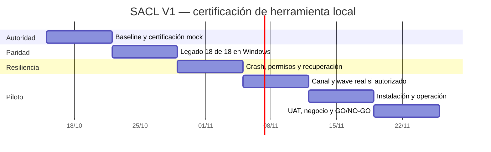

# SolidBit SACL — Roadmap de ingeniería para MVP comercial certificable

**Corte:** 2026-10-14 · **Repositorio:** `risejoaquin/solidbit-agent-execution-control-loop` · **Base inspeccionada:** `AC-CONT@d0429459b9caf13d1941b514371847a48409b1ad` · **PR:** #3 borrador · **Estado:** NO-GO operativo/comercial.

**Objetivo V1 vendible:** orquestador **local** para ejecutar paquetes de trabajo de agentes en Windows, con control de permisos, directorios Git aislados, ejecución DAG, SQLite persistente, reanudación segura, evidencia reproducible y escalamiento humano. **No** habilitar ejecución remota de producción, merges automáticos ni acceso libre a Jira/Railway. Monetización inicial: servicio gestionado de automatización de ingeniería/casos internos, no SaaS multiusuario hasta certificación y nueva política.

**Regla constitucional:** `DECISION_BASELINE.md` y `contracts/architecture-invariants.json` son autoridad superior. Declaran `IMPLEMENTATION_AUTHORIZED=NO`: existencia de código y CI **no** habilita ejecución real ni cambia ese flag. Modificar autorización requiere decisión explícita del PO y revisión formal; estándares rellenan huecos, no reemplazan reglas previas. Mantener `Stable-Ecommerce-Orchestrator` intacto mientras falta paridad.

## 1. Inventario de código e interpretación de evidencia

| Subsistema | Existente inspeccionado | Test/artefacto localizable | Diferencia con operación real |
|---|---|---|---|
| CLI y control de entrada | `src/sacl/cli/main.py`, `launch.py`, `status.py`, `stop.py` | `tests/integration/cli/test_cli_integration.py` | Probar secuencia completa en Windows real con script aprobado |
| Supervisor Graph-P | `src/sacl/supervisor/graph_p.py`, `dispatcher.py`, `lease.py` | `tests/integration/supervisor/test_supervisor_workflow.py` | Medir IDLE sin procesos LLM, arranque y stop en host |
| DAG / worktree / colisión | `src/sacl/dag/scheduler.py`, `src/sacl/dag/collision.py`, `src/sacl/security/guards.py` | `tests/integration/dag_worker/test_dag_worker_integration.py`; `tests/security/test_workspace_fail_closed.py` | Certificar no mutar root principal y ownership con Git/agy reales bajo permiso |
| SQLite WAL estado | `src/sacl/state/connection.py`, estructura state y 16 dominios | `tests/e2e/test_mock_certification.py`, `tests/integration/recovery/test_restart_reconciliation.py` | Recuperación crash OS/proceso y leases en local real |
| Autorización/fail-closed | `src/sacl/policy/hard_policy.py`, `lattice.py`, `src/sacl/approval/` | `tests/governance/test_frozen_authority.py`, `tests/security/test_threat_model_stride.py` | Cadena de aprobación humana autenticada y revocación real |
| Mail gateway y transporte | `src/sacl/transport/gmail_adapter.py`, `gateway.py`, `watch.py`, `pubsub.py` | `tests/integration/transport/test_transport_gateway.py` | Hay adapter + **MockGmailApiAdapter**; Gmail OAuth/PubSub reales no certificados |
| Recuperación y PID | `src/sacl/recovery/startup_reconciliation.py`, `process_identity.py` | `tests/unit/recovery/test_startup_reconciliation.py` | Fallos host, PID reciclado, orphan agents y seguridad al reiniciar |
| Resultados y auditoría | `src/sacl/results/collector.py`, `reconciler.py`, `packager.py` | `tests/unit/results/test_4point_reconciliation.py`, `test_dual_summary_contracts.py` | Validación de informes reales, cero entrega corrupta/collision |
| CI y seguridad | `.github/workflows/ci.yml`, `codeql.yml` | CI mock Windows/Linux y CodeQL **SUCCESS** para AC-CONT de corte | CodeQL verde no prueba 0 alertas; E2E host/prod no está ejecutado |

Fuente de contraste: `docs/AC_CONT_SPRINT_REVIEW.md`, `docs/E2E_CERTIFICATION_PLAN.md`, `README.md`. La revisión de sprint explícitamente marca **issue #6 bloqueado**: paridad con legado 18/18 en Windows host; GitHub Actions solo cubre ensayo simulado de 8 pasos. No atribuir E2E real a CI mock. PR #7 es un roadmap comercial anterior borrador; este archivo incorpora mapeo a clases y gates de host.

## 2. Definición de MVP de operación y de negocio

**Etapa A — herramienta interna aceptada:** sin envío Gmail real y sin agentes reales, demostrar 8/8 pasos mock y fail-closed en Windows; recuperación de proceso, aislamiento, registro de evidencias, stop y autorización. Ésta **no** es operación comercial.

**Etapa B — piloto de operación local bajo autorización PO:** en entorno Windows descartable, con controles aprobados y credenciales gestionadas, ejecutar 1 wave real segura de mínimo privilegio y 3 escenarios de falla; cotejar con legado **18/18 capacidades** sin regresión. Aprobación humana antes de cada acción externa; no auto-merge ni prod.

**Etapa C — oferta pagada:** servicio de automatización administrada con onboarding, soporte, límites/costos, aislamiento por cliente, política de aprobaciones, trazabilidad y contrato de responsabilidad. Si no se permite todavía el transporte real, **no vender ejecución automatizada de terceros**; ofrecer preparación/auditoría como servicio distinto y explícito.

## 3. Matriz de aceptación `SACL-ACC`

| ID | Condición de PASS / evidencia |
|---|---|
| SACL-ACC-01 | `DECISION_BASELINE` respetado; arranque sin autorización = DENIED y 0 mutations |
| SACL-ACC-02 | Manifiesto ZIP inválido, traversal, hijack de rutas, prompt no autorizado → cuarentena; log estructurado sin secretos |
| SACL-ACC-03 | Graph-P realmente IDLE sin workers ni tokens cuando cola vacía; Graph-H nace/termina por wave |
| SACL-ACC-04 | Worktree único por agente, root sucio intocable, main/release protegidos, permiso mínimo y 1 mutación/proyecto |
| SACL-ACC-05 | Crash/restart recupera SQLite WAL, estado, heartbeats, locks y PID sin duplicar ejecución peligrosa |
| SACL-ACC-06 | Stop seguro, timeout diagnóstico **no mata** procesos indebidamente; evidencias SUMMARY.md + SUMMARY.json consistentes |
| SACL-ACC-07 | Correo/API de transporte: recepción, reintento, dedup, suplantación rechazada; transporte no otorga autoridad |
| SACL-ACC-08 | 8/8 ensayo E2E inofensivo Windows + **18/18** paridad legado en host seguro con acta firmada |
| SACL-ACC-09 | Aprobación humana explícita y comprobable en cada operación mutante externa; nada contra prod/merge |
| SACL-ACC-10 | Instalación local repetible, logs redacted, backup/restore, diagnóstico y rollback de versión; UAT de cliente |
| SACL-ACC-11 | Oferta/piloto con alcance y precio aprobados, medición de costos y soporte, revisión de seguridad externa y PO GO |

## 4. Backlog priorizado de ingeniería y dependencias

| ID | P | Implementación/validación específica | Prueba de salida | Requiere |
|---|---|---|---|---|
| SACL-01 | P0 | Reconciliar `DECISION_BASELINE`, PR #3, #7, #8, review de seguridad; preservar freeze | matriz de invariantes + CI del SHA, autorización aún NO | — |
| SACL-02 | P0 | Materializar harness de certificación host sin tocar root legado (issue #6) | 8/8 E2E mock y acta PowerShell/Windows con evidencia | SACL-01 |
| SACL-03 | P0 | Inventariar y demostrar paridad **18/18** contra orquestador legacy bajo sandbox | matriz por capacidad: antes/después, logs, límites de confianza | SACL-02 |
| SACL-04 | P0 | Stress y kill/restart de Graph-P/Graph-H, PID, locks, worktrees, SQLite; rollback | tests fault injection y restore PASS; 0 ejecuciones duplicadas | SACL-02 |
| SACL-05 | P0 | Revisar permiso formal para piloto real: aprobaciones firmadas/bounded; IAM; evitar acceso agentes a tokens | tests de abuso, impersonation, replay y revocación | SACL-01 |
| SACL-06 | P0 | Realizar adaptador host y Gmail OAuth/PubSub **solo** después de autorización; modo fail-closed por defecto | 1 wave controlada, delivery + evidencia y escalamiento de bloqueo | SACL-03/05; PO |
| SACL-07 | P1 | Instalador Windows, backup/restore y manual operativo para terceros | instalación fresca, recuperación, revisión de log redactado | SACL-04/06 |
| SACL-08 | P0 | Piloto autorizado, UAT de 3 tipos de waves, 3 fallos, aprobación independiente, costos y GO/NO-GO | SACL-ACC 01..11 aceptados; 0 P0/P1 | SACL-03..07 |
| SACL-09 | P2 | SaaS/control-plane multiusuario, billing, cuotas, operación remota conforme a política futura | Nueva arquitectura/ADR + autorización; fuera V1 | SACL-08 |

**Las capacidades actuales del repo no invalidan el freeze**; una tarea de pruebas puede estar técnicamente lista y, sin embargo, `BLOCKED` por falta de aprobación PO o acceso host. En esta situación detener solo la dependencia bloqueada y escalar acción precisa.

## 5. Calendario objetivo (6 semanas, 15 oct–25 nov)

| Semana | Fechas | Entrega | Gate |
|---|---|---|---|
| W1 | 15–21 oct | SACL-01/02: baseline, tests mock Windows, paquete de certificación | CI y reglas 0 mutation |
| W2 | 22–28 oct | SACL-03: mapa 18/18 del legado, gaps, procesos e interfaces | evidencia de paridad por capacidad |
| W3 | 29 oct–4 nov | SACL-04/05: recuperación host, seguridad y aprobaciones | fault injection y red team fail-closed |
| W4 | 5–11 nov | SACL-06: piloto transporte/worker local **si autorizado** | 1 wave real en sandbox, entrega sin privilegios extra |
| W5 | 12–18 nov | SACL-07: instalador, respaldo, restore, soporte | UAT de operador Windows |
| W6 | 19–25 nov | SACL-08: piloto supervisado, límites comerciales y GO/NO-GO | acta PO, 11 criterios, 0 P0/P1 |

**Ruta crítica:** SACL-01 → SACL-02 → SACL-03 → SACL-05 → (autorización humana) → SACL-06 → SACL-07 → SACL-08. La falta de autorización **pospone el hito sin saltarse controles**.

## 6. Registro de riesgos con dueño y mitigación

| Riesgo | P/I | Impacto | Acción / dueño |
|---|---|---|---|
| Anular implícitamente `implementation_authorized=false` | Alta/Crítica | Ejecución no autorizada | Freeze + gate firmado; PO y seguridad |
| Paridad incompleta con legado | Alta/Crítica | Pérdida de protección real | Issue #6, demostrar 18/18 antes de adopción; QA |
| Agentes escriben en root/main/prod | Media/Crítica | Datos/código afectados | Worktree + permission lattice + denied cases; seguridad |
| PID reciclado mata proceso ajeno | Media/Crítica | Daño de host | Verificar proceso, imagen, timestamp y owner, fail-closed; ingeniería |
| Email malicioso / package prompt injection | Alta/Crítica | Escalada de privilegio | Validación firmas, archivo, rol y autoridad desacoplada; seguridad |
| Crash deja locks fantasma o ejecución doble | Alta/Alta | Jobs perdidos, consumo | WAL, leases, recuperación y pruebas kill; ingeniería |
| Exposición credenciales transport/LLM | Media/Crítica | Compromiso cuentas | Windows Credential Manager, redaction y separación; operaciones |
| Costos/consumo sin límite | Alta/Alta | Margen negativo | Presupuesto por job, cuotas, límites y stop; producto |
| No hay cliente que compre orquestador local | Media/Alta | Sin PMF | Pilotos de servicio gestionado antes SaaS; PO |
| Retirar orquestador previo prematuramente | Media/Crítica | Interrupción de trabajo | Mantener legado activo e inalterado hasta autorización; PO |

## 7. Producto y transición a venta

Primero usar SACL como herramienta interna para aumentar fiabilidad y acelerar las otras entregas **solo cuando esté certificado**. Luego vender implementación/operación supervisada a un cliente piloto con alcance explícito: conectores autorizados, agente local, paquetes auditables, soporte y costo máximo por wave. Después evaluar SaaS (panel multi-tenant, suscripciones y control remoto) como **nueva fase aprobada**, no una excepción clandestina de V1.

**Indicadores:** 18/18 paridad, 8/8 harness, 0 violaciones root/main/prod, 0 ejecuciones indebidas tras reinicio, entrega de evidencias 100%, tiempo recuperación medido, costo/wave con techo. Sin GO por porcentaje de tests mock.

## 8. Ciclo GitHub / evidencia operable por automatizaciones

En cada iteración: leer contratos congelados + este archivo + PR/issue #6; elegir un ID con gate libre, escribir solo branch aislada, ejecutar `python -m pytest` y suites Windows específicas, adjuntar logs/JUnit y matriz `ID → test → commit → SHA → resultado → revisor`. Si falta equipo, acceso o aprobación: mantener `BLOCKED` y notificar requisito concreto; avanzar slice independiente; nunca cambiar autorizaciones en secreto, no fusionar, no desplegar, no retirar legado.

**Roadmap de ingeniería completo / ejecución real todavía NO autorizada / estado NO-GO.**
