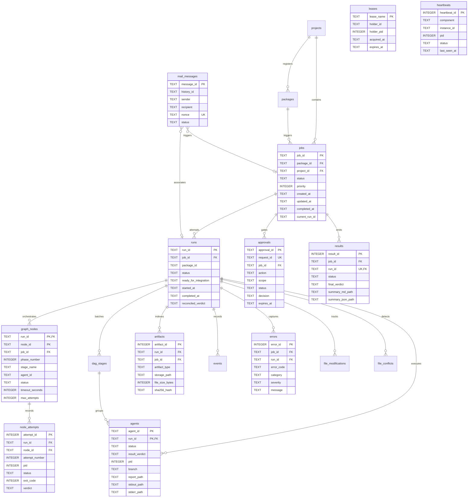

# SACL V1 SQLite Operational Data Model Specification

## 1. Executive Summary & Architectural Scope

The SolidBit Agent Execution Control Loop (SACL V1) uses a dedicated local relational database, `sacl_ops.db`, as its authoritative **Operational State Store**. This document establishes the relational data model, transaction semantics, indexing strategies, storage boundaries, and migration governance for SACL V1.

### 1.1 Constitutional Precedence Adherence
This specification strictly enforces the constitutional precedence hierarchy:
1. **Explicit Joaquín decisions:**
   - SQLite (`sacl_ops.db`) serves as the local Operational State Store.
   - Heavy artifacts (logs, git diffs, raw reports) reside exclusively in the filesystem.
   - Engineering Analytics Warehouse is deferred to future scope.
   - Remote production execution (Railway, mutating GitHub rulesets, Jira automation) is completely disabled in V1.
   - Mail Gateway and Graph-P are separated; zero idle token burn.
2. **Proven current-orchestrator behavior:**
   - Process reconciliation with PID verification, image whitelisting, and 300-second start-time drift guards.
   - Safe-stop and non-killing diagnostic timeout (`TIMEOUT_RUNNING`) tracking.
   - Cross-agent file modification overlap and collision registry.
   - Multi-phase staged DAG batching and dependency tracking.
   - Supervisor singleton mutual exclusion lease.
3. **Existing governance and contracts:**
   - Execution package manifest compliance (`solidbit.execution-package.v1`).
   - Deterministic run summaries and exit verdicts (`SUMMARY.md` + `SUMMARY.json`).
4. **W0.1 / W0.2 Remediation Baselines:**
   - **SB-FREEZE-P1-04:** Canonical job lifecycle (12 primary + 10 side states) and Graph-H node states.
   - **SB-FREEZE-P1-05:** Structurally covers 16 operational domains: `schema_migrations`, `projects`, `packages`, `mail_messages`/cursors, `jobs`, `runs`, `graph_nodes`, `node_attempts`, `agents`, `events`, `approvals`, `artifacts`, `results`, `leases`, `heartbeats`, `errors`.
   - **SB-FREEZE-P1-06:** Bounded approval contract: `JOB_ID + ACTION + SCOPE + REQUEST_ID + expires_at`.
   - Retention of justified compatibility tables (`supervisor_locks`, `dag_stages`, `agent_dependencies`, `file_modifications`, `file_conflicts`, `mail_inbox`, `mail_outbox`, `audit_events`).
   - Reconciled run success MUST NOT depend on `$Process.ExitCode` alone. Canonical reconciliation requires: process observation + persisted state + required outputs + final verdict.

---

## 2. Storage Boundaries: SQLite vs. Filesystem

Per Decision Baseline #22 and #23, SACL V1 strictly separates relational operational state from unstructured, heavy artifacts.

```
+-------------------------------------------------------------------------------+
|                             STORAGE BOUNDARY                                  |
+-------------------------------------------------------------------------------+
|    OPERATIONAL STATE STORE (SQLite)    |       FILESYSTEM ARTIFACT STORE      |
|              (sacl_ops.db)             |            (runs/<runId>/)           |
+----------------------------------------+--------------------------------------+
| - Schema migration ledger              | - Standard output logs (*.stdout.log)|
| - Project registry & policy configs    | - Standard error logs (*.stderr.log) |
| - Ingested package metadata & hashes   | - Full deliverable markdown reports  |
| - Top-level job lifecycle states       | - Complete git diffs and patches     |
| - Run execution attempts & metadata    | - Raw evidence files & test outputs  |
| - Graph-H DAG nodes & retry attempts   | - Human-readable SUMMARY.md          |
| - Agent process state, PIDs, verdicts  | - Machine-readable SUMMARY.json      |
| - Append-only system events & errors   | - Packaged zip bundles (*.zip)       |
| - Bounded action-approval records      | - Input prompt files (*.prompt.md)   |
| - Artifact metadata index & SHA-256    |                                      |
| - Sealed final run results             |                                      |
| - Supervisor & daemon singleton leases |                                      |
| - Component liveness heartbeats        |                                      |
| - Mail messages & historyId cursors    |                                      |
| - Normalized file modifications        |                                      |
| - Cross-branch file conflict records   |                                      |
+----------------------------------------+--------------------------------------+
```

### 2.1 Storage Boundary Invariants
1. **No Large Blobs in SQLite:** File contents, markdown reports, git patches, and execution logs must never be stored as `TEXT` or `BLOB` columns in `sacl_ops.db`. Only canonical filesystem paths, SHA-256 digests, and normalized metadata are persisted.
2. **Path Normalization:** All filesystem paths stored in SQLite must use forward slashes (`/`) or validated canonical absolute paths. File paths within repositories are stored as repository-relative paths.
3. **Strict UTC Standard:** All datetime columns across all tables store ISO-8601 UTC strings formatted as `YYYY-MM-DDTHH:MM:SSZ` (e.g. `2026-10-07T11:00:00Z`). Local timezone offsets are prohibited in relational storage.
4. **Transactional Integrity:** Multi-entity state transitions (e.g. node completion + attempt recording + event logging) MUST execute within explicit SQLite ACID transactions.

---

## 3. Database Engine & Connection PRAGMAs

To ensure high-throughput concurrent access, zero reader blocking, and immediate write availability across asynchronous workers and the supervisor monitor, every database connection MUST be initialized with the following bootstrap PRAGMAs:

```sql
PRAGMA journal_mode = WAL;          -- Write-Ahead Logging: concurrent readers do not block writers
PRAGMA busy_timeout = 5000;         -- 5000ms busy handler timeout during write locks
PRAGMA synchronous = NORMAL;        -- Optimal durability with minimal SSD wear under WAL
PRAGMA foreign_keys = ON;           -- Enforce relational referential integrity across all tables
```

### 3.1 Rationale for PRAGMA Bootstrap
- **`journal_mode = WAL`:** Write-Ahead Logging allows the live terminal console (`MONITOR.ps1`) and supervisor checks to query state continuously in read-only mode without taking table locks or causing `SQLITE_BUSY` exceptions for worker controllers.
- **`busy_timeout = 5000`:** Mitigates write lock contention when multiple parallel workers commit phase results simultaneously.
- **`synchronous = NORMAL`:** Provides full crash durability under WAL mode while reducing synchronization disk flushes.
- **`foreign_keys = ON`:** Guarantees cascading cleanup for runs and ensures dependencies reference valid parent entities.

---

## 4. Entity-Relationship Model (ERD)



---

## 5. Detailed Specifications for 16 Canonical V1 Domains

### 5.1 Table: `schema_migrations`
Tracks forward-only database schema migrations to ensure version consistency.

| Column | Type | Constraints | Description |
| :--- | :--- | :--- | :--- |
| `version` | `INTEGER` | `PRIMARY KEY` | Monotonically increasing migration version (e.g. `1`). |
| `name` | `TEXT` | `NOT NULL` | Migration script filename (e.g. `'001_init.sql'`). |
| `applied_at` | `TEXT` | `NOT NULL` | ISO-8601 UTC timestamp of execution. |
| `checksum` | `TEXT` | `NOT NULL` | SHA-256 hash of the applied migration file. |

---

### 5.2 Table: `projects`
Decouples the core execution loop from hardcoded single-repository paths (ADR-009).

| Column | Type | Constraints | Description |
| :--- | :--- | :--- | :--- |
| `project_id` | `TEXT` | `PRIMARY KEY` | Canonical project identifier (e.g. `'solidbit-control-loop'`). |
| `name` | `TEXT` | `NOT NULL` | Human-readable project display name. |
| `repo_url` | `TEXT` | `NULLABLE` | Remote Git repository URL. |
| `root_path` | `TEXT` | `NOT NULL` | Absolute local filesystem path to repository root. |
| `default_branch` | `TEXT` | `NOT NULL DEFAULT 'main'` | Default branch name. |
| `policy_override_json` | `TEXT` | `NULLABLE` | Project-specific policy configuration overrides. |
| `created_at` | `TEXT` | `NOT NULL` | ISO-8601 UTC creation timestamp. |
| `updated_at` | `TEXT` | `NOT NULL` | ISO-8601 UTC last update timestamp. |

---

### 5.3 Table: `packages`
Declarative execution package ingestion records (ADR-004, ADR-006).

| Column | Type | Constraints | Description |
| :--- | :--- | :--- | :--- |
| `package_id` | `TEXT` | `PRIMARY KEY` | Canonical package identifier from manifest. |
| `job_id` | `TEXT` | `NULLABLE` | Associated logical job ID. |
| `project_id` | `TEXT` | `NULLABLE`, `REFERENCES projects(project_id)` | Target project identifier. |
| `archive_sha256` | `TEXT` | `NOT NULL` | SHA-256 integrity digest of package ZIP archive. |
| `manifest_json` | `TEXT` | `NOT NULL` | Complete manifest payload serialized as JSON. |
| `storage_path` | `TEXT` | `NOT NULL` | Filesystem path where archive is preserved. |
| `created_at` | `TEXT` | `NOT NULL` | ISO-8601 UTC timestamp. |
| `status` | `TEXT` | `NOT NULL`, `CHECK(status IN ('RECEIVED', 'AUTHENTICATED', 'VALIDATED', 'REJECTED', 'QUARANTINED', 'PROCESSED'))` | Admission lifecycle status. |

---

### 5.4 Table: `jobs`
Authoritative record of top-level logical job lifecycle (SB-FREEZE-P1-04).

| Column | Type | Constraints | Description |
| :--- | :--- | :--- | :--- |
| `job_id` | `TEXT` | `PRIMARY KEY` | Canonical logical job identifier. |
| `package_id` | `TEXT` | `NULLABLE`, `REFERENCES packages(package_id)` | Ingested package identifier. |
| `project_id` | `TEXT` | `NULLABLE`, `REFERENCES projects(project_id)` | Target project identifier. |
| `status` | `TEXT` | `NOT NULL`, `CHECK(...)` | Canonical lifecycle state (12 primary + 10 side states). |
| `priority` | `INTEGER` | `NOT NULL DEFAULT 0` | Scheduling priority (higher numbers dispatched first). |
| `created_at` | `TEXT` | `NOT NULL` | ISO-8601 UTC creation timestamp. |
| `updated_at` | `TEXT` | `NOT NULL` | ISO-8601 UTC status heartbeat timestamp. |
| `completed_at` | `TEXT` | `NULLABLE` | ISO-8601 UTC completion timestamp. |
| `current_run_id` | `TEXT` | `NULLABLE` | Pointer to active or latest physical run attempt. |
| `error_summary` | `TEXT` | `NULLABLE` | Human/machine diagnostic message on failure. |
| `metadata_json` | `TEXT` | `NULLABLE` | Extensible job context metadata. |

**Allowed Status Values:**
- Primary: `RECEIVED`, `AUTHENTICATED`, `VALIDATED`, `PERSISTED`, `QUEUED`, `DISPATCHED`, `RUNNING`, `VERIFYING`, `RESULT_PACKAGED`, `RESULT_SENT`, `COMPLETED`, `ARCHIVED`.
- Side/Terminal: `WAITING_APPROVAL`, `RETRY_WAIT`, `BLOCKED`, `FAILED`, `CANCELLED`, `INTERRUPTED`, `TIMED_OUT`, `POLICY_DENIED`, `REJECTED`, `QUARANTINED`.

---

### 5.5 Table: `runs`
Tracks physical execution attempts, filesystem directories, and pre-merge integration state.

| Column | Type | Constraints | Description |
| :--- | :--- | :--- | :--- |
| `run_id` | `TEXT` | `PRIMARY KEY` | Canonical physical run ID (e.g. `'w0-2-20261007-105623-ee9f03'`). |
| `job_id` | `TEXT` | `NOT NULL`, `REFERENCES jobs(job_id) ON DELETE CASCADE` | Logical parent job FK. |
| `package_id` | `TEXT` | `NOT NULL` | Execution package identifier. |
| `project_id` | `TEXT` | `NULLABLE`, `REFERENCES projects(project_id)` | Project identifier. |
| `project` | `TEXT` | `NOT NULL` | Legacy project name string. |
| `repository` | `TEXT` | `NOT NULL` | Target GitHub repository identifier. |
| `mode` | `TEXT` | `NOT NULL` | Execution mode (e.g. `'architecture_freeze_and_repo_bootstrap'`). |
| `source_orchestrator` | `TEXT` | `NOT NULL` | Path to source orchestrator. |
| `target_repo_path` | `TEXT` | `NOT NULL` | Absolute filesystem path to target repository checkout. |
| `run_dir` | `TEXT` | `NOT NULL` | Filesystem path to run output directory (`runs/<runId>/`). |
| `status` | `TEXT` | `NOT NULL`, `CHECK(...)` | Current physical run state (canonical + compatibility). |
| `ready_for_integration` | `TEXT` | `NOT NULL DEFAULT 'NO'`, `CHECK(ready_for_integration IN ('YES', 'NO'))` | Evaluated pre-merge readiness flag. |
| `started_at` | `TEXT` | `NOT NULL` | ISO-8601 UTC timestamp when run began. |
| `completed_at` | `TEXT` | `NULLABLE` | ISO-8601 UTC timestamp when run concluded. |
| `reconciled_verdict` | `TEXT` | `NULLABLE` | Overall aggregated run verdict. |
| `error_summary` | `TEXT` | `NULLABLE` | Diagnostic failure summary. |

---

### 5.6 Table: `graph_nodes`
Tracks ephemeral Graph-H DAG node states during wave execution (SB-FREEZE-P1-04).

| Column | Type | Constraints | Description |
| :--- | :--- | :--- | :--- |
| `run_id` | `TEXT` | `REFERENCES runs(run_id) ON DELETE CASCADE` | Physical run FK. |
| `node_id` | `TEXT` | `NOT NULL` | Unique node identifier within run (e.g. `'AG-COMPAT'`). |
| `job_id` | `TEXT` | `NOT NULL`, `REFERENCES jobs(job_id) ON DELETE CASCADE` | Parent job FK. |
| `phase_number` | `INTEGER` | `NOT NULL` | Ordered DAG phase (1, 2, 3...). |
| `stage_name` | `TEXT` | `NOT NULL` | Stage name (e.g. `'MATERIALIZATION'`). |
| `agent_id` | `TEXT` | `NOT NULL` | Associated worker agent identifier. |
| `status` | `TEXT` | `NOT NULL`, `CHECK(status IN ('PENDING', 'READY', 'RUNNING', 'SUCCEEDED', 'RETRYABLE_FAILURE', 'FAILED', 'BLOCKED', 'WAITING_APPROVAL', 'CANCELLED'))` | Graph-H node lifecycle state. |
| `started_at` | `TEXT` | `NULLABLE` | ISO-8601 UTC timestamp when node launched. |
| `completed_at` | `TEXT` | `NULLABLE` | ISO-8601 UTC timestamp when node concluded. |
| `timeout_seconds` | `INTEGER` | `NOT NULL DEFAULT 1800` | Node-specific execution timeout. |
| `max_attempts` | `INTEGER` | `NOT NULL DEFAULT 1` | Maximum retry attempts for transient errors. |
| `current_attempt` | `INTEGER` | `NOT NULL DEFAULT 0` | Current execution attempt number. |
| `result_verdict` | `TEXT` | `NULLABLE` | Reconciled verdict for this node. |

**Primary Key:** `(run_id, node_id)`.

---

### 5.7 Table: `node_attempts`
Records each individual worker execution attempt for a Graph-H node.

| Column | Type | Constraints | Description |
| :--- | :--- | :--- | :--- |
| `attempt_id` | `INTEGER` | `PRIMARY KEY AUTOINCREMENT` | Unique attempt ID. |
| `run_id` | `TEXT` | `NOT NULL` | Parent run FK. |
| `node_id` | `TEXT` | `NOT NULL` | Parent graph node FK. |
| `attempt_number` | `INTEGER` | `NOT NULL` | 1-based attempt sequence number. |
| `pid` | `INTEGER` | `NULLABLE` | Operating system Process ID. |
| `status` | `TEXT` | `NOT NULL` | Attempt outcome status. |
| `exit_code` | `INTEGER` | `NULLABLE` | OS process exit code. |
| `started_at` | `TEXT` | `NOT NULL` | ISO-8601 UTC timestamp. |
| `finished_at` | `TEXT` | `NULLABLE` | ISO-8601 UTC timestamp. |
| `verdict` | `TEXT` | `NULLABLE` | Extracted attempt verdict. |
| `error_message` | `TEXT` | `NULLABLE` | Error diagnostics. |
| `stdout_path` | `TEXT` | `NULLABLE` | Filesystem path to stdout log. |
| `stderr_path` | `TEXT` | `NULLABLE` | Filesystem path to stderr log. |
| `report_path` | `TEXT` | `NULLABLE` | Filesystem path to deliverable report. |

---

### 5.8 Table: `agents`
Individual worker process instances and 4-point reconciled outcomes (preserved for script compatibility).

| Column | Type | Constraints | Description |
| :--- | :--- | :--- | :--- |
| `agent_id` | `TEXT` | `NOT NULL` | Agent identifier (e.g. `'AG-COMPAT'`). |
| `run_id` | `TEXT` | `NOT NULL`, `REFERENCES runs(run_id) ON DELETE CASCADE` | Parent run FK. |
| `stage_id` | `INTEGER` | `NULLABLE` | Legacy DAG stage FK. |
| `node_id` | `TEXT` | `NULLABLE` | Associated graph node identifier. |
| `status` | `TEXT` | `NOT NULL`, `CHECK(...)` | Worker lifecycle state (`RUNNING`, `TIMEOUT_RUNNING`, `COMPLETE`...). |
| `result_verdict` | `TEXT` | `NOT NULL DEFAULT 'UNKNOWN'`, `CHECK(...)` | Extracted verdict (`PASS`, `PASS (Report Present)`, `DONE_REVIEW_REQUIRED`...). |
| `pid` | `INTEGER` | `NULLABLE` | OS Process ID. |
| `branch` | `TEXT` | `NULLABLE` | Dedicated Git worktree branch. |
| `commit_sha` | `TEXT` | `NULLABLE` | SHA-1 of commit produced by agent. |
| `worktree_path` | `TEXT` | `NULLABLE` | Filesystem path to isolated worktree checkout. |
| `prompt_path` | `TEXT` | `NOT NULL` | Filesystem path to input prompt. |
| `report_path` | `TEXT` | `NOT NULL` | Filesystem path to expected deliverable report. |
| `stdout_path` | `TEXT` | `NOT NULL` | Filesystem path to stdout log. |
| `stderr_path` | `TEXT` | `NOT NULL` | Filesystem path to stderr log. |
| `started_at` | `TEXT` | `NULLABLE` | ISO-8601 UTC process launch timestamp. |
| `updated_at` | `TEXT` | `NOT NULL` | ISO-8601 UTC heartbeat timestamp. |
| `finished_at` | `TEXT` | `NULLABLE` | ISO-8601 UTC process exit timestamp. |
| `exit_code` | `INTEGER` | `NULLABLE` | Raw process exit code. |
| `error_message` | `TEXT` | `NULLABLE` | Diagnostic error details. |

**Primary Key:** `(agent_id, run_id)`.

---

### 5.9 Table: `events`
Append-only operational and security event log.

| Column | Type | Constraints | Description |
| :--- | :--- | :--- | :--- |
| `event_id` | `INTEGER` | `PRIMARY KEY AUTOINCREMENT` | Monotonically increasing event ID. |
| `job_id` | `TEXT` | `NULLABLE` | Associated job ID. |
| `run_id` | `TEXT` | `NULLABLE` | Associated run ID. |
| `node_id` | `TEXT` | `NULLABLE` | Associated graph node ID. |
| `agent_id` | `TEXT` | `NULLABLE` | Associated agent ID. |
| `event_type` | `TEXT` | `NOT NULL` | Event classifier (e.g. `'PROCESS_SPAWN'`, `'TIMEOUT_DETECTED'`). |
| `severity` | `TEXT` | `NOT NULL`, `CHECK(severity IN ('DEBUG', 'INFO', 'WARN', 'ERROR', 'FATAL'))` | Severity level. |
| `payload_json` | `TEXT` | `NOT NULL` | Structured event context serialized as JSON. |
| `created_at` | `TEXT` | `NOT NULL` | ISO-8601 UTC timestamp. |

---

### 5.10 Table: `approvals`
Bounded human action-approval contract (SB-FREEZE-P1-06).

| Column | Type | Constraints | Description |
| :--- | :--- | :--- | :--- |
| `approval_id` | `TEXT` | `PRIMARY KEY` | Unique approval identifier. |
| `request_id` | `TEXT` | `NOT NULL UNIQUE` | Cryptographic/unique approval request token. |
| `job_id` | `TEXT` | `NOT NULL`, `REFERENCES jobs(job_id) ON DELETE CASCADE` | Bound job identifier. |
| `run_id` | `TEXT` | `NULLABLE`, `REFERENCES runs(run_id) ON DELETE CASCADE` | Bound run identifier. |
| `action` | `TEXT` | `NOT NULL` | Specific requested action (e.g. `'GIT_COMMIT_PRIMARY'`). |
| `scope` | `TEXT` | `NOT NULL` | Bounded scope (e.g. `'docs/adr/'`). |
| `status` | `TEXT` | `NOT NULL`, `CHECK(status IN ('PENDING', 'APPROVED', 'REJECTED', 'EXPIRED', 'REVOKED'))` | Lifecycle status. |
| `decision` | `TEXT` | `NOT NULL`, `CHECK(decision IN ('PENDING', 'APPROVED', 'REJECTED'))` | Sovereign human decision. |
| `approver` | `TEXT` | `NULLABLE` | Authorized human identifier (e.g. `'Joaquín'`). |
| `rationale` | `TEXT` | `NULLABLE` | Justification or audit commentary. |
| `signature` | `TEXT` | `NULLABLE` | Structured approval signature token. |
| `requested_at`| `TEXT` | `NOT NULL` | ISO-8601 UTC request timestamp. |
| `decided_at`  | `TEXT` | `NULLABLE` | ISO-8601 UTC decision timestamp. |
| `expires_at`  | `TEXT` | `NOT NULL` | ISO-8601 UTC expiration deadline. |

**Inviolable Binding:** `JOB_ID + ACTION + SCOPE + REQUEST_ID + expires_at`. Approval can never override hard local policy.

---

### 5.11 Table: `artifacts`
Relational metadata index for heavy execution artifacts preserved on the filesystem (ADR-011).

| Column | Type | Constraints | Description |
| :--- | :--- | :--- | :--- |
| `artifact_id` | `INTEGER` | `PRIMARY KEY AUTOINCREMENT` | Unique artifact record ID. |
| `run_id` | `TEXT` | `NOT NULL`, `REFERENCES runs(run_id) ON DELETE CASCADE` | Producing run FK. |
| `job_id` | `TEXT` | `NOT NULL`, `REFERENCES jobs(job_id) ON DELETE CASCADE` | Parent job FK. |
| `agent_id` | `TEXT` | `NULLABLE` | Producing agent identifier. |
| `node_id` | `TEXT` | `NULLABLE` | Producing graph node identifier. |
| `artifact_type` | `TEXT` | `NOT NULL`, `CHECK(artifact_type IN ('REPORT', 'LOG_STDOUT', 'LOG_STDERR', 'DIFF', 'PATCH', 'SUMMARY_MD', 'SUMMARY_JSON', 'ZIP_PACKAGE', 'ZIP_RESULT', 'EVIDENCE', 'OTHER'))` | Semantic type of artifact. |
| `storage_path` | `TEXT` | `NOT NULL` | Canonical filesystem path to artifact. |
| `file_size_bytes` | `INTEGER`| `NOT NULL` | Physical size on disk. |
| `sha256_hash` | `TEXT` | `NOT NULL` | SHA-256 integrity hash of file contents. |
| `created_at` | `TEXT` | `NOT NULL` | ISO-8601 UTC timestamp. |

---

### 5.12 Table: `results`
Authoritative sealed final results and delivery evidence.

| Column | Type | Constraints | Description |
| :--- | :--- | :--- | :--- |
| `result_id` | `INTEGER` | `PRIMARY KEY AUTOINCREMENT` | Unique result ID. |
| `job_id` | `TEXT` | `NOT NULL`, `REFERENCES jobs(job_id) ON DELETE CASCADE` | Parent job FK. |
| `run_id` | `TEXT` | `NOT NULL UNIQUE`, `REFERENCES runs(run_id) ON DELETE CASCADE` | Parent run FK. |
| `status` | `TEXT` | `NOT NULL` | Final outcome status. |
| `final_verdict` | `TEXT` | `NOT NULL`, `CHECK(final_verdict IN ('PASS', 'PARTIAL', 'BLOCKED', 'FAILED', 'PASS (Report Present)', 'DONE_REVIEW_REQUIRED', 'STOPPED_BY_USER', 'UNKNOWN'))` | Canonical verdict. |
| `summary_md_path` | `TEXT` | `NOT NULL` | Filesystem path to sealed `SUMMARY.md`. |
| `summary_json_path` | `TEXT`| `NOT NULL` | Filesystem path to sealed `SUMMARY.json`. |
| `package_result_zip` | `TEXT`| `NULLABLE` | Filesystem path to packaged ZIP artifact. |
| `delivered_to` | `TEXT` | `NULLABLE` | Envelope recipient address or queue. |
| `delivered_at` | `TEXT` | `NULLABLE` | ISO-8601 UTC delivery confirmation timestamp. |
| `created_at` | `TEXT` | `NOT NULL` | ISO-8601 UTC timestamp. |

---

### 5.13 Table: `leases`
Generalized local and distributed process mutual exclusion leases (ADR-002, ADR-003).

| Column | Type | Constraints | Description |
| :--- | :--- | :--- | :--- |
| `lease_name` | `TEXT` | `PRIMARY KEY` | Unique lease identifier (e.g. `'SUPERVISOR_SINGLETON'`). |
| `holder_id` | `TEXT` | `NOT NULL` | Process or daemon instance holding lease. |
| `holder_pid` | `INTEGER` | `NOT NULL` | OS Process ID of holding process. |
| `acquired_at` | `TEXT` | `NOT NULL` | ISO-8601 UTC acquisition timestamp. |
| `heartbeat_at`| `TEXT` | `NOT NULL` | ISO-8601 UTC latest renewal timestamp. |
| `expires_at` | `TEXT` | `NOT NULL` | ISO-8601 UTC expiration deadline. |
| `metadata_json` | `TEXT` | `NULLABLE` | Extensible lease parameters. |

---

### 5.14 Table: `heartbeats`
High-frequency liveness monitoring for background daemons and workers.

| Column | Type | Constraints | Description |
| :--- | :--- | :--- | :--- |
| `heartbeat_id` | `INTEGER` | `PRIMARY KEY AUTOINCREMENT` | Monotonically increasing heartbeat ID. |
| `component` | `TEXT` | `NOT NULL` | System component (`'SUPERVISOR'`, `'MAIL_GATEWAY'`, `'WORKER'`). |
| `instance_id` | `TEXT` | `NOT NULL` | Unique process instance identifier. |
| `pid` | `INTEGER` | `NOT NULL` | OS Process ID. |
| `status` | `TEXT` | `NOT NULL` | Reported liveness status (`'HEALTHY'`, `'BUSY'`, `'IDLE'`). |
| `last_seen_at` | `TEXT` | `NOT NULL` | ISO-8601 UTC timestamp. |
| `details_json` | `TEXT` | `NULLABLE` | CPU/memory utilization or active task count. |

---

### 5.15 Table: `errors`
Structured operational error diagnostics repository.

| Column | Type | Constraints | Description |
| :--- | :--- | :--- | :--- |
| `error_id` | `INTEGER` | `PRIMARY KEY AUTOINCREMENT` | Monotonically increasing error ID. |
| `job_id` | `TEXT` | `NULLABLE` | Associated job ID. |
| `run_id` | `TEXT` | `NULLABLE` | Associated run ID. |
| `node_id` | `TEXT` | `NULLABLE` | Associated graph node ID. |
| `agent_id` | `TEXT` | `NULLABLE` | Associated agent ID. |
| `error_code` | `TEXT` | `NOT NULL` | Standardized error code (e.g. `'DIRTY_ROOT_HALT'`). |
| `category` | `TEXT` | `NOT NULL`, `CHECK(category IN ('INFRASTRUCTURE', 'POLICY', 'VALIDATION', 'EXECUTION', 'TIMEOUT', 'COLLISION', 'TRANSPORT', 'APPROVAL', 'RECOVERY'))` | Error category. |
| `severity` | `TEXT` | `NOT NULL`, `CHECK(severity IN ('WARN', 'ERROR', 'FATAL'))` | Severity level. |
| `message` | `TEXT` | `NOT NULL` | Human-readable error description. |
| `stack_trace` | `TEXT` | `NULLABLE` | Diagnostic stack trace or error log tail. |
| `context_json` | `TEXT` | `NULLABLE` | Contextual diagnostic metadata. |
| `occurred_at` | `TEXT` | `NOT NULL` | ISO-8601 UTC timestamp. |

---

### 5.16 Table: `mail_messages` & `mail_cursors`
Gmail API transport queue and historyId synchronization cursors (SB-FREEZE-P1-01).

| Column | Type | Constraints | Description |
| :--- | :--- | :--- | :--- |
| `message_id` | `TEXT` | `PRIMARY KEY` | RFC-2822 Message-ID or Gmail API Message ID. |
| `history_id` | `TEXT` | `NULLABLE` | Gmail historyId associated with message event. |
| `thread_id` | `TEXT` | `NULLABLE` | Gmail thread identifier. |
| `sender` | `TEXT` | `NOT NULL` | Envelope sender email address. |
| `recipient` | `TEXT` | `NOT NULL` | Envelope recipient email address. |
| `subject` | `TEXT` | `NOT NULL` | Subject line intake routing hint. |
| `snippet` | `TEXT` | `NULLABLE` | Preview text snippet. |
| `received_at` | `TEXT` | `NOT NULL` | ISO-8601 UTC receipt timestamp. |
| `processed_at`| `TEXT` | `NULLABLE` | ISO-8601 UTC processing timestamp. |
| `nonce` | `TEXT` | `NOT NULL UNIQUE` | Cryptographic anti-replay nonce. |
| `attachment_sha` | `TEXT` | `NOT NULL` | SHA-256 of package ZIP attachment. |
| `status` | `TEXT` | `NOT NULL`, `CHECK(...)` | Status (`RECEIVED`, `AUTHENTICATED`, `VALIDATED`, `PROCESSED`, `REJECTED`, `DUPLICATE_IGNORED`...). |
| `rejection_reason` | `TEXT`| `NULLABLE` | Rejection justification. |
| `job_id` | `TEXT` | `NULLABLE`, `REFERENCES jobs(job_id)` | Resulting job identifier. |
| `run_id` | `TEXT` | `NULLABLE` | Associated execution run identifier. |

**Cursor Table: `mail_cursors`**
- `cursor_name` (`TEXT PRIMARY KEY`): Unique cursor key (e.g. `'GMAIL_USERS_WATCH'`).
- `history_id` (`TEXT NOT NULL`): Authoritative Gmail `historyId` cursor for incremental fetch.
- `last_synced_at` (`TEXT NOT NULL`): ISO-8601 UTC synchronization timestamp.
- `expiration_at` (`TEXT`): Push notification watch expiration timestamp.
- `resource_id` (`TEXT`): Google Cloud Pub/Sub or Gmail watch subscription ID.

---

## 6. Compatibility Tables (Justified & Retained)

To preserve seamless backwards compatibility with existing orchestrator scripts (`run-supervisor.ps1`, `RUN-WAVE.ps1`, `stop-agents.ps1`, `MONITOR.ps1`), eight legacy tables are retained alongside the canonical entities:

1. `supervisor_locks`: Retained for legacy singleton checks in `run-supervisor.ps1`.
2. `dag_stages`: Retained for phase batching in `RUN-WAVE.ps1`.
3. `agent_dependencies`: Retained for DAG edge scheduling queries.
4. `file_modifications`: Retained for cross-branch diff harvesting.
5. `file_conflicts`: Retained for collision registry and pre-merge gating.
6. `mail_inbox`: Retained for legacy email polling intake.
7. `mail_outbox`: Retained for legacy email response dispatch.
8. `audit_events`: Retained for legacy audit log queries.

---

## 7. Indexing Strategy & Concurrency

To ensure near-instantaneous reconciliation queries and prevent lock contention, indexes are established on all foreign keys, status flags, and deduplication nonces:

```sql
CREATE INDEX IF NOT EXISTS idx_jobs_status ON jobs(status);
CREATE INDEX IF NOT EXISTS idx_runs_job_id ON runs(job_id);
CREATE INDEX IF NOT EXISTS idx_runs_status ON runs(status);
CREATE INDEX IF NOT EXISTS idx_graph_nodes_run_status ON graph_nodes(run_id, status);
CREATE INDEX IF NOT EXISTS idx_node_attempts_node ON node_attempts(run_id, node_id);
CREATE INDEX IF NOT EXISTS idx_agents_run_status ON agents(run_id, status);
CREATE INDEX IF NOT EXISTS idx_events_run_type ON events(run_id, event_type);
CREATE INDEX IF NOT EXISTS idx_approvals_job_req ON approvals(job_id, request_id);
CREATE INDEX IF NOT EXISTS idx_approvals_status ON approvals(status);
CREATE INDEX IF NOT EXISTS idx_artifacts_run_type ON artifacts(run_id, artifact_type);
CREATE INDEX IF NOT EXISTS idx_results_job_run ON results(job_id, run_id);
CREATE INDEX IF NOT EXISTS idx_mail_messages_nonce ON mail_messages(nonce);
CREATE INDEX IF NOT EXISTS idx_mail_messages_history ON mail_messages(history_id);
CREATE INDEX IF NOT EXISTS idx_file_mods_run_file ON file_modifications(run_id, file_path);
CREATE INDEX IF NOT EXISTS idx_audit_run_type ON audit_events(run_id, event_type);
CREATE INDEX IF NOT EXISTS idx_mail_inbox_nonce ON mail_inbox(nonce);
CREATE INDEX IF NOT EXISTS idx_dag_stages_run ON dag_stages(run_id, phase_number);
CREATE INDEX IF NOT EXISTS idx_mail_outbox_status ON mail_outbox(status);
CREATE INDEX IF NOT EXISTS idx_heartbeats_comp ON heartbeats(component, instance_id);
CREATE INDEX IF NOT EXISTS idx_errors_run ON errors(run_id, error_code);
```
