# SACL V1 Canonical Hierarchical State Machine & Reconciliation Specification

## 1. Executive Summary & Architectural Overview

The SolidBit Agent Execution Control Loop (SACL V1) governs autonomous execution through a **three-tier hierarchical state machine**. This state machine guarantees deterministic execution, strict isolation across parallel branches, safe diagnostics during timeouts, tamper-resistant result evaluation, and crash resilience.

### 1.1 Constitutional Precedence Hierarchy
This specification is governed by:
1. **Explicit Joaquín decisions:**
   - Ephemeral per-wave execution engine (`Graph-H`).
   - Persistent IDLE supervisor (`Graph-P`) with zero LLM token consumption when idle.
   - Local dirty-root protection (never destroy or stash uncommitted human changes).
   - SQLite `sacl_ops.db` as the operational state store; heavy logs & diffs reside strictly in the filesystem.
   - Remote production execution (Railway, mutating GitHub rulesets, Jira automation) is completely disabled in V1.
2. **Proven current-orchestrator behavior:**
   - Non-killing diagnostic timeouts (`TIMEOUT_RUNNING`).
   - Windows OS PID recycling defense (3-way check with 300-second start-time drift guard).
   - Structured deliverable regex extraction ladder.
   - Cross-agent file modification overlap and conflict detection.
   - Sovereign human authority gate emitting structured authorization artifacts.
3. **Existing governance and contracts:**
   - Manifest schema compliance (`solidbit.execution-package.v1`).
   - Output contracts (`SUMMARY.md` + `SUMMARY.json`).
4. **W0.1 / W0.2 Remediation Baselines:**
   - **SB-FREEZE-P1-04:** Restoration of the mandatory canonical job lifecycle (12 primary states + 10 side states) and Graph-H node states.
   - Reconciled run success MUST NOT depend on `$Process.ExitCode` alone. Canonical reconciliation requires: process observation + persisted state + required outputs + final verdict.
   - `DONE_REVIEW_REQUIRED` means execution completed and requires human review; it never means `PASS`.
   - Legacy fallback verdict `'PASS (Report Present)'` is preserved in the canonical result domain.
   - At-least-once transport delivery with strictly idempotent consumers.

---

## 2. Three-Tier Hierarchical State Machine

The SACL V1 state architecture operates across three distinct levels of abstraction:

```mermaid
stateDiagram-v2
    direction TB

    state "Tier 1: Canonical Job Lifecycle" as Tier1_Job {
        [*] --> RECEIVED
        RECEIVED --> AUTHENTICATED : Verify Message Source & Nonce
        RECEIVED --> REJECTED : Tampered or Unauthorized
        RECEIVED --> QUARANTINED : Malformed Archive / Security Violation
        AUTHENTICATED --> VALIDATED : Verify Schema, Checksums, Zip-Slip Guard
        AUTHENTICATED --> REJECTED : Schema Failure / Hash Conflict
        VALIDATED --> PERSISTED : Record in SQLite (jobs, packages)
        PERSISTED --> QUEUED : Ready for Scheduling
        PERSISTED --> POLICY_DENIED : Hard Local Policy Deny Wins
        QUEUED --> DISPATCHED : Supervisor Assigns Worker / Engine
        DISPATCHED --> RUNNING : Graph-H Spawns Execution Wave
        RUNNING --> WAITING_APPROVAL : Bounded Approval Required
        WAITING_APPROVAL --> RUNNING : Human Approval Granted
        WAITING_APPROVAL --> BLOCKED : Approval Rejected or Expired
        RUNNING --> RETRY_WAIT : Transient Failure Detected
        RETRY_WAIT --> RUNNING : Retry Interval Elapsed
        RUNNING --> TIMED_OUT : Hard Job Deadline Exceeded
        RUNNING --> INTERRUPTED : Supervisor or Host Crash
        RUNNING --> CANCELLED : Operator Safe Stop Issued
        RUNNING --> VERIFYING : All Graph Nodes Concluded
        VERIFYING --> RESULT_PACKAGED : 4-Point Reconciliation Evaluated
        VERIFYING --> FAILED : Required Deliverables Missing
        RESULT_PACKAGED --> RESULT_SENT : Dispatch via Mail Outbox
        RESULT_SENT --> COMPLETED : Delivery Confirmed
        COMPLETED --> ARCHIVED : Retention Policy Applied
        FAILED --> ARCHIVED : Diagnostics Preserved
        CANCELLED --> ARCHIVED : Operator Termination Preserved
    }

    state "Tier 2: Graph-H DAG Node Lifecycle" as Tier2_Node {
        [*] --> PENDING
        PENDING --> READY : Upstream Node Dependencies Satisfied
        READY --> RUNNING : Concurrency Slot Allocated
        RUNNING --> WAITING_APPROVAL : Node Requires Gated Authorization
        WAITING_APPROVAL --> RUNNING : Human Approval Granted
        WAITING_APPROVAL --> BLOCKED : Node Approval Denied
        RUNNING --> RETRYABLE_FAILURE : Transient Error (Attempts < Max)
        RETRYABLE_FAILURE --> READY : Exponential Backoff Reset
        RUNNING --> SUCCEEDED : Node Completed with Verified PASS
        RUNNING --> FAILED : Terminal Failure / Crash / Violations
        RUNNING --> BLOCKED : Explicit Deliverable BLOCKED
        RUNNING --> CANCELLED : Operator Killed Node Process
    }

    state "Tier 3: Worker Process Lifecycle" as Tier3_Worker {
        [*] --> SCHEDULED
        SCHEDULED --> LAUNCHING : Lease Worktree, Build Prompt
        LAUNCHING --> RUNNING : Process Spawned (PID Captured)
        RUNNING --> TIMEOUT_RUNNING : Exceeds Timeout Minutes (Non-Killing)
        RUNNING --> STOPPING : Stop Signal Received
        TIMEOUT_RUNNING --> STOPPING : Manual Termination Initiated
        STOPPING --> STOPPED : Process Terminated (STOPPED_BY_USER)
        RUNNING --> EVALUATING : Process Exits Normally
        TIMEOUT_RUNNING --> EVALUATING : Process Exits While in Timeout
        RUNNING --> FAILED : Process Crashed / Fatal Exit
        EVALUATING --> COMPLETE : Valid Deliverable & Regex Marker
        EVALUATING --> FAILED : Missing Deliverable or BLOCKED Marker
    }
```



---

## 3. Tier 1: Canonical Job Lifecycle

The Canonical Job Lifecycle represents the complete logical journey of an execution request, from inbound receipt at the transport layer to terminal archiving.

### 3.1 Primary Job Lifecycle States (12 Sequential Phases)

1. `RECEIVED`: The raw package has arrived at the Mail Gateway or local intake queue. Anti-replay nonce is registered.
2. `AUTHENTICATED`: Message source is verified against authorized sender contracts, and cryptographic / transport authenticity checks pass.
3. `VALIDATED`: Package archive integrity, SHA-256 checksums, manifest schema (`solidbit.execution-package.v1`), and Zip-Slip path traversals are validated.
4. `PERSISTED`: Validated job metadata, package archive records, and parameters are transactionally recorded in SQLite (`jobs`, `packages`).
5. `QUEUED`: Job is enqueued in the scheduler, waiting for supervisor dispatch based on priority and concurrency limits.
6. `DISPATCHED`: Supervisor assigns the job to an ephemeral `Graph-H` execution engine and acquires the supervisor lease.
7. `RUNNING`: Ephemeral `Graph-H` is actively executing the wave DAG phases across worker worktrees.
8. `VERIFYING`: Execution wave has concluded; the multi-dimensional reconciliation engine evaluates evidence across all agents.
9. `RESULT_PACKAGED`: Final deliverables (`SUMMARY.md`, `SUMMARY.json`, zipped diffs, report bundles) are generated and sealed.
10. `RESULT_SENT`: Delivery package is enqueued in `mail_outbox` and transmitted via transport.
11. `COMPLETED`: Result delivery is verified; job execution is finalized successfully.
12. `ARCHIVED`: Ephemeral worktrees are cleaned; operational records and filesystem logs are archived according to retention policy.

### 3.2 Canonical Side States & Outcomes (10 States)

1. `WAITING_APPROVAL`: Execution is paused awaiting explicit human sovereign authorization for a bounded action (`JOB_ID + ACTION + SCOPE + REQUEST_ID + expires_at`).
2. `RETRY_WAIT`: A transient, retryable failure occurred. The job is waiting for the backoff period before attempting re-execution.
3. `BLOCKED`: Execution is halted by an explicit policy block, unresolved collision, or rejected approval. Cannot proceed automatically.
4. `FAILED`: The job encountered an unrecoverable error, crashes, or failed reconciliation checks.
5. `CANCELLED`: Execution was explicitly cancelled by human operator intervention (e.g. `stop-agents.ps1`).
6. `INTERRUPTED`: Host supervisor, machine reboot, or sudden crash interrupted the active run. Reconciled upon restart.
7. `TIMED_OUT`: Job exceeded maximum allowable execution duration. Process remains alive for diagnostics; status transitions.
8. `POLICY_DENIED`: Operation requested by the package violates hard local policy. Hard deny always wins.
9. `REJECTED`: Package admission failed during authentication or integrity validation (e.g., hash conflict, invalid sender).
10. `QUARANTINED`: Package contained malicious content, directory traversal patterns (`..`), or forbidden executable formats (`.exe`, `.dll`).

### 3.3 Job Transition Matrix & Invariant Guards

| Current State | Allowed Next States | Trigger / Condition | Guard Invariant |
| :--- | :--- | :--- | :--- |
| `RECEIVED` | `AUTHENTICATED`, `REJECTED`, `QUARANTINED` | Inbound email or package arrives. | Unique nonce; authorized sender address. |
| `AUTHENTICATED` | `VALIDATED`, `REJECTED` | Sender authenticated; nonce recorded. | Manifest schema matches; archive SHA-256 matches header. |
| `VALIDATED` | `PERSISTED`, `REJECTED`, `POLICY_DENIED` | Archive unpacked in quarantine; manifest checked. | No Zip-Slip (`..`); no forbidden binary payloads. |
| `PERSISTED` | `QUEUED`, `POLICY_DENIED`, `BLOCKED` | SQLite rows committed to `jobs` and `packages`. | Effective policy lattice evaluated; hard deny wins. |
| `QUEUED` | `DISPATCHED`, `CANCELLED` | Scheduler evaluates priority and concurrency slot. | Target repo clean root verified (`git status --porcelain`). |
| `DISPATCHED` | `RUNNING`, `FAILED`, `CANCELLED` | Ephemeral `Graph-H` child process spawned. | Supervisor lock lease acquired in `leases`/`supervisor_locks`. |
| `RUNNING` | `VERIFYING`, `WAITING_APPROVAL`, `RETRY_WAIT`, `BLOCKED`, `FAILED`, `CANCELLED`, `INTERRUPTED`, `TIMED_OUT` | Active DAG phases iterating workers. | Concurrency limit respected; worktree isolation enforced. |
| `WAITING_APPROVAL` | `RUNNING`, `BLOCKED`, `CANCELLED` | Bounded approval token emitted. | Resumes only with valid approval grant; expiration enforced. |
| `RETRY_WAIT` | `RUNNING`, `FAILED`, `CANCELLED` | Backoff timer completes. | Attempt count $\le \text{MaxAttempts}$; logs preserved. |
| `VERIFYING` | `RESULT_PACKAGED`, `FAILED` | All stage workers terminated. | 4-point reconciliation evaluated; exit code alone insufficient. |
| `RESULT_PACKAGED` | `RESULT_SENT`, `FAILED` | `SUMMARY.md` and `SUMMARY.json` generated. | Dual output contract verified; atomic rename complete. |
| `RESULT_SENT` | `COMPLETED`, `FAILED` | Transport delivery confirmed. | Outbox row transitioned to `SENT`. |
| `COMPLETED` | `ARCHIVED` | Retention timer elapsed. | Artifacts sealed on filesystem; SQLite state preserved. |
| `FAILED` | `ARCHIVED` | Diagnostic report sealed. | Forensics and error logs preserved. |
| `CANCELLED` | `ARCHIVED` | All child processes safely stopped. | Worktree locks released; audit log sealed. |
| `INTERRUPTED` | `VERIFYING`, `FAILED` | Supervisor restarts after crash. | 4-point crash recovery algorithm executed; never blind restart. |

---

## 4. Tier 2: Graph-H DAG Node Lifecycle

Within an ephemeral execution wave, `Graph-H` manages execution tasks as a Directed Acyclic Graph (DAG) where each task is represented as a `graph_node`.

### 4.1 Graph-H Node States

1. `PENDING`: The node is waiting for upstream dependency nodes to complete successfully.
2. `READY`: All upstream dependencies have achieved `SUCCEEDED` (or acceptable partial status). Node is eligible to be scheduled.
3. `RUNNING`: Worker process has been spawned in an isolated worktree and is actively executing.
4. `SUCCEEDED`: Worker exited cleanly, deliverable report verified, passing regex marker confirmed, and worktree clean.
5. `RETRYABLE_FAILURE`: Worker experienced a transient failure (e.g. lock contention) and remaining attempts > 0.
6. `FAILED`: Worker crashed, produced unparseable errors, missing deliverables, or exhausted retry attempts.
7. `BLOCKED`: Worker deliverable contains explicit `BLOCKED` verdict, or upstream dependency failed.
8. `WAITING_APPROVAL`: Node execution reached a human authority boundary and requires explicit approval.
9. `CANCELLED`: Node was terminated due to an operator stop signal or wave-level abort.

### 4.2 Graph-H Node Transition Matrix

| Current State | Allowed Next States | Trigger / Precondition | Guard Invariant |
| :--- | :--- | :--- | :--- |
| `PENDING` | `READY`, `BLOCKED`, `CANCELLED` | Upstream nodes evaluated. | Every upstream node has `status = 'SUCCEEDED'`. |
| `READY` | `RUNNING`, `CANCELLED` | Free slot available under `$MaxParallel`. | Isolated worktree allocated; prompt assembled. |
| `RUNNING` | `SUCCEEDED`, `RETRYABLE_FAILURE`, `FAILED`, `BLOCKED`, `WAITING_APPROVAL`, `CANCELLED` | Process terminates or triggers boundary. | 3-way process check and deliverable extraction evaluated. |
| `RETRYABLE_FAILURE` | `READY`, `FAILED` | Retry backoff period elapses. | Attempt count incremented; distinct log paths allocated. |
| `WAITING_APPROVAL` | `READY`, `BLOCKED`, `CANCELLED` | Human approval decided. | Hard local policy checked; cannot override hard deny. |
| `SUCCEEDED` | *Terminal* | Node verified complete. | Deliverable report present; passing marker; worktree clean. |
| `FAILED` | *Terminal* | Node failed terminally. | Downstream dependent nodes transition to `BLOCKED`. |
| `BLOCKED` | *Terminal* | Unmet precondition or human denial. | Dependent downstream nodes cannot execute. |
| `CANCELLED` | *Terminal* | Operator cancellation. | Process confirmed dead via 3-way check. |

---

## 5. Tier 3: Worker Process Lifecycle State Machine

Individual worker processes spawned by launcher scripts traverse granular operational states tracked in SQLite table `agents`:

```
[SCHEDULED]
     │
     ▼ (Acquire worktree lease, assemble prompt)
[LAUNCHING]
     │
     ▼ (Start-Process spawns worker; PID & started_at recorded)
[RUNNING] ────────────────────────────────────────────────────────┐
     │                                                            │
     ├─► Exceeds WaitMinutes (Timeout Supervisor)                 ├─► Operator Stop Command
     │   │                                                        │   │
     │   ▼                                                        │   ▼
     │ [TIMEOUT_RUNNING] (Non-killing diagnostic state)           │ [STOPPING]
     │   │                                                        │   │
     │   ├─► Operator issues stop ────────────────────────────────┤   ▼
     │   │                                                        │ [STOPPED] (STOPPED_BY_USER)
     │   └─► Process finishes while in timeout                    │
     │       │                                                    │
     ├─► Process Exits (Fatal Stderr / Crash)                     │
     │   │                                                        │
     │   ▼                                                        │
     │ [FAILED] (CRASHED_OR_ERROR)                                │
     │                                                            │
     └─► Process Exits Normally                                   │
         │                                                        │
         ▼                                                        │
       [EVALUATING] ◄─────────────────────────────────────────────┘
         │
         ├─► Deliverable Report Missing / Empty ───────────────► [FAILED] (NO_EVIDENCE_FOUND)
         ├─► Regex Marker = BLOCKED ───────────────────────────► [FAILED] (BLOCKED)
         ├─► Regex Marker = PASS / PARTIAL ────────────────────► [COMPLETE] (PASS / PARTIAL)
         ├─► Report Present (No Marker) + Clean Worktree ──────► [COMPLETE] (PASS (Report Present))
         └─► Deliverable indicates Review Required ────────────► [COMPLETE] (DONE_REVIEW_REQUIRED)
```

### 5.1 Worker State Transition Matrix

| Current State | Allowed Next States | Trigger / Condition | Guard Invariant |
| :--- | :--- | :--- | :--- |
| `SCHEDULED` | `LAUNCHING`, `FAILED` | Scheduler enqueues agent for phase. | Dependencies satisfied in SQLite `graph_nodes` / `dag_stages`. |
| `LAUNCHING` | `RUNNING`, `FAILED` | Process spawned via `Start-Process`; PID and start time captured. | Target worktree checkout must exist, be clean, and on assigned branch. |
| `RUNNING` | `TIMEOUT_RUNNING`, `STOPPING`, `COMPLETE`, `FAILED` | Active execution; periodic supervisor polling. | `Test-AgentProcessRunning`: PID active, whitelisted image, drift $\le 300\text{s}$. |
| `TIMEOUT_RUNNING`| `STOPPING`, `COMPLETE`, `FAILED` | Agent runtime exceeds configured `timeout_minutes`. | **NON-KILLING INVARIANT:** Worker process is **NEVER** killed automatically. |
| `STOPPING` | `STOPPED`, `FAILED` | Operator invokes `stop-agents.ps1`. | Supervisor verifies PID and start time before issuing termination. |
| `STOPPED` | *Terminal* | Process killed by operator safe-stop. | Records `result_verdict = 'STOPPED_BY_USER'`. |
| `COMPLETE` | *Terminal* | Process exited, report verified, verdict extracted. | State immutable once phase seals. |
| `FAILED` | *Terminal* | Crashed process, missing report, or `BLOCKED` marker. | Diagnostic error tail preserved in database and filesystem. |
| `UNKNOWN` | `RUNNING`, `COMPLETE`, `FAILED` | Supervisor restart or PID recycling anomaly. | Reconciled via 4-point protocol. |

---

## 6. Canonical Reconciliation Engine

### 6.1 Fundamental Reconciliation Invariant
> **Process.ExitCode alone is INSUFFICIENT to determine success.**
> Run success and agent completion MUST be reconciled from four independent evidence sources:
> 1. **Process Observation:** Is the process alive? Does the PID match the image whitelist? Is the start time within drift tolerance?
> 2. **Persisted State:** What state was recorded in `sacl_ops.db` at last heartbeat?
> 3. **Required Outputs:** Does the expected deliverable report exist on disk? Are logs non-empty? Are git commits present in the worktree?
> 4. **Final Verdict:** Does the deliverable report contain valid structured result markers?

### 6.2 The 3-Way Process Observation Check (`Test-AgentProcessRunning`)
To eliminate false positives caused by Windows Process ID (PID) recycling, SACL V1 implements the proven 3-way check:

```powershell
function Test-AgentProcessRunning {
    param(
        [int]$ProcessId,
        [psobject]$State = $null
    )

    if ($ProcessId -le 0) { return $false }

    try {
        # 1. PID Active Check
        $proc = Get-Process -Id $ProcessId -ErrorAction Stop
        if (-not $proc -or $proc.HasExited) { return $false }

        # 2. Process Image Whitelist Check
        $procName = $proc.ProcessName.ToLower()
        $allowedNames = @('agy', 'powershell', 'pwsh', 'cmd', 'node', 'conhost')
        $isExpected = $false
        foreach ($allowed in $allowedNames) {
            if ($procName -like "*$allowed*") {
                $isExpected = $true
                break
            }
        }
        if (-not $isExpected) { return $false }

        # 3. Start-Time Drift Guard (PID Recycling Defense)
        if ($State -and $State.startedAt) {
            if ($proc.StartTime) {
                $recordStart = [DateTime]::Parse($State.startedAt)
                $diffSeconds = [Math]::Abs(($proc.StartTime - $recordStart).TotalSeconds)
                if ($diffSeconds -gt 300) {
                    # PID has been recycled by another host process!
                    return $false
                }
            }
        }

        return $true
    } catch {
        return $false
    }
}
```

### 6.3 Deliverable Result Extraction Priority Ladder
When an agent process terminates, the Result Extractor evaluates evidence in strict descending priority order:

```
Priority 1: Explicit SQLite state record verdict (if already PASS, PARTIAL, or BLOCKED)
      │
      ▼ (If UNKNOWN or IN_PROGRESS)
Priority 2: Scan expected deliverable report on disk from bottom-up for Primary Structured Marker:
            ^(?:AGENT_[A-Z0-9_-]+_RESULT|RESULT|FINAL_RESULT)\s*=\s*(PASS|PARTIAL|BLOCKED)
      │
      ▼ (If no marker found)
Priority 3: Scan first 25 lines of deliverable report for Markdown Status Header:
            (?:Final Status|Status)\s*:\s*\*{0,2}(PASS|COMPLETE\s*/\s*VERIFIED)
      │
      ▼ (If no report header match)
Priority 4: Scan tail 150 lines of worker stdout and stderr logs for Primary Structured Marker:
            ^(?:AGENT_[A-Z0-9_-]+_RESULT|RESULT|FINAL_RESULT)\s*=\s*(PASS|PARTIAL|BLOCKED)
      │
      ▼ (If no log marker match)
Priority 5: Report present on disk, non-empty, clean worktree status, and clean CLI shutdown:
            -> Evaluate as 'PASS (Report Present)'
      │
      ▼ (If report indicates execution finished but requires review)
Priority 5b: Reconciled Review Required:
            -> Evaluate as 'DONE_REVIEW_REQUIRED' (Requires review; NEVER means PASS)
      │
      ▼ (If no deliverable evidence exists)
Priority 6: Return 'NO_EVIDENCE_FOUND' -> Evaluates to agent status 'FAILED'
```

### 6.4 Special Reconciled Verdict Semantics

#### `PASS (Report Present)`
- **Origin:** Proven legacy behavior (`orchestrator-common.ps1#L289`) codified in W0.1 Remediation Baseline #11 and QA P1-04.
- **Meaning:** The agent created a non-empty, structurally valid deliverable markdown report and the process exited cleanly, but omitted an explicit regex marker string.
- **Handling:** Treated as a valid passing condition for DAG progression, but highlighted in universal run summaries for operator awareness.

#### `DONE_REVIEW_REQUIRED`
- **Origin:** W0.1 Remediation Baseline #2.
- **Meaning:** The agent completed its designated tasks, but the nature of the output (e.g. governance plan, architecture draft, risk finding) mandates explicit human sign-off before downstream automation may consume it.
- **Rule:** `DONE_REVIEW_REQUIRED` NEVER equals `PASS`. It halts automated downstream gated actions until human authorization is physically registered.

#### `STOPPED_BY_USER`
- **Origin:** Proven legacy behavior (`stop-agents.ps1#L118-L120`).
- **Meaning:** The agent was deliberately terminated by an operator invoking the safe-stop toolchain. It indicates intentional operator action rather than an unexpected worker crash.

---

## 7. Cross-Agent Collision Detection & Pipeline Gating

In multi-agent parallel execution phases (e.g. Phase 2 Architecture, Security, and Schema agents executing simultaneously), agents work in separate git worktrees. Upon stage completion, the Collision Engine evaluates potential conflicts before allowing any downstream stage or integration.

### 7.1 Collision Evaluation Algorithm
1. **File Modification Harvesting:** For each agent in the completed stage, inspect git diff:
   ```powershell
   git -C $worktree diff --name-only origin/main...HEAD
   ```
2. **Normalization:** Normalize all modified file paths to repo-relative forward-slash format.
3. **Registry Ingestion:** Insert entries into table `file_modifications`.
4. **Collision Query:**
   ```sql
   SELECT file_path, GROUP_CONCAT(agent_id, ', ') AS agents, COUNT(DISTINCT agent_id) AS agent_count
   FROM file_modifications
   WHERE run_id = :run_id
   GROUP BY file_path
   HAVING agent_count > 1;
   ```
5. **Pipeline Gating Impact:**
   - If `agent_count > 1`:
     - Insert rows into `file_conflicts` with status `UNRESOLVED`.
     - Set `runs.ready_for_integration = 'NO'`.
     - Set `runs.status = 'BLOCKED'`.
     - Emit error summary: `"Overlapping file modification detected across parallel branches."`
     - **Inviolable Invariant:** Downstream integration and finalization agents are **BLOCKED** from executing until all collisions are resolved or waived.

---

## 8. Legacy Orchestrator State Compatibility Mapping

To preserve seamless interoperability with existing orchestrator tools, legacy state names map directly to canonical states:

| Legacy State Name | Canonical Job Lifecycle State | Graph-H Node State | Worker Process State | Description |
| :--- | :--- | :--- | :--- | :--- |
| `INBOX_RECEIVED` | `RECEIVED` | `PENDING` | `SCHEDULED` | Inbound package arrived at intake. |
| `PACKAGE_VALIDATED` | `VALIDATED` | `PENDING` | `SCHEDULED` | Manifest & archive validated. |
| `ENVIRONMENT_LOCKED` | `PERSISTED` | `PENDING` | `SCHEDULED` | Workspace locked, records saved. |
| `RUN_INITIALIZED` | `QUEUED` | `READY` | `SCHEDULED` | Run queued in SQLite. |
| `DAG_EXECUTING` | `RUNNING` | `RUNNING` | `RUNNING` | Execution wave actively running. |
| `GATE_HALTED` | `WAITING_APPROVAL` / `BLOCKED` | `WAITING_APPROVAL` / `BLOCKED` | `STOPPED` | Execution halted at approval gate. |
| `RUN_RECONCILING` | `VERIFYING` | `RUNNING` | `EVALUATING` | Evidence being aggregated. |
| `RUN_SEALED` | `RESULT_PACKAGED` | `SUCCEEDED` | `COMPLETE` | Summaries & deliverables sealed. |
| `RUN_COMPLETED` | `COMPLETED` | `SUCCEEDED` | `COMPLETE` | All stages verified passing. |
| `RUN_FAILED` | `FAILED` | `FAILED` | `FAILED` | One or more components failed. |
| `HALTED_SAFETY` | `POLICY_DENIED` / `BLOCKED` | `BLOCKED` | `STOPPED` | Safety rule or dirty root tripped. |
| `STOPPED` | `CANCELLED` | `CANCELLED` | `STOPPED` | Operator safe stop executed. |
